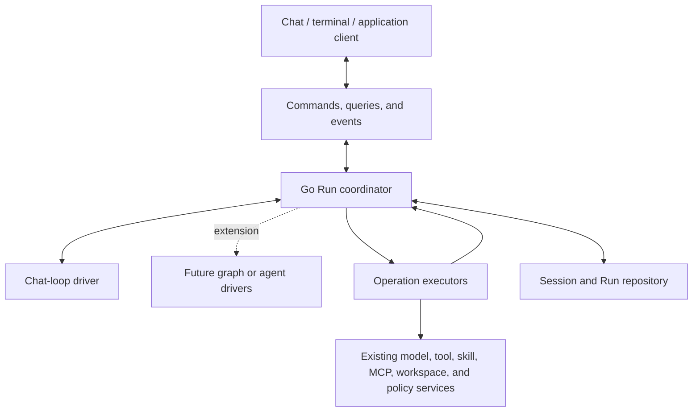

# Go Agent Runtime Proposal

## Purpose

Introduce a Go runtime that owns agent execution while retaining the current chat interface and its interaction model.

The runtime will coordinate:

- Model requests and tool execution.
- Automatic execution and continuation.
- Manual execution, retries, skips, and error-result submission.
- Approval and other human interventions.
- Context preparation and skill-session lifecycle.
- Cancellation, persistence, and recovery.

The same runtime will support interactive chat and delegated tasks. Its execution structure will allow graph workflows, subagent runs, and agent-to-agent transfers to be added later without replacing the command, event, persistence, or execution-control model.

The initial implementation will move the existing chat loop into Go. It will not introduce a graph interpreter or multi-agent execution system immediately.

## Scope

This is a transfer of execution ownership, not a frontend or backend overhaul.

The existing model, tool, skill, MCP, workspace, artifact, and policy services remain the underlying services. The runtime coordinates them through Go interfaces.

The frontend retains:

- The Plate editor and local authoring state.
- Tabs, navigation, focus, menus, and keyboard behavior.
- Attachment grouping and selection controls.
- Message, tool-chip, Markdown, and citation presentation.
- Approval dialogs and input forms.
- MCP App iframe hosting and browser isolation.
- Display buffering and rendering optimizations.

The frontend stops owning the transitions that make an accepted task progress.

Immediate frontend validation remains useful for authoring. It is not the authority for execution eligibility or permission.

Management and catalog APIs remain predominantly request/response based.

## Execution ownership

The runtime is the sole owner of accepted execution state.

Once a submission is accepted, its progress must not depend on:

- A composer remaining mounted.
- A tab remaining open.
- React committing a state update.
- A browser timer or animation frame firing.
- A frontend receiving a notification and making the next execution call.

The frontend expresses user intent and presents runtime state. Go validates that intent, records it, and performs the resulting transitions.

## Minimal state model

### Addressable execution objects

The runtime needs two application-level state roots.

| State root  | Purpose                                                                                                                  |
| ----------- | ------------------------------------------------------------------------------------------------------------------------ |
| **Session** | The durable conversation or task context: identity, transcript, configuration defaults, selections, and associated runs. |
| **Run**     | One accepted unit of work, including its execution position, pending operations, results, controls, and waits.           |

For chat, a Session is the conversation. The existing conversation ID becomes the Session ID. No additional persistent Context entity is required.

A non-chat application can use a Session without rendering a chat transcript. For example, an internal application can create a Session for a research task, code change, report, or operations workflow.

A tab is not a Session. A tab is one frontend view of a Session. Multiple views or clients may observe the same Session.

Agent definitions, tools, workspaces, skills, MCP servers, and other capabilities remain existing artifacts or service resources. They are not duplicated as new runtime entities.

### Why a Run is necessary

A single user task may involve:

```text
User input
  → model request
  → tool calls
  → approval
  → tool results
  → another model request
  → further tool calls
  → final response
```

The task needs one identity and one execution owner throughout this sequence, including while it waits for a person, a tool, or an external service.

The Run owns that continuity.

A Run is not equivalent to a provider completion request. It may contain multiple provider completion requests and multiple tool executions.

A manually submitted tool follow-up continues the existing Run. It does not create unrelated work merely because the current conversation format represents the follow-up as another user message.

A new ordinary user turn, after the prior task has reached a terminal state, normally creates a new Run.

### Model requests are operations, not another state root

There will be no independently addressable `ModelStep` entity.

Each model invocation needs an operation record inside its Run because the runtime must know:

- Which provider request is active.
- Which input and configuration were used.
- Where streamed output belongs.
- Which cancellation handle applies.
- Which response produced a tool call.
- What completed, failed, or was interrupted.

The existing completion request ID can serve as the model-operation ID.

This does not require a separate lifecycle API, persistent root, or user-facing entity called a model step.

The same principle applies to tool attempts and waiting requests: they are records owned by the Run rather than separate application state roots.

### Records owned by a Run

A Run contains a current-state checkpoint and an execution journal.

Its owned records include:

| Record             | Necessary state                                                                 |
| ------------------ | ------------------------------------------------------------------------------- |
| Model operation    | Input snapshot, request identity, output, usage, and outcome.                   |
| Tool call          | Originating operation, arguments, executable binding, and response requirement. |
| Tool attempt       | Dispatch identity, authorization, deadline, and known or uncertain outcome.     |
| Tool result        | Typed result, error/skip state, metadata, and consumption state.                |
| Waiting request    | Approval, input, manual action, configuration, or recovery requirement.         |
| Continuation input | User additions and configuration changes staged for a subsequent request.       |
| Control state      | Automatic-execution holds, continuation holds, pause, and cancellation.         |

These records are persisted where required for execution or recovery. They are not independent resources whose lifetimes need separate management.

The storage implementation may normalize records internally, but ownership remains with the Run.

## Runtime structure

The execution system consists of three parts:

- A **coordinator** that owns Run state and applies commands and operation results.
- An **execution driver** that determines the next logical work.
- **Operation executors** that invoke existing services.



The coordinator owns guarantees common to every execution form:

- Command ordering and deduplication.
- Persistence.
- Operation identity.
- Permission checks.
- Dispatch gates.
- Cancellation.
- Limits.
- Waiting requests.
- Result recording.
- Event publication.

The initial chat-loop driver owns the existing chat-specific progression rules.

An execution driver does not call a tool or model directly. It proposes work to the coordinator, which applies the same safeguards regardless of the driver.

## Current chat execution model

### Submission preparation and acceptance

Submission remains an explicit user action.

For normal chat submission, Go performs the send-time preparation currently distributed across the composer and conversation hooks:

- Validate that there is content to submit.
- Resolve the model and request preferences.
- Resolve selected tools and their user configuration.
- Verify provider-specific tool compatibility.
- Resolve instruction sources.
- Ensure the required skill state.
- Validate workspace selection.
- Validate MCP readiness and required arguments.
- Construct the history and current inputs.

Preparation may involve asynchronous service calls. The frontend displays the existing submitting state while awaiting the result.

Failures that currently prevent submission continue to reject submission. The draft remains available for correction.

Examples include unavailable selected tools, incompatible provider tools, missing MCP arguments, and an unavailable selected workspace.

Existing warning-versus-blocking distinctions are retained. Partial workspace capability diagnostics do not automatically become a blanket rejection of otherwise usable content.

Acceptance commits:

- The submitted input.
- Its accepted configuration.
- The Run identity and initial state.
- The associated Session conversation update.
- The command receipt.

The first model request cannot be dispatched before this commit.

The frontend clears the submitted draft only after receiving an accepted receipt. A resolved frontend promise or a queued save is no longer treated as acceptance.

### Model invocation

Before each model invocation, the coordinator records the actual input snapshot and applicable configuration.

History construction preserves the existing behavior:

- N previous pure user turns, excluding the current turn.
- Tool-output follow-ups remain part of their originating execution sequence.
- The full selected suffix is retained.
- Earlier system and developer messages remain pinned.

The model executor uses the existing completion service. Streaming and final responses return to the coordinator under the operation ID.

The coordinator owns response accumulation and finalization.

### Response handling

The runtime preserves the current meaningful outcome distinctions:

- A valid final response.
- A response containing actionable tool calls.
- A provider error with useful partial or final output.
- An unusable or missing final response.
- User cancellation before output.
- User cancellation after partial output.

Empty stream chunks remain no-ops, not end-of-stream signals.

Streamed content alone does not establish successful completion if the backend ends without a usable final outcome.

An error response containing usable tool calls does not cause those calls to disappear. Their treatment follows the chat-loop rules and recorded diagnostics rather than an unconditional terminal-failure shortcut.

Partial output remains available after interruption.

The existing stopped-generation and error presentation can remain. Its runtime meaning is recorded separately from assistant text, so cancellation is not stored as a successful completion merely because a stopped-generation line was added.

### Tool-call preparation

Calls requiring local execution are bound to the capabilities used by their originating model operation.

A binding records enough information to identify:

- A selected Go tool.
- An MCP tool and server.
- A runtime skill tool.
- A provider-managed tool.
- An unresolved call.

Provider-managed tools remain provider-managed. They are not sent through the local execution scheduler.

Unresolved calls remain visible and actionable as failures. They are not silently omitted.

Current catalogs may determine whether an operation is still available or permitted. They do not rewrite the identity of a historical call.

Debug details are diagnostic data, not a required source of executable tool mappings.

### Tool execution

The initial implementation retains sequential execution for the current chat loop.

For each permitted execution:

- The coordinator checks current Run controls.
- Authorization is evaluated.
- Any required approval is recorded.
- The dispatch record is committed.
- The executor invokes the appropriate service.
- The result or failure is recorded.
- The chat driver reevaluates progression.

Tool execution retains the distinction between:

- A completed invocation that returned an error result.
- An execution failure that did not produce a usable response.
- A skipped call.
- An invocation whose external outcome is uncertain.

These distinctions determine what the user can do next.

### Continuation

A new model request is permitted only when all required tool responses for the current request have been resolved.

The next request consumes selected recorded results and accepted continuation input.

Consumption is recorded atomically with creation of the next model operation. Repeated events or commands cannot cause the same continuation to be submitted twice.

When no further work or intervention is required, the Run reaches a terminal state.

## Preserving current execution controls

### Manual and automatic behavior are separate

The runtime maintains separate decisions for:

- Whether an operation is authorized.
- Whether a tool may execute automatically.
- Whether results may be submitted automatically.
- Whether the user explicitly requested continuation.

An auto-execute flag is not an approval.

An approval does not necessarily request execution or continuation.

### Action semantics

| Current action            | Backend execution semantics                                                                                                                             |
| ------------------------- | ------------------------------------------------------------------------------------------------------------------------------------------------------- |
| **Send**                  | Submit current input, or continue the current Run using recorded results and user additions. Pending or running required calls still block this action. |
| **Enter / Fast-forward**  | Execute pending runnable calls, then request continuation once all required responses are available.                                                    |
| **Play: run tools only**  | Execute pending calls without creating a new explicit continuation request. Existing automatic-batch policy remains applicable.                         |
| **Run one call**          | Create one attempt for that call. It does not grant unrelated execution or invent a continuation request.                                               |
| **Retry failed call**     | Create another attempt for the same unresolved logical call.                                                                                            |
| **Retry an error result** | Retain the previous attempt and create a replacement attempt before the result is consumed.                                                             |
| **Skip**                  | Record that the call was intentionally not executed and create the corresponding tool response.                                                         |
| **Submit error**          | Create a response for a failed call so the model protocol can continue without claiming successful execution.                                           |
| **Stop response**         | Cancel the current Run’s further progression and request cancellation of its active operation.                                                          |
| **Stop automatic tools**  | Prevent the next eligible automatic dispatches at the current or next applicable batch boundary.                                                        |

The Play behavior requires particular care. In the current implementation, Play does not directly request another model submission, but the independent automatic-submission logic may still continue a wholly automatic, successful batch.

The backend preserves that behavior. It does not silently redefine Play as a permanent continuation hold.

A stricter “execute and always wait” action can be added separately if desired.

### Automatic continuation rule

The initial chat driver preserves the existing rule:

- The batch has been observed and recorded.
- Every relevant call is automatic-eligible.
- No required calls remain unresolved.
- Every selected result is successful.
- There is no automatic-execution or continuation hold.
- Configuration and other submission requirements are satisfied.
- This batch has not already been consumed.

Mixed manual/automatic batches do not automatically continue.

Error and skipped results remain valid protocol responses, but do not satisfy the successful automatic-batch rule.

Explicit Fast-forward or Send may continue with error results once the required calls have corresponding responses. Calls that failed without a response still require retry or explicit error-result creation.

### Stopping the next scheduled automatic execution

The existing ability to prevent subsequent automatic calls is retained as a backend control.

The control targets:

- Undispatched automatic calls in the current batch, when such a batch exists.
- Otherwise, the next applicable batch proposed by the active model request.

It also prevents automatic continuation at the affected boundary where applicable.

Pending calls remain visible and can be run manually. An already executing call may finish; this control does not falsely report that it was cancelled.

The coordinator checks this hold before every automatic dispatch. There is no frontend drainer with a separate understanding of the hold.

After the command is acknowledged, no later automatic dispatch covered by its scope may begin.

If a call was already dispatched before the command was accepted, the receipt identifies that fact. The system cannot promise to undo work that has already started.

For the existing one-batch stop behavior, explicit completion of the held batch permits subsequent batches to use their normal settings. An indefinite hold is a separate control.

### Explicit pause controls

The underlying model also supports:

- Hold automatic model continuation.
- Hold automatic tool execution until resumed.
- Pause all new dispatch at a safe boundary.

These are distinct from cancellation.

A whole-Run pause prevents new dispatch, including manually requested continuation, until resumed. The existing automatic-tool stop affects automatic progression rather than cancelling an explicit manual batch already requested by the user.

## Continuation input and configuration changes

### Preserve additions made during tool execution

The current composer can collect text, attachments, and configuration changes while tools are executing. Its automatic-submit path reads that authoring state when it submits results.

Moving continuation into Go requires an explicit representation of those additions. Otherwise, a backend loop would ignore data that exists only in the editor.

The Run therefore supports a versioned **continuation input** record.

While a Run is in its tool/continuation portion, the frontend publishes meaningful authoring changes through `UpdateContinuationInput`. The record contains normalized input and selection intent, not Plate nodes or runtime tool-result payloads.

It can include:

- Text.
- Attachments.
- Instruction selections.
- Tool-selection changes.
- Model/request preferences.
- MCP context and approved App contributions.
- Workspace and skill-selection intent.

Automatic continuation consumes the latest accepted continuation-input revision.

The UI clears only the revision confirmed as consumed. A newer local edit is not erased because an older revision was submitted.

An update arriving after a model request has started does not alter that request. It remains staged for a later boundary or remains an unsent draft if the Run finishes.

This introduces an explicit acceptance cutoff: automatic continuation includes acknowledged input, not arbitrary frontend state that Go has not received. Unacknowledged edits remain available rather than being silently discarded.

The backend never requests a React callback to determine whether it may continue.

### Configuration applies at execution boundaries

Configuration is not permanently frozen for an entire interactive Run.

That would change the current ability to alter the model or context before a tool-result follow-up.

Instead:

- Each dispatched model operation has an immutable input/configuration snapshot.
- Accepted changes may apply to the next model operation.
- Changes do not alter a model operation already in flight.
- Changes do not rewrite an existing tool call’s original binding.
- Skill-session replacement waits until active users of the previous session have settled.
- Capability expansion and permission changes remain subject to backend policy.

Configuration updates with blocking issues prevent continuation until corrected, rather than causing the runtime to continue using an older valid configuration without explanation.

### Agent application

Applying an Agent remains a configuration action, not task execution.

Backend application preserves the current semantics:

- Empty recipe selections clear corresponding selections.
- Obsolete Agent-owned instruction sources are removed.
- Unrelated instruction sources remain.
- Workspace selection is retained unless explicitly changed.
- Installed and workspace-owned skill membership remain separate.
- Starter text is offered only for an empty draft.

The frontend inserts starter text into its local editor. Agent application never overwrites existing user text or automatically submits a task.

New Runs record Agent identity and revision alongside effective user-modified configuration. Historical conversations without that provenance can retain the current tracked-versus-applied distinction.

## Approvals and intervention

### Run-owned waiting requests

A waiting request is an owned Run record containing:

- Request identity.
- Kind.
- Relevant operation or dependency.
- Public summary or input schema.
- Allowed resolutions.
- Revision and status.
- Expiry where applicable.

It may represent:

- MCP or other tool approval.
- User input.
- Required configuration.
- Authentication action.
- Manual execution.
- Continuation review.
- Recovery of an uncertain operation.

The frontend renders these requests. It does not own the promise whose existence keeps execution alive.

### Approval behavior

The current approval choices remain available with their actual backend scopes.

The runtime:

- Evaluates the exact operation.
- Records the pending request.
- Accepts the user’s resolution.
- Revalidates the operation’s scope.
- Obtains and consumes any required execution authorization.
- Proceeds or records a denial result.

Approval is associated with the actual tool, arguments, definition, and execution scope. Changing material execution details invalidates the prior authorization.

Allow-once tokens remain in Go. The frontend submits the decision, not a token that it later forwards into tool invocation.

Policy evaluation remains in the existing policy services. The runtime does not create a second policy implementation.

### Intervention and automatic scheduling

A pending approval does not remove the user’s ability to stop later automatic calls.

An automatic-execution hold is recorded independently of approval state.

If the user approves a call while such a hold is active, approval alone does not dispatch that call. The call remains authorized but held unless the user explicitly requested its manual execution.

This separates consent from scheduling and avoids a delayed approval unexpectedly restarting automatic work.

### Disconnect and dismissal

A deliberate dismissal of an approval dialog may retain the current deny-once behavior.

Unmounting the dialog because of navigation, tab closure, or frontend reload is not treated as a user decision.

Run-owned requests remain pending until resolved, expired, cancelled, or invalidated.

If two clients resolve the same request, the first valid committed resolution wins. Subsequent clients receive its resolved state.

## Delegated tasks

Delegating work starts a Run with an execution policy that permits backend progression without repeated manual continuation.

It uses the same:

- Configuration preparation.
- Model and tool executors.
- Permission checks.
- Operation records.
- Limits.
- Intervention requests.
- Cancellation controls.
- Result format.

There is no separate delegated-task scheduler.

An existing interactive Run can be delegated at a safe boundary by changing its progression policy. The same task is not submitted again under another identity.

A delegated Run can still wait for approval or user input. Absence of a connected client is neither approval nor denial.

Non-chat clients can consume structured results and output artifacts without interpreting chat presentation.

Backend-owned execution continues only while the Go process is running. Continuing after the Wails application exits would require a separate host process; that deployment change is outside the initial scope.

## Extensibility for loops, graphs, and subagents

### Execution-driver boundary

The chat loop is the first execution driver.

The coordinator accepts driver transitions that contain:

- Updated logical execution position.
- Proposed operations.
- Required waits.
- An optional terminal outcome.

Conceptually:

```go
type ExecutionDriver interface {
    Kind() string
    Version() uint32
    Advance(state DriverState, event DriverEvent) (DriverTransition, error)
}

type DriverTransition struct {
    NextState  DriverState
    Operations []OperationIntent
    Waits      []WaitRequest
    Outcome    *RunOutcome
}
```

This is an internal Go boundary, not a frontend workflow language.

The driver’s state is versioned, serializable data owned by the Run. It cannot depend on a live closure, component, or goroutine stack to resume.

The coordinator commits the driver transition and its operation intents together.

Only supported operation kinds are executable. The initial implementation supports the operations needed by the current chat loop. Adding another driver does not grant access to arbitrary services or bypass dispatch checks.

### Agent loops

The initial chat driver already supports repeated model/tool cycles.

Loop progression is represented by its logical execution position and recorded operations. It does not create a new Run for every iteration.

Limits apply across the entire Run, not independently to each provider request.

### Graph workflows

A future graph driver records its logical position inside the existing Run:

- Active node activations.
- Loop counters.
- Branch state.
- Join dependencies.
- Pending operation associations.

A graph node is not automatically another persistent execution entity.

A node activation receives distinct operation identities where it performs work, including repeated visits to the same node.

Waiting requests are associated with operations or dependencies rather than implemented as an unconditional global freeze. A graph may continue independent branches while another branch waits, unless the Run is globally paused or constrained.

The current chat driver remains sequential. Supporting future concurrency does not change its present behavior.

The graph driver uses the same operation records, approvals, controls, journal, and event protocol. It does not require a new execution system.

### Subagent runs

A subagent becomes a child Run when it represents independently progressing work with its own outcome, waits, and cancellation state.

That is a justified additional Run, not a new entity type.

A child Run has:

- A parent and root Run identity.
- Explicit input and Session context.
- A bounded capability scope.
- An allocated budget.
- A typed result returned to its parent.

The parent’s driver decides whether to wait, continue other work, or incorporate the result.

Children do not append directly to the parent Session transcript as competing writers. The parent records and projects their results deliberately.

Permissions cannot expand merely because work is delegated. Child limits and consumption remain accountable to root limits rather than resetting the task’s budget at every delegation.

Child-Run relationships can be added to the existing Run schema and event envelope. The initial implementation need not support spawning children.

### Agent-to-agent transfers

Transferring the same task to another Agent differs from spawning a subagent.

A transfer can remain within the existing Run:

- Record the transfer.
- Change the active Agent/configuration scope at a boundary.
- Preserve task identity and execution history.
- Continue under the new driver/configuration state.

A new child Run is required only when separate execution is actually being created.

### Extension constraints

The initial runtime must not hard-code:

- One provider request per Run.
- One permanently blocking interaction per Run.
- One static Agent for the entire Run.
- One global phase as the sole representation of execution position.
- Direct tool invocation from driver code.
- A new Run for every logical workflow node.

It may deliberately implement only sequential chat behavior today while keeping these boundaries intact.

## Commands, queries, and events

### Command interface

Representative commands are:

| Command                            | Responsibility                                                             |
| ---------------------------------- | -------------------------------------------------------------------------- |
| `ApplyAgent`                       | Prepare and apply a coherent Session configuration selection.              |
| `StartRun`                         | Prepare and accept a new user turn or task.                                |
| `UpdateContinuationInput`          | Stage versioned user additions and next-request configuration.             |
| `ContinueRun`                      | Explicitly request the next model invocation.                              |
| `ExecuteCalls`                     | Execute selected calls with an explicit continuation intention.            |
| `RetryCall`                        | Create another attempt for an unresolved call.                             |
| `SkipCall` / `CompleteCallAsError` | Record a protocol-completing response.                                     |
| `ResolveWait`                      | Supply approval, input, or another requested decision.                     |
| `SetAutomationHold`                | Hold automatic tools or automatic continuation with a defined scope.       |
| `PauseRun` / `ResumeRun`           | Control new dispatch at safe boundaries.                                   |
| `CancelRun`                        | Prevent further work and cancel active operations where supported.         |
| `EditAndResend`                    | Replace the visible Session transcript suffix and accept replacement work. |

Commands carry:

- A unique command ID.
- Session/Run identity where relevant.
- The expected revision of the state being changed.
- Typed user intent.

Repeated command IDs with identical payloads return the original receipt. Reusing an ID with another payload is rejected.

Execution commands return accepted or rejected receipts. They do not remain open for the lifetime of the Run.

### Queries

Queries include:

- Session and conversation view.
- Run snapshot.
- Pending calls, results, and waits.
- Available actions and blocking reasons.
- Execution records.
- Events after a cursor.
- Active and recently completed Runs.
- Final result and output artifacts.

Catalog and management queries remain unchanged in principle.

Snapshots provide enough information to render the current UI without replaying every event.

### Events

Events describe recorded transitions, including:

- Accepted submission.
- Model operation started.
- Output appended or finalized.
- Tool calls proposed.
- Tool attempt dispatched.
- Result recorded.
- Wait requested or resolved.
- Input revision consumed.
- Automation hold changed.
- Run paused, cancelled, failed, or completed.

Each event carries:

- Run identity.
- A monotonically increasing Run sequence.
- Relevant operation and command identities.
- Session identity.
- Parent/root correlation when applicable.

Wails events are transport notifications. The journal and snapshots remain authoritative.

A client registers its listener, obtains a snapshot and cursor, and reconciles subsequent events. Duplicate delivery and gaps are handled using sequence information.

Foregrounding, reconnection, and bounded reconciliation queries protect against a missed final notification.

UI display throttling remains independent of authoritative output recording.

## Persistence and recovery

### Commit ordering

The following transitions must be durable before dependent work proceeds:

| Transition                     | Required ordering                                                                               |
| ------------------------------ | ----------------------------------------------------------------------------------------------- |
| Submission accepted            | Input and initial Run state recorded before model dispatch.                                     |
| Tool authorized and dispatched | Attempt identity and dispatch decision recorded before invocation.                              |
| Tool result obtained           | Result recorded before model continuation.                                                      |
| Wait resolved                  | Decision recorded before dispatch based on it.                                                  |
| Continuation started           | Consumed input/results and new model operation recorded together.                               |
| Run terminal                   | Final outcome and associated Session transcript changes committed before terminal notification. |

The existing conversation store may participate in this repository boundary if it supports the necessary operations.

If it cannot, the runtime can use a small transactional store for Run state and execution mutations, with the existing conversation/search storage updated as an idempotent projection.

There must not be two competing writers of execution state.

### Recovery behavior

Recovery distinguishes:

- Work accepted but not dispatched.
- Completed work with recorded results.
- Pending intervention.
- Interrupted model requests.
- External tool operations with uncertain outcomes.
- Invalidated server or skill-session state.

A completed recorded tool result is reused, not re-executed because a view reopened.

A tool whose side effect may have occurred but whose result was not recorded is not automatically classified as “not executed.”

External exactly-once execution is not assumed. Adapter idempotency keys and remote operation identities are used where available; otherwise uncertainty remains visible.

Recovery reconstructs state from checkpoints and records. It does not rerun arbitrary workflow code that performs external effects.

### Session and result fidelity

Execution records preserve the data currently vulnerable to UI-to-store conversion loss:

- Typed tool results.
- MCP structured content.
- MCP App render metadata.
- Skill runtime metadata.
- Explicit skipped/error distinctions.
- Actual tool identity and originating binding.
- Effective configuration and context usage.

Large or binary content may use artifact references.

Where repeatability is required, materialized inputs use recorded content or immutable references rather than assuming a mutable path still contains the same data.

Reasoning and diagnostics retain explicit persistence policies. Moving accumulation to Go does not automatically make all transient data permanent.

## Go coordinator behavior

The coordinator serializes state transitions for a Run.

It handles:

- User commands.
- Driver decisions.
- Executor progress and results.
- Deadline expiry.
- Policy or resource invalidation.
- Wait resolution.

External I/O occurs outside its state lock.

Executors receive operation identities and cancellation contexts. Their results return through the coordinator rather than mutating Session conversation state directly.

Before every dispatch, the coordinator checks:

- Cancellation and pause.
- Automatic-execution holds where applicable.
- Operation eligibility.
- Required authorization.
- Configuration validity.
- Dependencies and required tool responses.
- Remaining limits.

Controls are checked at each dispatch boundary, not only when a batch is initially scheduled.

Run contexts are owned by the Go runtime, not by the Wails method call or frontend subscription.

Inactive and waiting Runs do not require permanently running goroutines. Their state remains queryable and can be activated when work or a command arrives.

## MCP, skills, workspace, and App integration

### Reuse existing service authority

The runtime uses existing services for:

- MCP connections, generations, discovery, and policy.
- Skill rendering, session creation, and lifecycle tools.
- Workspace resolution and materialization.
- Attachment and filesystem access.
- Tool invocation.

It does not duplicate their catalogs, secret stores, or policy implementations.

Connection readiness and discovery needed for execution are supervised in Go. A picker no longer has to remain mounted and poll for execution to become possible.

### Skill and workspace state

Installed and workspace-owned skill membership remain distinguishable.

Removing or replacing one source preserves membership retained by another source.

Skill lifecycle results update active state through the coordinator. The frontend does not need a post-tool callback to list active skills and repair its own session state.

Workspace selections preserve recorded references until the user chooses current contents. Refresh reports changes rather than silently selecting newly discovered content.

Requested selection and actual model-request usage remain separately visible.

Workspace-discovered MCP declarations do not automatically authorize installation, expose every tool, or provide credentials.

### MCP Apps

The existing iframe sandbox and browser bridge remain.

Each view is associated with its owning Session, originating result, server, and view lifetime. Requests are not routed according to the selected tab.

App requests remain distinct:

- Tool invocation.
- Resource read.
- Draft proposal.
- Model-context update.
- External-link request.

Tracked App tool execution can use a tool-only Run through the same coordinator and executors. It does not automatically advance an agent conversation.

A draft proposal remains an authoring action. It does not load and replace unrelated runtime configuration.

Approved model-context updates target an explicit execution boundary or future submission. Opening historical content does not re-queue an already consumed update.

View-scoped operations may be invalidated on iframe teardown. Run-owned approvals and waits are not invalidated merely because a renderer disappeared.

A terminal client can display typed tool output without an App. A genuinely required graphical interaction produces a client-capability wait rather than a fabricated response.

## Current UX preservation and deliberate changes

### Preserved behavior

The implementation must retain:

- Send, Enter, Play, and Fast-forward controls.
- Per-call Run, Retry, Skip, and Submit error actions.
- Per-tool automatic-execution preferences.
- Successful all-automatic batch continuation.
- Manual review of mixed batches and error results.
- Stop controls for upcoming automatic work.
- Approval choices and explicit denial.
- User text and attachments added before continuation.
- Configuration changes between model requests.
- Agent starter behavior and empty-selection clearing.
- Workspace partial-usage diagnostics.
- Skill enabled/active distinctions.
- MCP prompt and resource-template argument requirements.
- Partial output and stopped-generation presentation.
- Existing message editing and visible suffix replacement.
- Conversation/tool-chip grouping.
- Frontend streaming and rich-rendering optimizations.

### Deliberate changes

| Change                                                                                  | Current UX effect                                                                                         |
| --------------------------------------------------------------------------------------- | --------------------------------------------------------------------------------------------------------- |
| Accepted input and tool results become durable immediately                              | No additional user action is required to preserve an executed tool’s result.                              |
| Closing or evicting a tab detaches its view rather than inherently destroying execution | Stop remains available; a close-and-stop action can retain deliberate cancellation behavior.              |
| Navigation or frontend reload does not imply denial of Run-owned approvals              | The same request can be presented after reattachment.                                                     |
| Automatic continuation consumes acknowledged continuation-input revisions               | Newer or unacknowledged draft edits are retained rather than cleared by an older submission.              |
| Cancellation is recorded as cancellation                                                | The UI can retain the current stopped-generation wording without storing a misleading successful outcome. |
| Historical hydration does not reconstruct execution                                     | Opening a Session cannot accidentally rerun a tool.                                                       |
| Editing history retains prior execution records                                         | The visible suffix can still be replaced, but external side effects are not represented as undone.        |
| App operations use their originating Session                                            | Switching tabs cannot redirect a delayed App request into another conversation.                           |
| Limits apply across the Run                                                             | Exhaustion produces a visible stop/wait reason rather than an unbounded loop or silent truncation.        |

Active and waiting Runs remain discoverable even when their chat tab is closed. They cannot become inaccessible merely because the UI’s tab limit was reached.

### Editing while work exists

Beginning an edit changes authoring state; it does not discard accepted results or attempts.

Submitting the replacement uses `EditAndResend`, which checks active work. Any required cancellation or safe-boundary wait is explicit.

Cancel Edit restores the authoring context without resetting Run-owned execution.

The visible chat behavior remains replacement of the selected message and later suffix. The audit history remains intact.

## Code responsibility transfer

The existing components can remain while their hooks become runtime clients.

| Current area                                         | New responsibility                                                                          |
| ---------------------------------------------------- | ------------------------------------------------------------------------------------------- |
| `composer/editor/editor_area.tsx`                    | Author input, publish continuation revisions, render available actions, and issue commands. |
| `composer/toolruntime/use_tool_runtime.ts`           | Replace its execution reducer with a projection of Run-owned calls and results.             |
| `composer/toolruntime/use_tool_auto_exec_drainer.ts` | Remove frontend scheduling; progression belongs to the chat driver and coordinator.         |
| `composer/toolruntime/execute_tool_call.ts`          | Move execution coordination into Go executors using existing services.                      |
| `composer/skills/use_composer_skills.ts`             | Render and edit selections; Go owns runtime-session coordination.                           |
| `composer/mcp/use_composer_mcp.ts`                   | Render catalog/selection state; Go owns execution-dependent preparation and readiness.      |
| `composer/mcp/use_mcp_approval.ts`                   | Present waiting requests and submit resolutions rather than own execution promises.         |
| `conversation/use_send_message.ts`                   | Submit commands and apply accepted receipts; remove model/tool lifecycle ownership.         |
| `conversation/completion_finalizer.ts`               | Move canonical outcome handling into Go; retain presentation helpers where needed.          |
| `conversation/use_streaming_runtime.ts`              | Keep display buffering; remove tab-owned request and cancellation authority.                |
| `conversation/use_input_registry.ts`                 | Retain focus, menus, drops, and draft delivery; remove assistant-turn scheduling delivery.  |
| `tabs/use_chats_controller.ts`                       | Manage views and Session subscriptions; remove canonical execution save queues.             |
| `mcpapps/mcp_app_rpc_router.ts`                      | Adapt browser requests to explicitly scoped backend operations.                             |
| `messages/`, `platedoc/`, scrolling, and search UI   | Retain presentation and authoring responsibilities.                                         |

The Wails completion API remains usable by the Go model executor’s underlying service path. Chat no longer uses a completion response as the signal to reconstruct and restart the loop in the editor.

At integration, each accepted Run has one execution owner. The frontend drainer and backend coordinator do not both schedule the same calls.

## Acceptance criteria

The implementation is complete when the existing chat loop can be exercised through Go commands and fake service adapters without React or Wails rendering.

Verification must include:

- Duplicate submission and lost acknowledgment.
- Empty, invalid, and partially usable submissions.
- Current history-window behavior.
- Agent switching with empty selections and preserved user text.
- Sequential automatic tools and mixed batches.
- Play, Fast-forward, and Send behavior.
- Error results versus failures without results.
- Retry, skip, and explicit error-result submission.
- Automatic-execution stop before a batch and between calls.
- Automatic-execution stop while approval is pending.
- No covered dispatch after the stop acknowledgment.
- Continuation input changed before and after consumption.
- Configuration changes applied only to subsequent model operations.
- Approval dismissal, navigation, reconnect, expiry, and competing resolutions.
- Cancellation with no output, partial output, and active tool work.
- Durable tool results before the next model request.
- Recovery without blind re-execution.
- Skill and workspace membership invariants.
- MCP App ownership across tab changes.
- Event duplication, gaps, and missed terminal notifications.
- Tab closure, route changes, frontend reload, and process restart.

The extension boundary should also be verified with a small test driver that branches, waits, and rejoins using ordinary operation records. This is a contract test of the coordinator, not delivery of a production graph-workflow feature.

## Proposed outcome

The initial implementation delivers the current chat execution model in Go with its manual, automatic, approval, and intervention behavior intact.

The durable state remains small:

- Sessions, which are conversations or task contexts.
- Runs, which own execution records and versioned logical position.

Model invocations are recorded operations, not additional execution entities.

Future graphs, agent transfers, and subagent tasks extend execution drivers and operation handling while retaining the same coordination, permission, control, persistence, and client protocols.
