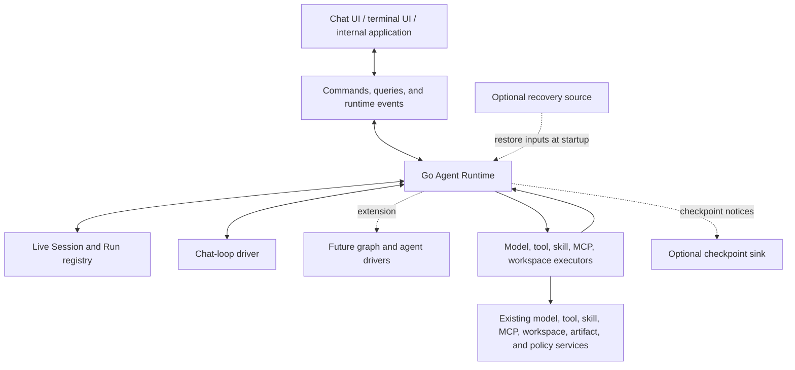

# Go Agent Runtime Proposal

## Purpose

Introduce a Go agent runtime that owns execution while retaining the current chat interface and interaction model.

The runtime will coordinate:

- Model requests and streamed output.
- Tool execution and tool-result handling.
- Automatic execution and automatic continuation.
- Manual execution, retries, skips, and error-result submission.
- Approvals and other human interventions.
- Skill-session, MCP, workspace, attachment, and configuration preparation.
- Cancellation, pausing, and execution limits.
- Optional checkpointing and optional recovery.

The same runtime will support:

- The current interactive chat interface.
- Delegated or handoff tasks that continue in the backend.
- A terminal UI.
- Other internal applications that need agent execution without reproducing chat behavior.

The initial implementation moves the current chat loop into Go. It does not introduce graph execution, subagent execution, or agent-to-agent transfer immediately. The runtime model is structured so those capabilities can be added without replacing the execution, control, event, or optional recovery model.

## Scope

This is a transfer of execution ownership, not a frontend or backend overhaul.

Existing model, tool, skill, MCP, workspace, artifact, and policy services remain the underlying services. The runtime coordinates them through Go interfaces.

The frontend retains:

- The Plate editor and local authoring state.
- Tabs, navigation, focus, menus, keyboard shortcuts, and scroll state.
- Attachment grouping and draft-editing controls.
- Message, tool-chip, Markdown, citation, and debug rendering.
- Approval dialogs and user-input forms.
- MCP App iframe hosting and browser isolation.
- Rendering throttling and display-oriented stream buffering.

The frontend no longer owns the transitions that make an accepted task progress.

Management pages and catalog APIs remain predominantly request/response based.

## Design principles

### Execution is independent of UI lifetime

Once a task is accepted, progress must not depend on:

- A composer remaining mounted.
- A tab remaining open.
- React committing a state update.
- A browser timer, animation frame, or effect running.
- A frontend callback deciding whether to run the next tool or model request.
- A Wails event reaching the frontend.

The frontend expresses user intent and presents runtime state. Go validates that intent, owns the live execution state, and applies the resulting transitions.

### Persistence is optional

The runtime is not a database-backed workflow engine by definition.

It runs correctly with only in-memory state. Checkpointing and recovery are optional host capabilities supplied through an interface.

A deployment may use:

- No store.
- An in-memory store.
- A file-backed store.
- A database-backed store.
- A store that writes snapshots.
- A store that writes events.
- A store that maintains conversation/search projections.
- A store that retains only selected terminal results.

The runtime does not require any particular persistence mechanism, file layout, database schema, event format, transaction model, or retention policy.

### Session is the runtime term for a conversation

In this proposal, **Session** is the runtime synonym for a conversation.

For the existing chat product:

- A Session is the conversation.
- The existing conversation ID becomes the Session ID where one already exists.
- A tab is only a frontend view of a Session.
- Multiple views or clients may observe the same Session.

A non-chat application may use a Session without presenting a conversation UI.

The term **skill session** remains separate and refers to the existing skill-runtime session concept.

### Runs own work

A **Run** is one accepted unit of work inside a Session.

A Run may include multiple model requests, tool calls, approvals, user interactions, and continuation cycles.

A manually submitted tool follow-up continues the existing Run. It does not become unrelated work merely because the visible conversation may represent it as another user message.

### Physical state roots remain minimal

The runtime has two application-level state roots:

| State root  | Purpose                                                                                           |
| ----------- | ------------------------------------------------------------------------------------------------- |
| **Session** | Conversation or task context, transcript, default configuration, selections, and associated Runs. |
| **Run**     | One accepted task and its active execution state, controls, waits, operations, and results.       |

There is no separately addressable `ModelStep` entity.

A model request, tool attempt, approval request, or graph node activation is an operation or record owned by a Run. It may have an identity and history because execution requires it, but it is not another top-level runtime object.

## Minimal runtime state model

### Session

A Session contains the live state needed to represent a conversation or task context:

- Session identity.
- Visible transcript or task history.
- Default model and capability selections.
- Agent selection and applied configuration provenance.
- Instruction-source selections.
- Installed skill selections.
- Workspace and MCP selection intent.
- Associated Runs.
- A revision for optimistic commands and view synchronization.

The Session stores defaults for future Runs. A dispatched model request always uses a captured snapshot of the configuration that applied when that request began.

### Run

A Run owns one accepted task from admission through completion, cancellation, failure, or waiting.

A Run contains:

- Run identity.
- Session identity.
- Lifecycle state.
- Driver kind and logical driver state.
- Active model and tool operations.
- Proposed tool calls and recorded results.
- Pending intervention requests.
- Automation and pause controls.
- Limits and accumulated usage.
- Versioned continuation input.
- Execution history needed for diagnostics and optional recovery.

A Run lifecycle may be represented as:

```text
queued
running
waiting
paused
cancelling
completed
failed
cancelled
```

The lifecycle state is not sufficient by itself to describe execution. The Run also has a logical driver position and owned operation records.

For example, a Run may be `waiting` because:

- A tool approval is required.
- A tool is waiting for manual execution.
- A user answer is required.
- A selected MCP server is not ready.
- A recovery decision is required.
- Automatic continuation is intentionally held.

### Model operations

A model operation is a record inside a Run.

It exists because the runtime must know:

- Which request is in flight.
- Which model and request configuration were used.
- Which history and materialized inputs were used.
- Which cancellation handle applies.
- Where streamed text and reasoning belong.
- Which tool calls originated from the response.
- Whether the operation completed, failed, stopped, or was interrupted.

The existing completion request ID can serve as the model-operation identity.

A model operation is not a top-level application entity and does not require a separate user-facing lifecycle API.

### Tool calls, attempts, and results

A tool call is a logical request produced by a model operation.

A tool attempt is one execution of that call.

A tool result is the response selected for that call when the Run proceeds.

This distinction is necessary for retries and side-effect safety:

- Retrying does not erase the previous attempt.
- Skipping creates a deliberate result rather than deleting the call.
- A tool error result is different from an execution failure with no result.
- A timeout may leave the external outcome unknown.
- A result can be recorded before a later model request consumes it.

### Waiting requests

A waiting request is a Run-owned record for work the runtime cannot resolve independently.

Examples include:

- Tool approval.
- User input.
- Required configuration repair.
- Authentication action.
- Manual tool execution.
- Continuation review.
- Recovery of uncertain external work.

The frontend renders waiting requests. It does not own the promise whose existence keeps execution alive.

## Runtime architecture



The runtime consists of:

- A live in-memory Session and Run registry.
- A Run coordinator that serializes state transitions.
- An execution driver that determines the next logical work.
- Executors that invoke existing application services.
- A command/query/event interface for clients.
- Optional checkpoint and recovery adapters.

The initial driver is a sequential chat-loop driver.

Future graph, loop, subagent, and transfer behavior can be implemented as additional drivers using the same coordinator and executors.

## Optional store, checkpointing, and recovery

### Runtime state is live in memory by default

The runtime maintains Sessions and Runs in memory while the process is running.

No persistence provider is required for:

- Creating a Session.
- Starting a Run.
- Streaming a response.
- Executing tools.
- Waiting for approval.
- Continuing a task.
- Cancelling a task.
- Rendering current runtime state to a client.

A process without a store can run the complete interactive chat loop.

If that process exits, active in-memory Sessions and Runs are lost unless a recovery provider was configured. This is an explicit deployment property, not a runtime failure.

### Store providers are optional adapters

A store provider may consume runtime checkpoints and later supply recovery input.

Conceptually:

```go
type CheckpointSink interface {
    HandleCheckpoint(context.Context, RuntimeCheckpointView) error
}

type RecoverySource interface {
    Restore(context.Context, RuntimeRestorer) error
}

type RuntimeStore interface {
    CheckpointSink
    RecoverySource
}
```

These interfaces are conceptual. Their final names and exact Go signatures can follow existing application conventions.

The important boundary is:

- The runtime provides semantic checkpoint views.
- The provider decides what to store.
- The provider decides how to encode it.
- The provider decides when to compact, snapshot, index, encrypt, or discard it.
- The provider later supplies semantic restore input.
- The runtime does not own the provider’s storage format.

A checkpoint view is not a mandated database schema or serialized file format. A provider may represent the same runtime state as:

- Rows across several tables.
- A JSON or protobuf snapshot.
- An append-only event log.
- A compressed encrypted blob.
- A conversation projection plus a separate execution journal.
- A terminal-result archive only.
- Nothing at all.

### Checkpoint notices

The runtime emits checkpoint notices after meaningful live transitions, such as:

- Session configuration changes.
- Run acceptance.
- Model operation start or terminal outcome.
- Tool dispatch.
- Tool result.
- Waiting request creation or resolution.
- Automation-control changes.
- Run terminal state.

A store may consume every notice, coalesce them, retain only selected notices, or ignore them.

The runtime does not require the provider to persist every event and does not require the provider to use event sourcing.

A store may also consume the public runtime event stream if that is more appropriate for its design. The runtime does not require persistence to use either a particular checkpoint representation or the public event representation.

### Recovery input

At initialization, an optional recovery source can provide Session and Run restore input.

The provider may restore:

- Nothing.
- Idle Sessions only.
- Completed Runs.
- Waiting Runs.
- Paused Runs.
- Fully resumable Runs.
- A subset selected by application policy.

The provider controls which records it retained and which Sessions or Runs it wants restored.

The runtime validates restore input and reconstructs live in-memory state.

Recovery input is semantic, not raw storage data. A provider may reconstruct it from any internal representation.

### Recovery of active external work

A recovered Run does not blindly replay in-flight operations.

Recovery distinguishes:

- Work accepted but never dispatched.
- Completed work with a recorded result.
- Waiting approval or user input.
- Interrupted model operations.
- Tool attempts whose external outcome is uncertain.
- Invalidated skill, MCP, workspace, or model state.

A completed recorded tool result is reused.

A tool whose side effect may have occurred but whose final result was not retained is not automatically treated as unexecuted. The Run enters a visible recovery state or waits for an explicit decision where necessary.

External exactly-once execution is not assumed. Tool adapters may use idempotency keys or remote operation identities where available.

### In-memory, file, and database implementations

The runtime may provide standard implementations:

| Store implementation | Behavior                                                                                                        |
| -------------------- | --------------------------------------------------------------------------------------------------------------- |
| No store             | Runtime keeps only live in-memory state. No restart recovery.                                                   |
| In-memory store      | Useful for tests, local host abstractions, and controlled lifecycle behavior. It does not survive process exit. |
| File store           | Persists provider-defined snapshots or logs to local files.                                                     |
| Database store       | Persists provider-defined records and may also maintain search or conversation projections.                     |

The live runtime registry is not required to be implemented through the store interface. The store is an optional observer and recovery source.

### Checkpoint failure behavior

By default, checkpointing is observational.

A checkpoint sink failure:

- Is reported through diagnostics or runtime events.
- Does not invalidate the live Run.
- Does not cancel already accepted work.
- Does not prevent in-memory progression.

A host that requires storage acknowledgment before accepting or dispatching a particular class of work may add an admission or dispatch policy around the runtime.

That stricter behavior is a host policy. It is not a requirement of the core runtime.

## Current chat execution model

### Submission preparation and acceptance

Submission remains an explicit user action.

For a normal chat submission, Go performs the send-time preparation currently distributed across composer and conversation hooks:

- Validate that there is content to submit.
- Resolve the selected model and request preferences.
- Resolve selected tools and user-provided tool configuration.
- Verify provider-specific tool compatibility.
- Resolve instruction sources.
- Ensure required skill-session state.
- Validate workspace selection.
- Validate MCP readiness and required arguments.
- Construct history and current inputs.

Preparation may involve asynchronous service calls. The frontend displays the existing submitting state while awaiting the result.

Failures that currently prevent submission continue to reject submission. The draft remains available for correction.

Examples include:

- An unavailable saved tool selection.
- Incompatible provider tools.
- Missing required tool arguments.
- Missing MCP prompt or resource-template arguments.
- An unavailable selected workspace.
- A required skill session that cannot be prepared.

Existing warning-versus-blocking distinctions remain. Partial workspace diagnostics do not become a blanket rejection of otherwise usable content.

When accepted, the runtime applies a live transition that:

- Adds submitted input to the Session transcript.
- Captures the accepted configuration for the Run.
- Creates or advances the Run.
- Creates the first model operation.
- Returns an acceptance receipt.

The frontend clears the submitted draft only after receiving that receipt.

Acceptance means the live runtime owns the work. It does not inherently claim that a persistence provider has written the work to disk or a database.

### Model invocation

Before each model invocation, the runtime captures:

- The effective model and request configuration.
- The selected history.
- Materialized attachments and context.
- Selected tools and bindings.
- Skill and workspace state.
- MCP selections and resolved capability state.

History construction preserves the current behavior:

- Include the current turn plus N previous pure user turns.
- Do not count tool-output follow-ups as independent pure user turns.
- Retain the full selected suffix.
- Preserve earlier system and developer messages.

The Go runtime calls the underlying Go completion service directly. It does not call the frontend `WailsCompletionAPI` as part of internal execution.

The Wails completion binding may remain as a compatibility adapter where needed, but the runtime model executor uses the service behind `CompletionWrapper.FetchCompletion` directly.

### Streamed output

The runtime owns authoritative output accumulation for an active model operation.

The frontend may still:

- Batch display updates.
- Delay expensive Markdown rendering.
- Render only the active tab.
- Preserve a last visible stream snapshot during rendering transitions.

Empty stream chunks remain no-ops, not end-of-stream signals.

A client missing stream events can request a current Run snapshot. The event stream is not the sole source of truth.

### Response handling

The runtime preserves the current meaningful outcome distinctions:

- A valid final response.
- A response containing actionable tool calls.
- A provider error with useful partial or final output.
- An unusable or missing final response.
- User cancellation before output.
- User cancellation after partial output.

Streamed text alone does not establish a successful outcome if the provider ends without a usable final response.

A response error containing usable tool calls does not cause those calls to disappear. The calls remain part of the Run and are handled by the chat-loop driver.

Partial output remains available after interruption.

The existing stopped-generation and error presentation can remain. Its runtime meaning is recorded separately from assistant text, so cancellation is not represented as successful completion merely because a terminal line was appended for display.

### Tool-call preparation

Calls requiring local execution are bound to the capabilities used by their originating model operation.

A tool binding identifies:

- A selected Go tool.
- An MCP tool and server.
- A runtime skill tool.
- A provider-managed tool.
- An unresolved call.

Provider-managed tools remain provider-managed. They are not sent through the local tool scheduler.

Runtime-injected skill tools are registered bindings, not merely tool names that happen to match a prefix.

Unresolved calls remain visible and actionable as failures. They are not silently dropped.

Current catalogs may determine whether rerunning a call is possible or allowed. They do not rewrite what the original call meant.

### Tool execution

The initial implementation retains sequential execution for the existing chat loop.

For each permitted execution:

- The coordinator checks current Run controls.
- Authorization is evaluated.
- Any required approval becomes a waiting request.
- The runtime records a live dispatch attempt.
- The executor invokes the appropriate service.
- The result or failure is applied to the Run.
- The chat driver reevaluates progression.

Tool execution retains the distinction between:

- A completed invocation that returned an error result.
- An execution failure that did not produce a usable response.
- A skipped call.
- An invocation whose external outcome is uncertain.

These distinctions determine what the user can do next.

### Continuation

A new model operation is permitted only when all required tool responses for the current operation have been resolved.

The next model operation consumes:

- Selected recorded tool results.
- Accepted continuation input.
- Configuration changes accepted for the next execution boundary.

The runtime applies result consumption and creation of the next model operation as one ordered live transition. Duplicate events or repeated commands cannot cause the same continuation to begin twice.

When no further work or intervention is required, the Run reaches a terminal state.

## Preserving current execution controls

### Manual and automatic behavior are separate

The runtime keeps separate decisions for:

- Whether an operation is authorized.
- Whether a tool may execute automatically.
- Whether results may continue automatically.
- Whether the user explicitly requested continuation.

An auto-execute preference is not approval.

Approval is not a request to execute or continue.

### Action semantics

| Current action            | Runtime semantics                                                                                                                                       |
| ------------------------- | ------------------------------------------------------------------------------------------------------------------------------------------------------- |
| **Send**                  | Submit current input, or continue the current Run using recorded results and user additions. Pending or running required calls still block this action. |
| **Enter / Fast-forward**  | Execute pending runnable calls, then request continuation once all required responses are available.                                                    |
| **Play: run tools only**  | Execute pending calls without creating a new explicit continuation request. Existing automatic-batch policy remains applicable.                         |
| **Run one call**          | Create one attempt for that call. It does not grant unrelated execution or create a continuation request.                                               |
| **Retry failed call**     | Create another attempt for the same unresolved logical call.                                                                                            |
| **Retry an error result** | Retain the prior attempt and create a replacement attempt before the result is consumed.                                                                |
| **Skip**                  | Record that the call was intentionally not executed and create the corresponding tool response.                                                         |
| **Submit error**          | Create a response for a failed call so the model protocol can continue without claiming successful execution.                                           |
| **Stop response**         | Cancel further Run progression and request cancellation of the active operation where supported.                                                        |
| **Stop automatic tools**  | Prevent covered automatic dispatches at the current or next applicable batch boundary.                                                                  |

### Play behavior

The current Play action does not directly request another model submission. However, the existing frontend can automatically continue a wholly automatic successful batch through separate auto-submit behavior.

The backend preserves that behavior.

Play does not become a permanent continuation hold merely because execution ownership moved into Go.

A separate future action may explicitly mean “execute and always wait.”

### Automatic continuation rule

The initial chat driver preserves the current rule:

- The relevant batch has been observed.
- Every relevant call is automatic-eligible.
- No required call remains unresolved.
- Every selected result is successful.
- No automation hold or pause applies.
- Configuration and other continuation requirements are satisfied.
- The batch has not already been consumed.

Mixed manual and automatic batches do not automatically continue.

Error and skipped results remain valid protocol responses, but do not satisfy the successful automatic-batch rule.

Explicit Fast-forward or Send may continue with error results once each required call has a corresponding response. Calls that failed without a response still require retry or explicit error-result creation.

### Stopping the next scheduled automatic execution

The existing ability to stop upcoming automatic work is retained as a backend control.

The control targets:

- Undispatched automatic calls in the current batch, when one exists.
- Otherwise, the next applicable batch proposed by the active model operation.

It also prevents automatic continuation at the affected boundary where applicable.

Pending calls remain visible and can be run manually. An already executing call may finish; this control does not falsely report that it was cancelled.

The coordinator checks the hold before every automatic dispatch. There is no frontend drainer with a separate understanding of the hold.

After the command is accepted, no later automatic dispatch covered by its scope may begin.

If a call was already dispatched before the command was accepted, the receipt identifies that fact. The system cannot undo work that has already started.

For the existing one-batch stop behavior, explicit completion of the held batch permits subsequent batches to use their normal settings. An indefinite hold is a separate control.

### Pause and cancellation

The runtime distinguishes:

| Control                     | Effect                                                                       |
| --------------------------- | ---------------------------------------------------------------------------- |
| Hold automatic tools        | Prevent automatic tool dispatch; manual actions remain possible.             |
| Hold automatic continuation | Prevent automatic model continuation after tools settle.                     |
| Pause Run                   | Prevent all new dispatch at a safe boundary until resumed.                   |
| Cancel Run                  | Prevent future work and request cancellation of active work where supported. |

A pause does not claim that already dispatched external work was stopped.

Cancellation is not rollback. If an external tool may have performed a side effect despite timeout or cancellation, that uncertainty remains visible in the Run.

## Continuation input and configuration changes

### Preserving additions made while tools are active

The current composer can collect text, attachments, and configuration changes while tool work is pending.

Moving continuation into Go requires an explicit representation of those additions. Otherwise, automatic continuation would ignore authoring state that exists only in the frontend.

A Run therefore supports a versioned **continuation input**.

While a Run is awaiting tool completion or continuation, the frontend may publish `UpdateContinuationInput` commands containing normalized authoring intent.

A continuation input may include:

- Text.
- Attachments.
- Instruction selections.
- Tool-selection changes.
- Model and request preferences.
- MCP context and approved App contributions.
- Workspace and skill-selection intent.

The runtime consumes the latest accepted continuation-input revision when it begins the next model operation.

The frontend clears only the revision confirmed as consumed. A newer edit is not erased because an earlier revision was used.

An update received after a model operation starts does not alter that operation. It remains staged for the next boundary or remains a draft if the Run completes.

This creates a clear acceptance cutoff:

- Acknowledged continuation input may be consumed.
- Unacknowledged frontend edits remain local and are not silently lost.

If there is no continuation input, automatic continuation proceeds with the same no-addition behavior available today.

### Configuration applies at execution boundaries

Configuration is not frozen for the entire interactive Run.

That would remove the current ability to change model, instructions, tools, MCP context, or workspace settings before a tool-result follow-up.

Instead:

- Each dispatched model operation has an immutable input and configuration snapshot.
- Accepted changes may apply to the next model operation.
- Changes do not alter an operation already in flight.
- Changes do not rewrite an existing tool call’s original binding.
- Skill-session replacement waits until active use of the prior session has settled.
- Capability expansion remains subject to backend policy.

Blocking configuration changes prevent continuation until corrected. The runtime does not silently continue with a stale configuration without exposing the reason.

### Agent application

Applying an Agent remains a configuration action, not task execution.

Backend application preserves current semantics:

- Empty recipe selections clear corresponding selections.
- Obsolete Agent-owned instruction sources are removed.
- Unrelated instruction sources remain.
- Workspace selection remains unless explicitly changed.
- Installed and workspace-owned skill membership remain separate.
- Starter text is offered only for an empty draft.

The frontend inserts starter text into its local editor. Agent application never overwrites existing user text or automatically submits a task.

New Runs record Agent identity and revision alongside effective user-modified configuration. Historical Sessions without that provenance can retain the current tracked-versus-applied distinction.

## Approvals and intervention

### Run-owned waiting requests

A waiting request contains:

- Request identity.
- Kind.
- Relevant operation or dependency.
- Public summary or input schema.
- Allowed resolutions.
- Revision and status.
- Optional expiry.

It may represent:

- MCP or other tool approval.
- User input.
- Required configuration.
- Authentication action.
- Manual tool execution.
- Continuation review.
- Recovery of uncertain work.

The frontend renders waiting requests. It does not own the promise that keeps execution alive.

### Approval behavior

The current approval choices remain available with their actual backend scopes.

The runtime:

- Evaluates the exact operation.
- Creates a pending waiting request.
- Accepts a user resolution.
- Revalidates the operation scope.
- Obtains and consumes any required execution authorization.
- Proceeds or records a denial result.

Approval is associated with the exact tool, arguments, definition, and execution scope. Changing material execution details invalidates prior authorization.

Allow-once tokens remain in Go. The frontend submits a decision, not a token that it later forwards into invocation.

Policy evaluation remains in the existing policy services. The runtime does not create a second policy implementation.

### Approval and automation controls

A pending approval does not remove the user’s ability to stop later automatic calls.

An automation hold is recorded independently of approval state.

If a user approves a call while an automatic-execution hold is active:

- The call becomes authorized.
- The call does not automatically dispatch.
- The call remains visible and may be run manually.
- Automatic execution resumes only if the hold is removed or its scope ends.

This separates consent from scheduling and avoids delayed approval unexpectedly restarting automatic work.

### Disconnect and dismissal

A deliberate dismissal of an approval dialog may preserve the current deny-once behavior.

Unmounting a dialog because of navigation, tab closure, frontend reload, or client disconnection is not treated as a user decision.

Run-owned waiting requests remain pending until resolved, expired, cancelled, or invalidated.

If two clients resolve the same request, the first valid resolution wins. Subsequent clients receive the resolved state.

## Delegated tasks

Delegating work starts or updates a Run with an execution policy that permits backend progression without repeated manual continuation.

Delegated execution uses the same:

- Configuration preparation.
- Model and tool executors.
- Permission checks.
- Run operation records.
- Limits.
- Intervention requests.
- Cancellation controls.
- Result format.

There is no separate delegated-task scheduler.

An existing interactive Run can be delegated at a safe boundary by changing progression policy. The same task is not submitted again under another identity.

A delegated Run can still wait for approval or user input. Absence of a connected client is neither approval nor denial.

Non-chat clients can consume structured results and output artifacts without interpreting chat presentation.

Backend-owned execution continues only while the Go process is running. Continuing after the Wails application exits requires a separate host process and is outside the initial scope.

## Extensibility for loops, graphs, and subagents

### Execution-driver boundary

The chat loop is the first execution driver.

A driver determines logical progression. It proposes work; it does not directly invoke tools or models.

Conceptually:

```go
type ExecutionDriver interface {
    Kind() string
    Version() uint32
    Advance(state DriverState, event DriverEvent) (DriverTransition, error)
}

type DriverTransition struct {
    NextState  DriverState
    Operations []OperationIntent
    Waits      []WaitRequest
    Outcome    *RunOutcome
}
```

This is an internal Go boundary, not a frontend workflow language.

Driver state is versioned and owned by the Run. It cannot depend on a live closure, component, or goroutine stack to resume.

The coordinator applies the driver transition, validates proposed work, and dispatches only supported operation kinds.

### Agent loops

The initial chat driver already supports repeated model/tool cycles.

Loop progression is represented by:

- Run-owned logical driver state.
- Model-operation records.
- Tool-call and result records.
- Automation and continuation controls.

It does not create a new Run for every iteration.

Limits apply across the entire Run rather than independently to each provider request.

### Graph workflows

A future graph driver can store its logical position inside the existing Run:

- Active node activations.
- Loop counters.
- Branch state.
- Join dependencies.
- Pending operation associations.

A graph node is not automatically a new persistent runtime entity.

A node activation receives distinct operation identities when it performs work, including repeated visits to the same node.

Waiting requests can belong to individual operations or dependencies rather than freezing all work by definition. A future graph may continue independent branches while another branch waits, unless the Run is globally paused or constrained.

The current chat driver remains sequential. Supporting graph concurrency later does not change current chat behavior.

The graph driver uses the same coordinator, controls, waiting requests, executors, events, and optional checkpoint/recovery interfaces.

### Subagent runs

A subagent becomes a child Run only when it represents independently progressing work with its own:

- Outcome.
- Waiting state.
- Cancellation behavior.
- Limits.
- Capability scope.

That is a justified additional Run, not a new entity type.

A child Run has:

- Parent and root Run identity.
- Explicit input and Session-derived context.
- A bounded capability scope.
- An allocated budget.
- A typed result returned to its parent.

The parent driver decides whether to wait, continue other work, or incorporate the child result.

Children do not append directly to the parent Session transcript as competing writers. The parent records and projects their results deliberately.

Permissions cannot expand merely because work is delegated. Child consumption remains accountable to root limits.

Child-Run relationships can be added to the Run schema and event envelope later. The initial implementation does not need to spawn children.

### Agent-to-agent transfer

Transferring the same task to another Agent differs from spawning a subagent.

A transfer can remain within the existing Run:

- Record the transfer.
- Change Agent or configuration scope at a safe boundary.
- Preserve task identity and execution history.
- Continue under the updated driver or configuration state.

A child Run is needed only when separate concurrent or independently managed execution is actually created.

### Extension constraints

The initial runtime must not hard-code:

- One provider request per Run.
- One permanently blocking waiting request per Run.
- One static Agent for the entire Run.
- One global phase as the sole representation of execution position.
- Direct tool invocation from driver code.
- A new Run for every workflow node.
- Database persistence as a prerequisite for execution.

It may deliberately implement only sequential chat behavior while retaining these boundaries.

## Commands, queries, and events

### Commands

Representative commands are:

| Command                            | Responsibility                                                             |
| ---------------------------------- | -------------------------------------------------------------------------- |
| `ApplyAgent`                       | Prepare and apply a coherent Session configuration selection.              |
| `StartRun`                         | Prepare and accept a new user turn or task.                                |
| `UpdateContinuationInput`          | Stage versioned user additions and next-request configuration.             |
| `ContinueRun`                      | Explicitly request the next model operation.                               |
| `ExecuteCalls`                     | Execute selected calls with an explicit continuation intention.            |
| `RetryCall`                        | Create another attempt for an unresolved logical call.                     |
| `SkipCall` / `CompleteCallAsError` | Record a protocol-completing response.                                     |
| `ResolveWait`                      | Supply approval, input, or another requested decision.                     |
| `SetAutomationHold`                | Hold automatic tools or automatic continuation with a defined scope.       |
| `PauseRun` / `ResumeRun`           | Control new dispatch at safe boundaries.                                   |
| `CancelRun`                        | Prevent further work and cancel active operations where supported.         |
| `EditAndResend`                    | Replace the visible Session transcript suffix and accept replacement work. |

Commands carry:

- A unique command ID.
- Session and Run identity where relevant.
- The expected revision of state being changed.
- Typed user intent.

Repeated command IDs with identical payloads return the original receipt. Reusing a command ID with different payload is rejected.

Execution commands return accepted or rejected receipts. They do not remain open for the lifetime of a Run.

### Queries

Queries include:

- Session and conversation view.
- Run snapshot.
- Pending calls, results, and waits.
- Available actions and blocking reasons.
- Active operations.
- Execution diagnostics.
- Current streamed output.
- Active and recently completed Runs.
- Final result and output artifacts.

Catalog and management queries remain request/response operations.

Snapshots provide enough information to render the current UI without replaying every event.

### Events

Runtime events describe live transitions, including:

- Submission accepted.
- Model operation started.
- Output appended or finalized.
- Tool calls proposed.
- Tool attempt dispatched.
- Tool result recorded.
- Wait requested or resolved.
- Continuation input consumed.
- Automation hold changed.
- Run paused, cancelled, failed, or completed.

Each event carries:

- Session identity.
- Run identity.
- A monotonically increasing Run sequence.
- Relevant operation and command identities.
- Parent/root correlation when applicable.

Wails events are transport notifications. They are not the authority for live runtime state.

Without a persistent event store, a client handles missed notifications by requesting a fresh Session or Run snapshot.

A store provider may retain events if it chooses, but durable event retention is not required by the runtime.

## MCP, skills, workspace, and App integration

### Existing service authority remains intact

The runtime uses existing services for:

- MCP connections, generations, discovery, and policy.
- Skill rendering, session creation, and lifecycle tools.
- Workspace resolution and materialization.
- Attachment and filesystem access.
- Tool invocation.
- Artifact and model resolution.

The runtime does not duplicate catalogs, secret stores, or policy implementations.

Connection readiness and discovery needed for execution are supervised in Go. A picker no longer needs to remain mounted and poll for execution to become possible.

### Skills and workspace state

Installed and workspace-owned skill membership remain distinguishable.

Removing or replacing one source preserves membership retained by another source.

Skill lifecycle results update active state through the coordinator. The frontend does not need a post-tool callback to list active skills and repair local session state.

Workspace selections preserve recorded references until the user chooses current contents. Refresh reports changed or unavailable references rather than silently selecting newly discovered content.

Requested workspace selection and actual model-request usage remain separately visible.

Workspace-discovered MCP declarations do not automatically authorize installation, expose every tool, or provide credentials.

### MCP Apps

The existing iframe sandbox and browser bridge remain frontend responsibilities.

Each App view is associated with:

- Its owning Session.
- Its originating result or tool call.
- Its MCP server.
- Its view lifetime.
- Its allowed host operations.

Requests are not routed according to whichever tab happens to be selected.

App operations remain distinct:

- Tool invocation.
- Resource read.
- Draft proposal.
- Model-context update.
- External-link request.

Tracked App tool execution can use a tool-only Run through the same coordinator and executors. It does not automatically advance an unrelated agent conversation.

A draft proposal remains an authoring action. It does not replace unrelated runtime configuration.

Approved model-context updates target an explicit Run boundary or future submission. Opening historical content does not re-queue already consumed updates.

View-scoped operations may be invalidated when an iframe is removed. Run-owned approvals and waiting requests are not invalidated merely because a renderer disappeared.

A terminal client can display typed tool output without rendering an App. A genuinely required graphical interaction produces a client-capability wait rather than a fabricated response.

## Current UX preservation and deliberate changes

### Preserved behavior

The implementation retains:

- Send, Enter, Play, and Fast-forward controls.
- Per-call Run, Retry, Skip, and Submit error actions.
- Per-tool automatic-execution preferences.
- Successful all-automatic batch continuation.
- Manual review of mixed batches and error results.
- Stop controls for upcoming automatic work.
- Approval choices and explicit denial.
- User text and attachments added before continuation.
- Configuration changes between model operations.
- Agent starter behavior and empty-selection clearing.
- Workspace partial-usage diagnostics.
- Skill enabled/active distinctions.
- MCP prompt and resource-template argument requirements.
- Partial output and stopped-generation presentation.
- Existing message editing and visible suffix replacement.
- Conversation and tool-chip grouping.
- Frontend streaming and rich-rendering optimizations.

### Deliberate changes

| Change                                                                                | Current UX effect                                                                                      |
| ------------------------------------------------------------------------------------- | ------------------------------------------------------------------------------------------------------ |
| Accepted input and tool results become Run-owned live state immediately               | A later frontend action is not required for the runtime to know that work occurred.                    |
| Optional stores receive checkpoints independently                                     | Storage policy can vary without changing chat execution behavior.                                      |
| Closing or evicting a tab detaches a view rather than inherently destroying execution | Stop remains available; a deliberate close-and-stop action can preserve cancellation behavior.         |
| Navigation or frontend reload does not imply denial of Run-owned approvals            | The same waiting request can be presented after reattachment.                                          |
| Automatic continuation consumes acknowledged continuation-input revisions             | Newer or unacknowledged draft edits remain available rather than being cleared by an older submission. |
| Cancellation is represented as cancellation                                           | The UI can retain current stopped-generation wording without storing a misleading successful outcome.  |
| Historical Session loading does not reconstruct execution                             | Opening a conversation cannot accidentally rerun a tool.                                               |
| Editing history retains prior execution history                                       | The visible suffix can still be replaced, but external effects are not represented as undone.          |
| App operations use their originating Session                                          | Switching tabs cannot redirect a delayed App request into another conversation.                        |
| Limits apply across a Run                                                             | Exhaustion produces a visible stop or wait reason rather than an unbounded loop or silent truncation.  |

### Editing while work exists

Beginning an edit changes authoring state. It does not discard Run-owned results or attempts.

Submitting the replacement uses `EditAndResend`, which checks active work. Any required cancellation or safe-boundary wait is explicit.

Cancel Edit restores authoring state without resetting Run-owned execution.

The visible chat behavior remains replacement of the selected message and later suffix. The execution history remains available to the runtime and optional store provider.

## Existing code responsibility transfer

The existing components can remain while their hooks become runtime clients.

| Current area                                         | New responsibility                                                                                                   |
| ---------------------------------------------------- | -------------------------------------------------------------------------------------------------------------------- |
| `composer/editor/editor_area.tsx`                    | Author input, publish continuation revisions, render available actions, and issue runtime commands.                  |
| `composer/toolruntime/use_tool_runtime.ts`           | Replace local execution reducer behavior with a projection of Run-owned calls and results.                           |
| `composer/toolruntime/use_tool_auto_exec_drainer.ts` | Remove frontend scheduling; progression belongs to the chat driver and coordinator.                                  |
| `composer/toolruntime/execute_tool_call.ts`          | Move execution coordination into Go executors using existing services.                                               |
| `composer/skills/use_composer_skills.ts`             | Render and edit skill selections; Go owns skill-session coordination for active Runs.                                |
| `composer/mcp/use_composer_mcp.ts`                   | Render catalog and selection state; Go owns execution-time preparation and readiness.                                |
| `composer/mcp/use_mcp_approval.ts`                   | Present waiting requests and submit resolutions rather than own execution promises.                                  |
| `conversation/use_send_message.ts`                   | Submit commands and apply receipts; remove model and tool lifecycle ownership.                                       |
| `conversation/completion_finalizer.ts`               | Move canonical outcome handling into Go; retain display-oriented helpers where useful.                               |
| `conversation/use_streaming_runtime.ts`              | Keep display buffering; remove tab-owned request and cancellation authority.                                         |
| `conversation/use_input_registry.ts`                 | Retain focus, menus, drops, and draft delivery; remove assistant-turn scheduling delivery.                           |
| `conversation/conversation_persistence_mapper.ts`    | Become an optional Session projection or historical import/export adapter rather than the canonical execution owner. |
| `tabs/use_chats_controller.ts`                       | Manage views and Session subscriptions; remove canonical execution save queues.                                      |
| `tabs/tabs_persistence.ts`                           | Continue storing local tab layout if desired; it remains UI state, not runtime state.                                |
| `mcpapps/mcp_app_rpc_router.ts`                      | Adapt browser requests to explicitly scoped backend operations.                                                      |
| `frontend/app/apis/wailsapi/completion.ts`           | Remain a frontend compatibility binding where needed; not the internal runtime execution path.                       |
| `messages/`, `platedoc/`, scrolling, and search UI   | Retain presentation and authoring responsibilities.                                                                  |

At integration, each accepted Run has one execution owner. The frontend drainer and backend coordinator do not both schedule the same calls.

## Optional projection and existing conversation storage

The existing conversation store can remain useful without becoming a runtime dependency.

A store or projection adapter may consume Session and Run checkpoints to:

- Preserve the existing conversation document format.
- Maintain search indexes.
- Maintain exported chat JSON.
- Populate conversation listings.
- Store message projections.
- Retain tool details and usage.
- Support reopening historical Sessions.

That adapter owns conversion between runtime semantics and the existing storage format.

The runtime itself does not require that projection to exist.

Historical conversations that only contain transcript data can be restored as idle Sessions. They do not imply that historical tool calls should execute again.

## Acceptance criteria

The implementation is complete when the current chat loop can be exercised through Go commands and fake service adapters without React or Wails rendering.

Verification includes:

- Running the complete chat loop with no store configured.
- Running the complete chat loop with an in-memory store.
- Running with a file or database test store that chooses its own serialization.
- Checkpoint sink failure not stopping execution in the default observational mode.
- Recovery source restoring selected Sessions and Runs into live memory.
- Recovery of waiting and paused Runs without blind re-execution.
- Recovery of uncertain external tool attempts as visible uncertain state.
- Duplicate submission and lost command receipts.
- Empty, invalid, and partially usable submissions.
- Current history-window behavior.
- Agent switching with empty selections and preserved user text.
- Sequential automatic tools and mixed manual/automatic batches.
- Play, Fast-forward, and Send behavior.
- Error results versus failures without results.
- Retry, skip, and explicit error-result submission.
- Automatic-execution stop before a batch and between calls.
- Automatic-execution stop while approval is pending.
- No covered automatic dispatch after the stop acknowledgment.
- Continuation input changed before and after consumption.
- Configuration changes applied only to subsequent model operations.
- Approval dismissal, navigation, reconnect, expiry, and competing resolutions.
- Cancellation with no output, partial output, and active tool work.
- Tool results applied to live Run state before continuation.
- Skill and workspace membership invariants.
- MCP App ownership across tab changes.
- Event duplication, gaps, and missed terminal notifications.
- Tab closure, route changes, frontend reload, and process restart.

The extension boundary is also verified with a small test driver that branches, waits, and rejoins using ordinary Run operation records. This validates the coordinator contract without delivering a production graph-workflow feature.

## Proposed outcome

The initial implementation delivers the current chat execution model in Go with manual, automatic, approval, and intervention behavior intact.

The live runtime state remains small:

- Sessions, which are conversations or task contexts.
- Runs, which own execution records and versioned logical position.

Model invocations, tool attempts, approvals, and future graph-node activations are Run-owned operations rather than new top-level runtime entities.

Persistence remains optional:

- The runtime works in memory.
- A store provider may observe checkpoints.
- A recovery provider may restore state.
- Storage format and retention remain provider-controlled.
- Stronger storage guarantees, where needed, are host policy rather than a requirement of the agent runtime itself.

Future graphs, agent transfers, and subagent tasks extend execution drivers and operation handling while retaining the same Session/Run model, controls, events, optional store interfaces, and client protocols.
