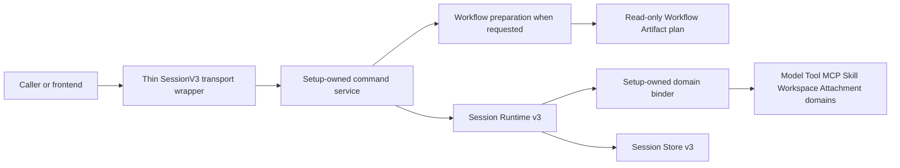

# SessionV2 to SessionV3 Backend Migration High-Level Design

## Purpose

This document records the backend migration from SessionV2 to SessionV3.

It covers only the supported normal-conversation replacement and the backend
architecture required to host it.

```text
SessionV2 remains readable in its existing Store.
SessionV3 creates new durable Sessions in its separate Store.
No stored Session is converted, copied, deleted, or retired in this cycle.
```

Workflow v1 is newly introduced. Its additional orchestration capability is not
a prerequisite for replacing the SessionV2 normal completion flow.

`workflow_artifact.md` remains the authority for Workflow source admission,
Artifact retrieval, static closure, and read-only planning.

`workflow_runtime.md` remains the authority for Runtime and setup design.

This document is the working migration record for SessionV2-to-SessionV3
backend replacement readiness and its remaining backend work.

## Goals

- Create new SessionV3 Sessions independently from SessionV2 data.
- Preserve the full supported SessionV2 normal completion capability in
  SessionV3.
- Keep normal conversation, Agent loops, Model execution, Tool execution,
  continuation, App interaction, attachments, Skills, MCP, persistence,
  recovery, projections, and export available in SessionV3.
- Keep Runtime ownership in `internal/agentruntime-go/sessionv3/`.
- Keep setup-owned preparation and domain binding outside Runtime.
- Keep Artifact Store passive and source-fact focused.
- Keep Session and Workflow as orchestration owners.
- Remove V3-local duplication without removing SessionV2 code.
- Keep all old SessionV2 Sessions unchanged.

## Current implementation cycle

This migration is work in progress (`WIP`).

No declaration, Store, Session, ProgramFrame, interpreter, package, module,
public API, or release version identifier may be bumped in this cycle.

This is one substantial backend delivery. It is not a sequence of small
partial deliveries.

An item can change to `Implemented` only when the complete listed behavior
exists in source. The implementer must update the status and source evidence in
this document in the same delivery.

The status in this document is source-based only. It does not report tests,
validation results, frontend behavior, or application execution.

## Scope exclusions

This cycle excludes:

- Tests and all validation work.
- Validation-only hardening and cleanup.
- Frontend integration and frontend traffic switching.
- SessionV2 deletion, replacement cleanup, retirement, and stored-session
  conversion.
- Any SessionV2 data migration, archive, copy, or deletion activity.
- Version changes, release work, release notes, and package version changes.
- Cost metering.
- New Workflow features that are not needed for the SessionV2 normal
  completion replacement.

The implementation must not add tests, validation-only code, SessionV2 cleanup,
stored-session conversion, frontend work, or version changes.

## Ownership and architecture



Ownership is:

- Artifact Store and Workflow Artifact planning:
  - Source admission.
  - Artifact identity.
  - Static closure.
  - Read-only plan facts.
  - No execution preparation, Runtime state, scheduling, or binding.

- Setup:
  - Current Artifact pin verification.
  - Workflow source-to-program preparation.
  - Model, Agent, Tool, MCP, Skill, Workspace, and Attachment preparation.
  - Native request construction.
  - Native result conversion.
  - Private resources and clients.

- Session Runtime v3:
  - Durable Session and Execution state.
  - Conversation and Workflow ProgramFrame interpretation.
  - WorkItem lifecycle.
  - Scheduling, waits, retries, recovery, cancellation, settlement, and
    projections.
  - No Artifact Store or setup-package dependency.

- SessionV3 transport wrapper:
  - Transport input and output only.
  - Delegation to Runtime and setup-owned command services.
  - No Workflow plan resolution, Artifact preparation, or domain binding.

## Backend migration workflows

### Normal conversation workflow

```text
CreateSession
    ->
SubmitMessage
    ->
Attachment admission
    ->
Conversation ProgramFrame
    ->
Agent-loop ProgramFrame
    ->
LLM WorkItem
    ->
Setup-owned Model binding
    ->
Provider completion and stream records
    ->
Tool WorkItems when the Model requests local Tools
    ->
Tool settlement
    ->
Automatic or requested continuation
    ->
Durable Session checkpoint and projection
```

The normal conversation path is Session-scoped. The long-lived conversation
ProgramFrame replaces the SessionV2 pattern of repeatedly creating a Run for
each normal user interaction.

A Model-only SessionV3 configuration uses the same Agent-loop machinery
without requiring an Agent selection.

### Workflow start workflow

```text
Caller command identity
    ->
Duplicate receipt lookup
    ->
Setup-owned Workflow preparation
    ->
Read-only Artifact plan and static closure
    ->
Prepared ProgramSnapshot
    ->
Session Runtime v3 StartWorkflow
```

Runtime receives a prepared `ProgramSnapshot`. Runtime must not parse Workflow
source, resolve an Artifact plan, retain an Artifact Store handle, or create a
second Workflow preparation path.

### Trigger registration workflow

```text
Caller command identity
    ->
Duplicate receipt lookup
    ->
Setup-owned trigger ProgramSnapshot preparation
    ->
Session Runtime v3 RegisterWorkflowTriggers
    ->
Durable trigger registration
    ->
Runtime-owned due-time scheduling
```

Direct Workflow start and trigger registration remain separate operations.

### SessionV2 and SessionV3 coexistence workflow

```text
SessionV2 Store: existing sessions remain unchanged
SessionV3 Store: new SessionV3 documents only
```

The supplied bootstrap creates separate directories:

- SessionV2: `sessions_v1`
- SessionV3: `sessions_v3`

This is sufficient backend storage isolation.

The caller route that selects SessionV3 for new ordinary user traffic is not
part of this document. It remains frontend or caller migration work.

## Source-backed implementation status

### Normal completion replacement

The supplied source implements the base normal SessionV3 path, but it does
not yet establish complete SessionV2 normal-flow parity.

- SessionV2 reference:
  - `internal/agentruntime-go/session/chat_driver.go`
  - `internal/agentruntime-go/session/commands.go`
  - `internal/agentruntime-go/session/dispatch.go`

- SessionV3 replacement:
  - `internal/agentruntime-go/sessionv3/runtime.go:SubmitMessage`
  - `internal/agentruntime-go/sessionv3/runtime.go:conversationExecutionLocked`
  - `internal/agentruntime-go/sessionv3/program.go:conversationInterpreter`
  - `internal/agentruntime-go/sessionv3/program.go:agentLoopInterpreter`
  - `internal/agentruntime-go/sessionv3/normal_session.go`
  - `internal/agentruntime-go/sessionv3/stream.go`
  - `internal/agentruntimesetup/sessionv3runtime/llm.go`
  - `internal/agentruntimesetup/sessionv3runtime/inputs.go`

The source implements:

- Normal Model completion.
- Agent-loop continuation.
- Model stream persistence.
- Automatic and manually requested Tool execution.
- Tool retry, skip, and explicit error completion.
- Per-message invocation defaults and execution budgets.
- Artifact-backed Model, Agent, Tool, Skill, MCP, Workspace, and Text setup.
- Immutable attachment admission.
- MCP App operations and staged App context.
- Durable recovery, Store projections, search, and semantic export.

The following normal-flow behavior remains incomplete:

- An automatic Tool hold can block requested Tools and non-Tool WorkItems in
  `Runtime.dispatchOne`.
- A provider completion with usable output or Tool calls plus an error becomes
  a failed V3 LLM WorkItem, while V2 continues its normal completion flow.

`MIG-NORMAL-001.b` and `MIG-NORMAL-001.c` are backend blockers. The remaining
open tasks in this document are also required before this migration can claim
full normal-session configuration and contribution behavior.

### Source-backed migration limitations

The supplied source does not prove that a fresh application action calls
`SessionV3Wrapper`.

`cmd/agentgo/main.go` registers both SessionV2 and SessionV3 wrapper services.
`cmd/agentgo/app.go` initializes both runtimes. This is intentional coexistence
in this cycle, but it leaves caller routing outside backend evidence.

### Architecture and residual source findings

Observed ownership boundaries are intact:

- `internal/agentruntime-go/sessionv3/` has no Artifact Store or setup-package
  dependency. It owns Runtime state and lifecycle.
- `workflowruntime.WorkflowCommandService` owns Workflow preparation before
  Runtime receives a `ProgramSnapshot`.
- `SessionV3Wrapper` delegates Workflow commands and does not retain
  `workflowruntime.Admission`.
- Workflow Artifact planning remains read-only. Artifact Store does not
  receive Runtime execution behavior.

Intentional V2 and V3 coexistence is not a duplicate implementation to remove:

- `cmd/agentgo/app.go` configures `sessions_v1` and `sessions_v3`.
- `cmd/agentgo/main.go` registers both wrappers during the coexistence
  checkpoint.

Residual V3-local duplication remains:

- `sessionv3runtime/llm.go:bindLLM` clones the same Model Provider header map
  twice in succession.
- `sessionv3/workflow_handlers.go:workflowTerminalChildProgram` assigns
  `child.Scope.Cleanup` in both the error branch and the unconditional common
  path.

The supplied Workspace prompt producer was not inspected. Setup currently
uses the Workspace prompt as the one Workspace instruction route. Exact
Workspace Text equivalence remains source-unproven until the owner of
`WorkspaceRuntimePlan.Prompt` is inspected.

### Completed backend migration corrections

The following completed corrections remain source-backed. They do not change
the excluded caller-routing or SessionV2 retirement scope.

- Workflow start and trigger preparation belong to the setup-owned
  `workflowruntime.WorkflowCommandService`.
- The Wails wrapper delegates Workflow commands and does not retain
  `workflowruntime.Admission`.
- App Tool and App-context commands apply the required Runtime lifecycle
  restrictions.
- App context transfers only from the active conversation owner or its active
  durable handoff predecessor.
- App-context consumption uses Runtime logical time.
- The redundant V3 attachment delegate is removed.

## Functional tasks

This is the migration status ledger.

The implementer must update every open status and its source evidence in this
document in the same substantial backend delivery.

### Normal SessionV3 replacement

#### `MIG-NORMAL-001` Provide the SessionV2 normal completion capability in SessionV3

- Status: Partial.
- Source evidence:
  - `sessionv3/runtime.go:SubmitMessage` creates or reuses the durable
    normal-conversation Execution.
  - `sessionv3/program.go:conversationInterpreter` and
    `agentLoopInterpreter` create ordered Agent-loop LLM work.
  - `sessionv3runtime/llm.go:bindLLM` and `executeLLM` prepare and execute
    the effective Model request.
  - `sessionv3/normal_session.go` provides continuation and manual Tool
    controls.
  - `sessionv3/stream.go` persists stream output.
- Missing parity evidence:
  - `sessionv3/runtime.go:dispatchOne` has a Tool-hold dispatch predicate
    that is broader than its Tool-only ready-work predicate.
  - `sessionv3runtime/llm.go:executeLLM` and
    `sessionv3/runtime.go:finishWorkLocked` do not preserve usable output
    from an errored provider response.
- Completed behavior:
  - Normal Model completion.
  - Agent-loop Tool cycles in the ordinary successful path.
  - Automatic and requested Tool execution when automation holds are absent.
  - Continuation.
  - Streamed output.
  - Baseline configuration composition.
  - Artifact-backed domain contributions.

##### `MIG-NORMAL-001.a` Preserve durable normal conversation state

- Status: Implemented.
- Source evidence:
  - `sessionv3/runtime.go:conversationExecutionLocked`.
  - `sessionv3/program.go:conversationInterpreter`.
- Completed behavior:
  - Keep one normal conversation root in the Session.
  - Queue user activities through the active conversation owner.
  - Preserve semantic Activities and completed Tool results.

##### `MIG-NORMAL-001.b` Preserve normal Tool-loop behavior

- Status: Partial.
- Source evidence:
  - `sessionv3/program.go:agentLoopInterpreter`.
  - `sessionv3/normal_session.go:normalToolBatchDispatchAllowed`.
  - `sessionv3/runtime.go:readyWorkLocked` scopes Tool holds to automatic,
    unrequested Tool WorkItems.
  - `sessionv3/runtime.go:dispatchOne` applies
    `automationHoldApplies` outside that Tool-only condition.
- Implemented behavior:
  - Create local Tool WorkItems from Model output.
  - Preserve ordered automatic Tool execution.
  - Support user-requested Tool execution, retry, skip, explicit error
    completion, and continuation.
- Missing behavior:
  - A Tool automation hold must not block a manually requested Tool WorkItem.
  - A Tool automation hold must not block LLM, Fork, Join, Wait, Emit, retry,
    resource, or other non-Tool WorkItems.
  - Ready-work selection and final dispatch must use one Tool-only hold rule.

##### `MIG-NORMAL-001.c` Preserve usable provider completion output with an accompanying error

- Status: Partial.
- Source evidence:
  - `session/dispatch.go:finishModelExecution` completes a V2 Model operation
    when `Usable` output or Tool calls exist despite `result.Error`.
  - `sessionv3runtime/llm.go:executeLLM` returns both `LLMOutput` and a
    `SanitizedError` for `out.Error`.
  - `sessionv3/runtime.go:finishWorkLocked` converts that V3 result to
    `WorkItemStateFailed`.
  - `sessionv3/program.go:agentLoopInterpreter` consumes only a completed LLM
    WorkItem.
- Missing behavior:
  - Retain usable text, protocol output, and Tool calls from an errored
    provider response.
  - Preserve the provider error durably without preventing normal Agent-loop
    Tool dispatch or completion.
  - Fail only a completion with no usable output and no Tool calls.

### Store isolation and durable replacement

#### `MIG-STORE-002` Keep SessionV2 and SessionV3 durable data isolated

- Status: Implemented.
- Source evidence:
  - `cmd/agentgo/app.go:newApp` configures `sessions_v1` and `sessions_v3`.
  - `cmd/agentgo/app.go:initManagers` creates `sessionstorev3.Store` only for
    SessionV3.
  - `internal/sessionstorev3/` owns SessionV3 checkpoint, restore, projection,
    search, tombstone, and export behavior.
- Completed behavior:
  - New V3 documents use the V3 Store only.
  - Existing SessionV2 documents are not converted or modified.
  - V3 deletion tombstones remain inside Store v3.

### Setup and wrapper ownership

#### `MIG-ARCH-003` Move Workflow command preparation to setup ownership

- Status: Implemented.
- Source evidence:
  - `internal/agentruntimesetup/workflowruntime/command_service.go` owns
    duplicate receipt lookup, Session-default retrieval, Workflow preparation,
    and prepared Runtime command submission.
  - `cmd/agentgo/wrapper_sessionv3_bootstrap.go` constructs the command
    service after Runtime restore.
  - `cmd/agentgo/wrapper_sessionv3_runtime.go` delegates Workflow start and
    trigger registration without retaining `workflowruntime.Admission`.
- Completed behavior:
  - Duplicate receipts return before Workflow preparation.
  - Setup owns Artifact-facing Workflow preparation.
  - Runtime receives only a prepared ProgramSnapshot.
  - The wrapper remains transport-only.

##### `MIG-ARCH-003.a` Preserve start-command idempotency before preparation

- Status: Implemented.
- Source evidence:
  - `workflowruntime.WorkflowCommandService.StartWorkflow` uses
    `WorkflowStartCommandIdentity` with `Runtime.FindCommandReceipt` before
    it reads Session defaults or calls `Admission.PrepareWorkflow`.

##### `MIG-ARCH-003.b` Preserve trigger-registration idempotency before preparation

- Status: Implemented.
- Source evidence:
  - `workflowruntime.WorkflowCommandService.RegisterWorkflowTriggers` uses
    `WorkflowTriggerRegistrationCommandIdentity` before it prepares the
    input-unbound ProgramSnapshot.

##### `MIG-ARCH-003.c` Remove setup ownership from the Wails wrapper

- Status: Implemented.
- Source evidence:
  - `SessionV3Wrapper` retains
    `*workflowruntime.WorkflowCommandService`, not
    `*workflowruntime.Admission`.
  - `SessionV3Wrapper.StartWorkflow` and
    `RegisterWorkflowTriggers` only delegate transport values.

### V3-local duplication and owner consolidation

#### `MIG-ARCH-004` Remove duplicated V3 behavior and use canonical owners

- Status: Partial.
- Source evidence:
  - `attachmentruntime.SessionV3Admitter` is the canonical V3 attachment
    admission owner.
  - `sessionv3runtime/attachments.go` is removed.
  - `normal_model_defaults.go` has one stop-sequence clear removal.
  - `mcpruntime/v3.go:V3Executor.Execute` has no unreachable repeated
    read-effect branch.
  - `workflow_handlers.go:workflowTerminalChildProgram` still has one cleanup
    assignment in its error branch and one identical unconditional assignment.
  - `sessionv3runtime/llm.go:bindLLM` still has two consecutive
    `DefaultHeaders` clone operations.
  - `runtime.go:finishWorkLocked` uses `ActionKindTool`.
- Implemented behavior:
  - One V3 attachment admission implementation remains.
  - The reported stop-sequence clear, MCP read-effect, and Action-kind paths
    are consolidated.
  - Existing constants and enums own stable values in touched code.
  - SessionV2 coexistence remains unchanged.
- Remaining behavior:
  - Remove the two residual V3-local duplicate statements without adding a
    second helper or lifecycle path.

##### `MIG-ARCH-004.a` Remove the redundant V3 attachment delegate

- Status: Implemented.
- Source evidence:
  - `internal/agentruntimesetup/sessionv3runtime/attachments.go` is removed.
  - `sessionv3runtime.Binder` retains
    `*attachmentruntime.SessionV3Admitter` and delegates through
    `Binder.AdmitAttachments`.

##### `MIG-ARCH-004.b` Remove identified repeated and dead local logic

- Status: Partial.
  - `sessionv3runtime/llm.go:bindLLM` repeats the same header-map clone after
    `CapabilityOverrides` cloning.
  - `sessionv3/workflow_handlers.go:workflowTerminalChildProgram` repeats the
    cleanup assignment for an errored terminal state.
- Missing behavior:
  - Keep one necessary Model Provider header clone.
  - Keep one cleanup-state assignment after terminal child scope construction.
  - Preserve current Runtime semantics and do not add a new validation,
    preparation, or execution path.

### Normal configuration and contribution parity

#### `MIG-CONFIG-007` Preserve explicit empty Model stop-sequence replacement

- Status: Partial.
- Source evidence:
  - `sessionv3/normal_model_defaults.go:MergeModelDefaultsOverride` retains a
    present empty `StopSequences` collection.
  - `modelruntime/runtime_request_patch.go:applyRuntimeDefaults` applies
    `stopSequences` only when its decoded collection is nonempty.
- Missing behavior:
  - A supplied empty collection must clear inherited stop sequences.
  - Omission must retain inherited stop sequences.
  - The Model runtime patch owner must implement this once for all consumers.
  - Do not add a V3-local patch-merging implementation.

#### `MIG-CONTRIB-008` Preserve duplicate Skill contribution replacement by identity

- Status: Partial.
- Source evidence:
  - `contributionruntime/prepared.go:appendPreparedSkill` finds a matching
    contribution, calls `enableOrAppendPreparedSkill`, and then writes
    instruction and activity facts through `output.Skills[len(output.Skills)-1]`.
- Missing behavior:
  - Update the matching Skill contribution, even when it is not the final
    collection entry.
  - Preserve pin identity, owner precedence, enabled state, active state,
    instruction mode, instruction content, and contribution order for that
    same Skill only.
  - Keep normal Session and Workflow invocation preparation on the one
    `contributionruntime.Preparer` behavior.

### MCP App lifecycle parity

#### `MIG-APP-005` Keep App context and App Tool work inside the active Runtime lifecycle

- Status: Implemented.
- Source evidence:
  - `normal_app.go:appContextStagingMessage` rejects terminal and cancelling
    Executions before and after setup-domain preparation.
  - `normal_app.go:appToolExecutionMessage` applies terminal, cancellation,
    paused, and recovery-review restrictions before and after preparation.
  - `normal_session.go:stagedConversationAppContextLocked` accepts only the
    active owner or a durable active-handoff predecessor.
  - `Runtime.clearConsumedAppContextLocked` uses `Runtime.now` and updates
    consumed non-owner Execution state durably.
- Completed behavior:
  - App context remains within the active Runtime conversation lifecycle.
  - App Tool work follows normal Tool-control state restrictions.
  - App-context provenance and consumption remain idempotent.

##### `MIG-APP-005.a` Preserve App command state gating

- Status: Implemented.
- Source evidence:
  - `normal_app.go:ExecuteAppTool` checks
    `appToolExecutionMessage` before and after App Tool preparation.
  - `normal_app.go:StageAppContext` checks
    `appContextStagingMessage` before and after App-context preparation.

##### `MIG-APP-005.b` Make App-context routing explicit

- Status: Implemented.
- Source evidence:
  - `normal_session.go:appContextSourceRoutesToConversationOwner` uses the
    active `ConversationOwnershipState` handoff relation as the only
    cross-Execution route.
  - `Runtime.clearConsumedAppContextLocked` clears only copied source values
    and uses Runtime-owned logical time.

### Caller traffic selection

#### `MIG-ROUTE-006` Route new ordinary user traffic to SessionV3

- Status: Not applicable in this backend-only cycle.
- Source evidence:
  - Both V2 and V3 wrappers are registered in `cmd/agentgo/main.go`.
- Required future behavior:
  - Select SessionV3 commands for new ordinary Sessions.
  - Leave SessionV2 reads and existing data unchanged.
- Exclusion reason:
  - This requires frontend or other caller integration, which is outside this
    implementation cycle.
