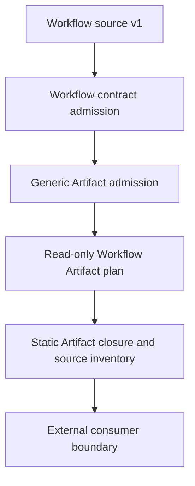

# Workflow v1 Declaration and Artifact Planning High-Level Design

## Purpose

Workflow v1 is a typed declaration language for process orchestration.

```text
Agent      = reusable reasoning and interaction configuration
Workflow   = typed process declaration
Invocation = one execution of a Workflow
```

An Agent owns reusable reasoning and interaction configuration.

A Workflow owns declaration-level process behavior, target-selection rules, and
portable orchestration semantics.

This document specifies the Workflow source Artifact family:

- Declaration admission.
- Canonical Definition construction.
- Read-only plan resolution.
- Static dependency closure.
- Source-backed identity facts.
- Callable-target and requirement inventory.
- Canonical declaration paths.
- Static source relationships.

Execution preparation, Runtime interpretation, persistence, scheduling,
recovery, domain binding, and frontend behavior are outside this document.
Their behavior and completion status belong in `workflow_runtime.md`.

This HLD describes Artifact admission, retrieval, static relationships, and
read-only planning only. It does not describe consumer setup, consumer
execution, or consumer-private representations.

## Current implementation cycle

Workflow v1 remains work in progress as a source-family HLD.

Workflow declarations use:

```yaml
apiVersion: v1
type: workflow
```

`apiVersion: v1` identifies the declaration language.

Workflow v1 remains `apiVersion: v1`. No declaration, Artifact schema, Store
schema, package, module, public API, interpreter, execution payload, or other
version identifier may change in this implementation cycle.

A Workflow source document is stored as an Artifact Definition. The standalone
source field `apiVersion` is admission metadata. It is not stored in the
canonical Definition body.

### Source-planning assessment

The supplied source assessment accepts Workflow declaration admission and static
Artifact planning as complete for this audit.

This completion assessment covers:

- Workflow v1 declaration decoding.
- Source schema and static declaration validity.
- Canonical Definition construction.
- Callable-target and requirement inventory.
- Static source-backed Artifact closure.
- Nested Workflow plan nodes in closure.
- Canonical declaration paths.
- Unsupported direct-composition rejection.
- Read-only source-planning boundaries.

Runtime and consumer-execution gaps remain in `workflow_runtime.md`.

The conclusions are source-based. Test execution and application execution were
not reviewed.

### Scope exclusions

This cycle excludes:

- Tests and validation reports.
- Validation-only hardening and cleanup.
- Frontend integration.
- SessionV2 migration, conversion, deletion, and replacement cleanup.
- Version changes and release work.
- Consumer execution implementation in Artifact Store.
- Cost metering.

### Completion discipline

The single current Artifact source-planning status authority is `Functional
tasks` at the end of this document.

It replaces former Artifact implementation tables, completion records, cleanup
tables, and repeated static-planning status claims.

The Runtime HLD has a separate Runtime and consumer-execution task ledger.
Neither HLD creates work owned by the other boundary.

A task can change to `Implemented` only when the complete listed Artifact
behavior exists in source. A status change alone is not completion.

## Source-planning ownership

### Workflow declaration responsibilities

A Workflow declaration owns source-level orchestration semantics:

- Ordered work.
- Typed callable declarations.
- Target-selection declarations.
- Structured control declarations.
- Typed state declarations.
- Parallel and collection declarations.
- Repeat declarations.
- State-machine declarations.
- Event, channel, port, wait, and human-work declarations.
- Timer and schedule declarations.
- Trigger declarations.
- Retry, reconciliation, compensation, and Saga declarations.
- Resource-claim and execution-budget declarations.
- Cancellation and cleanup declarations.

Workflow Artifact planning exposes admitted static facts and deterministic
source-backed relationships.

These are declaration meanings and planning facts. Runtime persistence, frame
construction, binding, dispatch, settlement, scheduling, recovery, cancellation
execution, and domain invocation are not Artifact behavior.

A Workflow declaration does not own:

- Consumer execution preparation.
- Runtime Artifact pinning.
- Consumer-local enablement decisions.
- Credentials.
- Provider configuration.
- Provider clients.
- Native target request grammars.
- Target-domain invocation semantics.
- Native file access.
- MCP client sessions.
- Consumer-private bindings.
- Frontend state.
- Wails transport behavior.
- Browser state.

### Workflow Artifact plan boundary

Workflow Artifact planning owns static source facts.

It returns:

- The admitted Workflow declaration.
- The root Workflow Artifact identity.
- The complete static Artifact dependency closure.
- Static dependency edges.
- Callable target facts.
- Requirement facts.
- Unsupported direct-composition issue facts.
- Source inventory facts for calls, contexts, ports, retries, effects, blocks,
  triggers, and structured declarations.
- Canonical declaration paths.

The closure contains only source-backed Artifact identity facts and static
relationships.

The closure does not contain:

- ProgramFrames.
- WorkItems.
- Attempts.
- Waits.
- Timers.
- Runtime semantic bindings.
- Provider-ready requests.
- Credentials.
- Provider clients.
- MCP sessions.
- Approval tokens.
- Native handles.
- Callbacks.
- Runtime-private state.

Consumers can use the plan as a read-only source-fact projection. Consumer
lowering, binding, execution, persistence, scheduling, recovery, and transport
are not specified in this document.

### Artifact Store boundary

Artifact Store is a passive source-fact provider.

It admits and returns:

- Definitions.
- Source identity.
- Relationships.
- Admitted source facts.
- Static planning facts.
- Read-only retrieval results.

Artifact Store does not:

- Prepare execution.
- Construct bindings.
- Schedule work.
- Dispatch work.
- Recover execution.
- Persist Runtime execution state.
- Retain consumer-private state.
- Receive consumer-specific execution requests.
- Expose consumer-specific execution APIs.

Consumers can read generic Artifact facts when they need current source identity.
The Store does not become an execution API.

### Agent source relationships

An Agent owns reusable reasoning and interaction configuration.

An Agent can contribute:

- A Model selection.
- Instructions and Text contributions.
- Tool capabilities.
- Skill capabilities.
- MCP capabilities.
- Model system-prompt behavior.
- Agent-specific capability requirements.

Workflow source can declare an Agent target.

Artifact planning records:

- The declared static Agent relationship.
- The callable interface.
- Source identity facts.
- Source-backed dependency relationships.

Current capability readiness, selected contribution preparation, private
resource construction, and native invocation are consumer behavior outside this
document.

## Workflow Artifact API

Workflow is a source-backed Artifact family.

Its Artifact-facing API is read-only plan resolution through
`workflow.Service.ResolvePlan`.

The plan contract provides:

- The admitted Workflow declaration.
- The root Workflow Artifact identity.
- The complete static Artifact closure.
- Callable targets.
- Requirements.
- Source inventory facts.
- Canonical declaration paths.
- Static relationship status and issue facts.

The plan contract returns:

- The admitted Workflow document and current root Artifact identity facts.
- `Inventory.CallableTargets`, containing only declarations that a Workflow call
  can select.
- `Inventory.Requirements`, containing only admission prerequisites.
- Source-backed `ResolvedArtifactRef` values for resolved Artifact targets.
- Call, context, port, retry, effect, block, trigger, and structured-operation
  planning facts.
- Detailed relationship status and issue facts.

Workflow plan resolution is valid for an available Workflow Artifact regardless
of consumer-local enablement state. A consumer can apply enablement, binding,
credential, policy, and domain-readiness rules only after it receives the
read-only plan.

Current target readiness, Runtime Artifact pin conversion, domain binding,
execution, persistence, recovery, and Wails behavior are outside this API.

Workflow declarations are admitted through generic Source refresh and
application-selected canonical declaration decoders.

Built-in and Workspace Source configuration are application bootstrap choices.
Workflow has no Workflow-specific source-origin, Source-driver, or package
publication policy.

Generic Artifact, catalog, Definition, Resource, and enablement APIs provide
entity-management operations. No Workflow-specific list, get, source export,
enablement, Plugin, or managed package API is required until a concrete
consumer requires one.

## Direct capabilities, requirements, and source identity

### Direct capabilities are unsupported

Workflow does not support direct capabilities for:

- Model.
- Agent.
- Tool.
- MCP Tool.
- Skill Tool.
- Service.
- Activity.
- Nested Workflow.

A direct composition result for one of these families is unsupported Workflow
input.

Planning returns an unsupported planning error before it creates a usable plan.

Planning must not publish or fabricate:

- A direct callable target.
- An Artifact.
- A Source.
- A Definition.
- A revision.
- A closure node.
- A resolved Artifact reference.
- A pin.
- A binding.
- A runtime direct-target representation.

### Direct Tool identity boundary

`CapabilityTargetForm.Direct` has no source-backed Artifact identity.

It cannot enter:

- A Workflow Artifact closure.
- An Inventory target plan.
- A resolved Artifact reference.
- Definition identity.
- Revision identity.
- A static source relationship.

Built-in Go Tool and provider SDK Tool declarations are ordinary Tool Artifacts.
They remain source-backed closure members.

An MCP Server is an Artifact closure member. A discovered MCP Tool operation is
not an individual Tool Artifact.

A Skill declaration is an Artifact. Skill Runtime lifecycle operations are not
Artifact declarations.

This document does not define consumer compatibility representations such as
`session.DirectCapabilitySelection`. Current provider registration, consumer
compatibility, and SessionV2 retirement are outside this Artifact boundary.

### Requirements are not callable targets

Artifact-backed requirements receive ordinary composition resolution.

Service and Activity requirements remain typed registered-binding prerequisites.
They do not receive synthetic Artifact resolution.

Requirements are static prerequisites. They are separate from:

- Callable-target inventory.
- Target-set membership.
- Call selection.
- Runtime target dispatch.

`Plan.Capabilities` remains a recursive composition and diagnostic projection.

Consumers must use separate callable-target and requirement collections.
Consumers must not rebuild callable target lookup by walking
`Plan.Capabilities`.

`Plan.Capabilities` is not executable Workflow target data.

Inventory paths are planning-owned canonical declaration paths. The root block
path is `root`. A root step path is `root/steps/<step-id>`.

Artifact planning does not define Runtime frame identities, WorkItem
identities, delivery routes, or channel storage names.

### Inline declaration data

Inline Workflow Text, explicit Model and Agent messages, instructions, and
defaults remain ordinary declaration data.

They are not:

- Direct capabilities.
- Artifact pins.
- Generic native request envelopes.
- Consumer-private state.

## Artifact architecture



Artifact ownership is:

- Declaration language:
  `internal/llmartifactory-go/workflow/contract/v1/`
  - Source grammar.
  - Source schema.
  - Static validation.
  - JSON Schema validity.
  - CEL scope validity.
  - Target and requirement declaration validity.

- Workflow planning:
  `internal/llmartifactory-go/workflow/`
  - Read-only Artifact-backed relationship resolution.
  - Callable-target and requirement inventory.
  - Source-backed references.
  - Static closure.
  - Planning facts.

- Artifact Store:
  - Passive Definition storage.
  - Identity.
  - Relationships.
  - Admitted source facts.
  - Read-only retrieval.

- External consumer boundary:
  - Consumer behavior is intentionally outside this document.

Artifact planning ends when it returns admitted source facts.

Consumer-local representations, consumer-private bindings, execution
preparation, transport, scheduling, and Runtime state are not part of Artifact
planning.

### Registration ownership

LLM declaration-family registration is split by ownership:

- `internal/llmartifactory-go/registration` assembles family interpretations,
  schema codecs, canonical declaration decoders, source-format decoders, and
  locator factories.
- `internal/artifactsetup/registration` supplies application topology choices,
  such as candidate filenames and package document layouts.

Generic schema type-overlap checks are domain-neutral JSON utility behavior.
They have one implementation in `internal/jsonutil`. They can be used by
declaration and consumer boundaries without giving Artifact Store an execution
role.

## Declaration model

### Root declaration

A root Workflow declaration has this shape:

```yaml
apiVersion: v1
type: workflow
name: example

inputSchema:
  type: object

outputSchema:
  type: object

schemas: {}

targets: {}

targetSets: {}

events: {}

channels: {}

ports: {}

triggers: {}

requirements: {}

resources: {}

limits: {}

state:
  schema:
    type: object
  initial: {}

listen: {}

steps: []

output: {}

catch: []

finally:
  steps: []
```

Root fields are:

- `apiVersion`: required in standalone source; must be `v1`.
- `type`: required; must be `workflow`.
- `name`: required portable Workflow name.
- `inputSchema`: required JSON Schema for invocation input.
- `outputSchema`: required JSON Schema for successful root output.
- `schemas`: optional reusable JSON Schema definitions.
- `targets`: optional named callable targets.
- `targetSets`: optional static or resolver-backed target collections.
- `events`: optional typed external event contracts.
- `channels`: optional invocation-local channel declarations.
- `ports`: optional published typed port declarations.
- `triggers`: optional event and schedule entry points.
- `requirements`: optional named Artifact or registered-binding prerequisites.
- `resources`: optional named claimable resource declarations.
- `limits`: optional invocation-limit and cleanup-allowance declarations.
- `state`: optional root typed state declaration.
- `listen`: optional root subscription declarations.
- `steps`: required ordered root steps.
- `output`: required explicit successful root output mapping.
- `catch`: optional ordered root failure handlers.
- `finally`: optional root finalization block.

The root Workflow has no implicit output. The final successful value is the root
`output` value or an explicit Workflow-level `return`.

### Blocks

A block contains:

- Optional local state.
- Optional subscriptions.
- Ordered steps.
- Explicit output.
- Optional ordered catch handlers.
- Optional finalization.

```yaml
steps:
  - id: prepare
    transform:
      value:
        request:
          $expr: input.request

output:
  prepared:
    $expr: steps.prepare.output
```

A nested block can omit `output` only when its grammar permits omission. Its
default output is `null`.

The root output is always explicit.

### Step identity and semantic outcomes

A step identity is unique within its block.

A nested step identity cannot shadow an enclosing visible step identity.

Artifact planning identifies declared blocks, steps, calls, and relationships.
It does not allocate execution, WorkItem, Attempt, ProgramFrame, or logical
operation identities.

The declaration distinguishes a retry from a new Repeat iteration or Foreach
item. Runtime identity and persistence of those meanings belong in
`workflow_runtime.md`.

A Workflow step declares one semantic terminal outcome:

```text
succeeded
failed
skipped
cancelled
uncertain
```

A successful outcome can contain:

- Typed output.
- Selected target identity.
- Receipt facts.
- Effect facts.

A false `when` condition produces `skipped`.

A skipped outcome has no output.

An uncertain outcome means an external effect can have happened without durable
confirmation.

Runtime creation, persistence, settlement, and projection of outcomes belong in
`workflow_runtime.md`.

## Values, schemas, and expressions

### Canonical JSON values

Workflow values can be:

- JSON literals.
- Objects.
- Arrays.
- CEL expressions.
- Explicit literal directives.

```yaml
input:
  request:
    $expr: input.request
  language: en
  flags:
    - concise
    - reviewed
```

A CEL expression uses one field:

```yaml
$expr: input.price * input.quantity
```

A literal directive preserves expression-looking data:

```yaml
$literal:
  $expr: this-is-data
```

Ordinary strings are literal strings.

### Schema boundaries

Workflow uses JSON Schema Draft 2020-12 for:

- Invocation input.
- Invocation output.
- State initialization.
- State updates.
- Target input.
- Target output.
- Target error.
- Target receipt.
- Event data.
- Event correlation.
- Channel message data.
- Human response.
- Foreach item.
- Step output when `outputSchema` exists.
- Port payloads.
- Trigger input.

Schema validity and business success are separate concepts.

A business decline can be valid output data.

### Expression scope

Expressions can use these variables when the controlling declaration provides
them:

- `input`: immutable invocation input.
- `state`: current state of the nearest state-owning scope.
- `steps`: completed visible step outcomes.
- `item`: current Foreach item.
- `index`: current Foreach or Repeat index.
- `result`: controlled-block result where defined.
- `event`: current matched event, trigger event, or Machine event.
- `messages`: authorized channel snapshot at the evaluation boundary.
- `error`: error visible to a catch handler.
- `outcome`: scope outcome visible to finalization.
- `completed`: confirmed operation facts visible to compensation.
- `operation`: original operation facts visible to reconciliation.
- `context`: invocation metadata and logical evaluation time.
- `ports`: authorized port input values for the current target boundary.

Expressions are pure.

Expressions do not:

- Call external services.
- Read files.
- Resolve Artifacts.
- Resolve credentials.
- Open MCP connections.
- Invoke Tools.
- Invoke Models.
- Invoke Agents.
- Start timers.
- Mutate state.

External behavior uses a typed callable target or a Workflow operation.

### Expression planning facts

The admitted declaration retains expression templates and source scope.

Inventory retains associated declaration paths and static call, context, port,
retry, effect, and block facts.

Evaluation snapshots, logical time, cursors, resumption, and compiled-program
lifecycle are Runtime concerns.

## State declarations

### State ownership

```yaml
state:
  schema:
    type: object
    required: [attempts]
    properties:
      attempts:
        type: integer
        minimum: 0
    additionalProperties: false
  initial:
    attempts: 0
```

A state declaration creates a state-owning scope.

A nested block with local `state` declares its own state scope.

A nested block without local `state` refers to the closest enclosing
state-owning scope.

### Atomic state update declaration

```yaml
- id: record
  set:
    values:
      attempts:
        $expr: state.attempts + 1
    remove:
      - obsoleteField
```

All assignment expressions observe one state snapshot.

The complete resulting value validates against the owning state schema.

`set` declares the resulting state as its output.

### Concurrent state declaration semantics

Parallel branches and Foreach items declare isolated state snapshots.

A parent-state change requires an explicit deterministic merge after child
outcomes become available.

Artifact planning retains:

- Declared state schemas.
- Initial values.
- Update expressions.
- Merge expressions.
- Canonical declaration paths.

Runtime executes merges and persists state changes.

## Callable targets and calls

### Target kinds

```yaml
targets:
  research-agent:
    kind: agent
    ref: researcher

  summarize:
    kind: model
    ref: summary-model

  list-issues:
    kind: tool
    ref: issues.list

  publish:
    kind: service
    ref: releases.publish

  calculate:
    kind: activity
    ref: pricing.calculate

  review-process:
    kind: workflow
    ref: review-process
```

Supported kinds are:

- `agent`: reusable Agent capability.
- `model`: direct Model request.
- `tool`: Tool Artifact or MCP Tool operation.
- `service`: registered typed Service binding.
- `activity`: registered typed Activity binding.
- `workflow`: nested Workflow declaration.

Agent and Model declarations use typed Workflow adapters.

Admission and planning retain declared interfaces and source-backed
relationships. Adapter availability, enablement, domain readiness, and
execution transport belong to consumer preparation.

An MCP Tool target declares a server:

```yaml
targets:
  publish-issue:
    kind: tool
    server:
      name: issue-tracker
    ref: publish_issue
```

### Callable interface

A target, target set, or call can declare a callable interface.

```yaml
interface:
  inputSchema:
    type: object
  outputSchema:
    type: object
  errorSchema:
    type: object
  receiptSchema:
    type: object
  modes: [invoke, start]
  context: {}
  ports: {}
  effect:
    kind: keyed
    keyed: true
  limits: {}
```

A callable interface defines:

- Input schema.
- Output schema.
- Error schema.
- Receipt schema.
- Supported modes.
- Accepted context forms.
- Typed ports.
- Effect capability.
- Limits.

A call-level interface can narrow a target interface. It cannot widen a target
interface.

### Calls

```yaml
- id: research
  call:
    target: research-agent
    input:
      request:
        $expr: input.request
    context:
      messages:
        $expr: messages.research
```

A call declaration identifies:

- Target.
- Input.
- Context.
- Allowed target set.
- Effect declaration.
- Retry declaration.
- Deadline declaration.
- Port intent.

Planning exposes static call facts through the admitted document and Inventory.

Execution preparation captures current target and binding facts. Durable call
handling belongs in `workflow_runtime.md`.

### Call modes

Call modes are:

- `invoke`: typed call-return behavior.
- `start`: starts declared child behavior and returns a completion handle.
- `handoff`: declares transfer of conversation ownership to an Agent.

`invoke` is the default.

`start` lifetime values are:

- `attached`: the declaration requests child behavior owned by the parent scope.
- `independent`: the declaration requests child behavior in an Execution in the
  same Session document.

An independent-start declaration supplies ownership, cancellation relationship,
and child-budget intent.

`handoff` is valid only for an Agent target.

A handoff declaration identifies:

- Conversation.
- Agent target.
- Ownership intent.
- Completion behavior.

Handoff completion values are:

- `restore`: restore the saved owner after child completion.
- `retain`: retain the target Agent as conversation owner after child
  completion.

Runtime ownership records, message routing, completion, and relinquish behavior
belong in `workflow_runtime.md`.

### Target sets

A target set restricts dynamic dispatch.

```yaml
targetSets:
  specialists:
    members:
      - analyst
      - reviewer
```

```yaml
- id: delegate
  call:
    target:
      $expr: steps.plan.output.assignee
    allowed: specialists
    input:
      $expr: steps.plan.output.task
```

A static target set has explicit members.

A resolver-backed target set has:

- A resolver value.
- A callable interface.
- Optional constraints.

Planning records resolver-backed target sets as deferred selection facts.

Planning does not:

- Evaluate membership.
- Select a target.
- Create Runtime work.
- Invoke an execution adapter.

### Provider-managed Tool Artifacts

A provider SDK Tool Artifact declares a provider-managed capability.

Its admitted interface and source identity remain ordinary Artifact facts.

Workflow Artifact planning records only:

- The declared relationship.
- The callable interface.
- The static source-backed dependency.

Planning does not specify consumer request construction, execution
representation, or invocation.

## Declaration transport contract

Workflow source declares:

- Explicit call input and context forms.
- Callable interface ports and schemas.
- Channel binding and requested access.
- Published Workflow ports.
- Stream intent.

Contract admission validates static declaration compatibility.

Planning exposes immutable transport facts in Inventory.

Current target capability, native request adaptation, port staging, port
delivery, stream ordering, and target settlement belong in
`workflow_runtime.md`.

### Explicit context transfer

Only mapped input, context, ports, and copied message values cross a target
boundary.

A target does not implicitly receive:

- Whole Session history.
- Workspace files.
- Tool outputs.
- Attachments.
- Agent outputs.
- Channel logs.
- Credentials.
- Native paths.
- Application state.

### Ports

A port is a typed named boundary between caller and target.

```yaml
ports:
  progress:
    direction: output
    stream: true
    schema:
      type: object
```

A call binds a target port to a Workflow channel:

```yaml
call:
  target: analyzer
  ports:
    progress:
      channel: analysis-progress
      access: write
```

Static port compatibility includes:

- Port name.
- Port direction.
- Stream capability.
- Channel declaration.
- Channel read or write authorization.
- Source schema.
- Destination schema.
- Parent-child declaration relationship.
- Target interface compatibility.
- Published root Workflow port compatibility for nested Workflow targets.

A port declaration distinguishes:

- Input ports.
- Final-output ports.
- Streamed-output ports.

Runtime stages values, maintains cursors, delivers output, retains records, and
orders streams.

### Channels

A channel declaration describes an invocation-local append-only message log.

```yaml
channels:
  review:
    schema:
      type: object
      required: [notes]
      properties:
        notes:
          type: string
    additionalProperties: false
    maxMessages: 50
    maxBytes: 262144
    readers:
      - review
    writers:
      - draft
```

Artifact planning retains:

- Channel name.
- Message schema.
- Message and byte limits.
- Reader authorization.
- Writer authorization.
- Canonical declaration path.

Runtime creates channel records, message identities, sequences, cursors,
deduplication facts, and consumption records.

### Emit

```yaml
- id: publish-draft
  emit:
    to:
      channel: review
    kind: draft
    data:
      notes:
        $expr: steps.write.output.notes
    deduplicationKey:
      $expr: input.requestId
```

An emit declaration can target:

- A local channel.
- A Workflow event.

Artifact planning retains destination, kind, data template, deduplication-key
template, and declaration path.

Runtime receipt persistence and duplicate-key behavior belong in
`workflow_runtime.md`.

## Structured declarations

### Operation set

Workflow operations are:

- `call`: invoke, start, dispatch, or hand off to a typed target.
- `transform`: construct a deterministic value.
- `set`: atomically update typed state.
- `scope`: create a nested declaration and lifecycle boundary.
- `choose`: select one conditional block.
- `parallel`: declare named branches.
- `foreach`: declare processing of a captured collection.
- `repeat`: declare repeated behavior with carried state.
- `machine`: declare a state lifecycle.
- `wait`: declare suspension for a typed condition.
- `emit`: declare a local channel message or event.
- `saga`: declare a compensation boundary.
- `cancel`: declare cancellation intent for child work.
- `return`: complete a block or Workflow with an explicit value.
- `fail`: produce a typed failure.
- `break`: exit the nearest Repeat.
- `continue`: complete the current Repeat iteration.

### Transform

```yaml
- id: prepare
  transform:
    value:
      title:
        $expr: input.title
      enabled:
        $expr: input.documents.filter(d, d.enabled)
    outputSchema:
      type: object
```

A transform is deterministic.

A transform does not declare an external effect.

### Scope

```yaml
- id: protected
  scope:
    state:
      schema:
        type: object
      initial: {}
    steps: []
    output: null
```

A scope declaration can own:

- Local state.
- Subscriptions.
- Catch handlers.
- Finalization.
- Attached-child declarations.
- Resource-claim declarations.
- Cleanup declarations.

### Choose

```yaml
- id: route
  choose:
    cases:
      - when:
          $expr: input.priority == 'high'
        do:
          steps: []
          output:
            queue: urgent
    default:
      steps: []
      output:
        queue: normal
```

Cases are declared in order.

The first matching case is the selected source branch.

No matching case without `default` produces `routing.no_match`.

### Parallel

```yaml
parallel:
  completion:
    mode: all
  errors: collect
  remaining: wait
  branches:
    legal:
      do:
        steps: []
        output:
          approved: true
    security:
      when:
        $expr: input.requiresSecurityReview
      do:
        steps: []
        output:
          approved: true
```

All branch conditions use the same declared entry boundary.

Only selected branches participate in completion.

Completion modes are:

- `all`: every selected branch succeeds.
- `first-completed`: the first terminal branch determines the result.
- `first-success`: the first successful branch wins.
- `quorum`: a declared positive number of branches succeed.

Remaining-branch behavior is:

- `cancel`: request cancellation of remaining selected branches.
- `wait`: wait for remaining selected branches to settle.

For `all`, error behavior is:

- `fail-fast`: request cancellation after branch failure.
- `collect`: wait for all selected branches and return aggregate outcomes.

Runtime preserves branch outcomes, including uncertainty, after another branch
satisfies completion policy.

### Foreach

```yaml
foreach:
  items:
    $expr: input.files
  itemSchema:
    type: object
  concurrency: 4
  maxItems: 1000
  completion:
    mode: all
  errors: collect
  remaining: wait
  do:
    steps: []
    output:
      name:
        $expr: item.name
      index:
        $expr: index
```

A Foreach declaration specifies:

- Source collection expression.
- Item schema.
- Concurrency.
- Optional maximum item count.
- Completion policy.
- Error policy.
- Remaining-item behavior.
- Child block.
- Parent-state merge when declared.

A Foreach item declaration has a captured source index.

The admitted definition preserves omission separately from explicit zero
`maxItems`. Planning does not normalize either form.

For `completion.mode: all`, an empty captured collection has an empty ordered
item result. Runtime owns durable collection settlement and any declared parent
state merge.

Runtime captures collection values, creates item execution identities, applies
effective limits, executes child work, and persists ordered item outcomes.

### Repeat

```yaml
repeat:
  state:
    schema:
      type: object
    initial:
      attempts: 0
  until:
    $expr: state.approved
  maxIterations: 3
  onExhausted: fail
  timeout: PT10M
  do:
    steps: []
    output: null
```

Exactly one Repeat control is selected:

- `count`: fixed number of iterations.
- `while`: condition before each iteration.
- `until`: condition after each iteration.
- `lifetime: until-cancelled`: ongoing lifecycle.

Repeat declaration output has:

```text
state
result
iterations
exhausted
```

The admitted definition preserves omission separately from explicit zero
`maxIterations`. Planning does not normalize either form.

A body-local state is declared per iteration.

A carried Repeat state is declared for the Repeat.

`break` exits the nearest Repeat.

`continue` completes the current Repeat iteration.

### Structured planning facts

The admitted declaration and Inventory retain:

- Structured child blocks.
- Collection declarations.
- Completion policies.
- Error policies.
- Merge declarations.
- Repeat controls.
- Machine declarations.
- Canonical declaration paths.

Artifact planning does not create child programs, Fork work, Join work,
execution identities, or settlement records.

## State-machine declarations

A state machine declares cyclic and event-driven lifecycle behavior.

```yaml
machine:
  initial: open
  state:
    schema:
      type: object
    initial:
      version: 1
  listen:
    updates:
      event: case-updated
      correlation:
        caseId:
          $expr: input.caseId
  states:
    open:
      entry:
        steps: []
        output: null
      transitions:
        - event: updates
          when:
            $expr: event.data.action == 'close'
          to: closed
        - after: P30D
          to: expired
    closed:
      final: true
      output:
        status: closed
    expired:
      final: true
      output:
        status: expired
```

Artifact planning retains:

- Initial state name.
- Declared states.
- State schema.
- Subscription declarations.
- Transition declarations.
- Entry and exit blocks.
- Final outputs.
- Canonical declaration paths.

The declaration semantic order is:

1. State entry.
2. Immediate transition selection.
3. Event transition selection.
4. Timer transition selection.

For one accepted event, the first matching declared transition wins.

A declared transition contains:

1. Current-state exit block.
2. Transition block.
3. Target-state entry block.
4. Target-state transition selection.

A state timer is declared to begin on entry and end on exit.

A final state has explicit output.

Runtime owns state persistence, event arbitration, timer lifecycle, transition
execution, and serialization.

## Events, waits, human work, and triggers

### Event contracts

```yaml
events:
  payment-confirmed:
    source: payments
    schema:
      type: object
    correlationSchema:
      type: object
```

An event envelope has:

```text
id
type
source
data
correlation
time
```

The source event identity contract is `(source, id)`.

An event contract declares:

- Source.
- Data schema.
- Correlation schema.

Runtime accepts and deduplicates events.

### Subscriptions

```yaml
listen:
  confirmation:
    event: payment-confirmed
    correlation:
      orderId:
        $expr: input.orderId
    filter:
      $expr: event.data.status == 'confirmed'
    retention: P1D
    capacity: 100
    maxBytes: 262144
```

A subscription declaration contains:

- Event reference.
- Correlation template.
- Filter template.
- Retention.
- Capacity.
- Byte limit.

Artifact planning retains these static facts.

Runtime activates subscriptions, accepts events, retains consumption facts, and
manages cursors.

### Wait

```yaml
wait:
  for: event
  subscription: confirmation
  consume: true
```

Supported wait forms are:

- `timer`: requires `after` or `at`; returns timer firing facts.
- `event`: requires `subscription`; returns an event envelope.
- `channel`: requires `channel`; returns a channel message and cursor.
- `completion`: requires `handle`; returns child completion output.
- `human`: requires assignees, request, and response schema; returns validated
  human response.

A completion handle declaration can identify one of:

- WorkItem.
- ProgramFrame.
- Execution.

Runtime preserves success, failure, cancellation, and uncertainty semantics for
completion waits.

### Human wait

```yaml
wait:
  for: human
  assignees:
    users:
      - release-manager-1
    roles:
      - release-manager
  request:
    release:
      $expr: input.release
  responseSchema:
    type: object
    required: [approved]
```

A human-wait declaration contains:

- Assignee templates.
- Request template.
- Response schema.

Artifact planning retains those source facts.

Runtime owns assignment snapshots, deadlines, resolution identities, received
responses, and assignment authorization.

Runtime accepts a human response only when its actor satisfies persisted
assignment facts.

A business rejection remains response data unless the Workflow explicitly fails.

### Timer declarations

Durations use ISO 8601.

Absolute times use RFC 3339.

Planning retains timer, timeout, and schedule declaration values.

Runtime owns scheduling, firing facts, and enclosing execution deadlines.

A timer cannot be manually resolved.

A timeout remains distinct from a successful timer firing.

### Event triggers

```yaml
triggers:
  intake:
    event:
      event: request-received
      filter:
        $expr: event.data.enabled
      input:
        request:
          $expr: event.data
      instanceKey:
        $expr: event.correlation.requestId
      behavior: start-or-signal
```

Event-trigger behavior values are:

- `start`: start a new Execution.
- `signal`: signal an active matching Execution.
- `start-or-signal`: signal an active matching Execution or start one when none
  exists.

Artifact planning retains event-trigger declarations, filters, input mappings,
instance-key expressions, and behavior values.

Artifact planning does not create trigger registrations, occurrences, queues,
or Executions.

### Schedule triggers

```yaml
triggers:
  hourly:
    schedule:
      calendar: "0 * * * *"
      timeZone: America/New_York
      input:
        reportDate:
          $expr: context.time
      overlap: queue
      missed:
        mode: catch-up
        maxOccurrences: 3
```

A schedule has exactly one of:

- `calendar`: five-field numeric cron expression.
- `interval`: ISO 8601 interval.

A calendar schedule requires an IANA time zone.

Overlap policy values are:

- `allow`: start another Execution.
- `skip`: record and skip while an instance is active.
- `queue`: persist the occurrence until an active instance settles.
- `replace`: cancel matching active work and start the new occurrence.

Missed-occurrence policy values are:

- `skip`: skip missed occurrences.
- `latest`: accept only the latest missed occurrence.
- `catch-up`: accept at most `maxOccurrences` missed occurrences.

Calendar gaps are skipped.

Repeated local times produce one occurrence for one scheduled local time.

UTC schedules avoid local-time ambiguity.

Runtime owns registration state, occurrence persistence, queue draining,
overlap execution, and local-slot deduplication.

## Effects, retries, reconciliation, compensation, and Sagas

### Effect contract

```yaml
effect:
  kind: keyed
  key:
    $expr: input.requestId + ':publish'
  reconcile:
    steps: []
    output:
      decision: unknown
  compensate:
    steps: []
    output: null
```

Effect kinds are:

- `read`: no externally visible business mutation.
- `idempotent`: repeating has the same business effect.
- `keyed`: target deduplicates repeated requests with one stable key.
- `non-idempotent`: repeating can create another business effect.

A keyed operation declaration has one stable idempotency-key expression per
logical WorkItem declaration.

The key semantic scope remains stable through:

- Attempts.
- Retry backoff.
- Durable waits.
- Recovery.
- Reconciliation.
- Resumption.

A new Repeat iteration or Foreach item has a distinct logical operation scope
and can have a new key.

### Effect planning facts

Planning retains:

- Declared effect kind.
- Key template.
- Reconciliation block.
- Compensation block.
- Canonical declaration paths.

Effect state, confirmation, uncertainty, receipts, and recovery records are
Runtime data.

### Retry

```yaml
retry:
  maxAttempts: 3
  match:
    categories: [transient, timeout]
  backoff:
    initial: PT1S
    maximum: PT30S
    multiplier: 2
    jitter: 0.2
  perAttemptTimeout: PT10S
```

`match.schema`, when declared, is a source-level error-schema matcher.

The admitted retry declaration and Inventory preserve `match.schema` without
evaluating error matching.

Automatic retry declaration semantics require:

1. A matching retry policy.
2. A retry-safe effect contract.

Read, idempotent, and keyed work can retry under declared policy.

A non-idempotent WorkItem does not retry after uncertainty.

Confirmed non-application from reconciliation can enable retry for a
non-idempotent WorkItem.

Runtime evaluates matching, captures logical call values, applies effect-safe
replay, persists retry boundaries, and schedules backoff.

### Reconciliation

A reconciliation block receives typed `operation` facts.

`operation` contains:

- Original WorkItem identity.
- Original Attempt identity.
- Original input.
- Selected target facts.
- Idempotency key.
- Receipt.
- Uncertainty error.

A reconciliation result declares one of:

```json
{
  "decision": "applied",
  "output": {},
  "receipt": {}
}
```

```json
{
  "decision": "notApplied"
}
```

```json
{
  "decision": "unknown",
  "error": {
    "code": "status_unavailable",
    "message": "status service did not confirm the effect"
  }
}
```

The declaration decision vocabulary is:

- `applied`
- `notApplied`
- `unknown`

Runtime maps those decisions to original WorkItem settlement, retry eligibility,
or recovery review.

### Saga

```yaml
saga:
  compensateOn: [failed, cancelled]
  compensationErrors: continue
  concurrency: 1
  do:
    steps: []
    output: {}
```

A Saga declaration defines:

- A compensation boundary.
- Trigger terminal states.
- Compensation error policy.
- Compensation concurrency.
- Child block.

Runtime records confirmed compensatable effects in dependency and confirmation
order.

A Saga does not compensate:

- Read effects.
- Confirmed non-application.
- Unknown effects.
- Effects without a compensation block.
- Effects outside the Saga boundary.

An uncertain effect enters automatic compensation only after reconciliation
confirms application.

### Compensation

Compensation declarations define:

- Reverse-dependency intent.
- Compensation block.
- Concurrency intent.
- Error policy.

A compensation expression can use typed `completed` facts supplied by Runtime.

Compensation error-policy values are:

- `continue`: record a compensation failure and continue eligible compensation.
- `stop`: record a compensation failure and stop later compensation.

Compensation failure does not replace primary failure or cancellation. Runtime
retains compensation failures as typed causes.

Artifact planning retains declared compensation facts and canonical source paths.

Runtime:

- Supplies completed-operation facts.
- Selects eligible effects.
- Applies dependency ordering.
- Persists compensation settlement.
- Preserves primary failure or cancellation.
- Attaches compensation failures as typed causes.

### Cleanup allowance

Cleanup allowance is separate from normal work duration.

A normal deadline can stop ordinary work while allowing bounded:

- Finalization.
- Reconciliation.
- Compensation.
- Target cancellation acknowledgement.
- Resource release.

Cleanup declarations use declared cleanup duration.

Runtime applies effective cleanup deadlines and cleanup dispatch behavior.

## Cancellation, resources, and limits

### Cancellation

The `cancel` operation declares cancellation intent and its typed child-work
relationship.

Artifact planning retains:

- Declaration form.
- Expression templates.
- Target relationship.
- Canonical declaration path.

Runtime owns:

- Target cancellation requests.
- Ordinary-wait settlement.
- Child propagation.
- Finalization.
- Cleanup allowance.
- Uncertainty.
- Reconciliation.
- Compensation.
- Catch and finally execution.

### Resources

```yaml
resources:
  customer-write:
    concurrency: 1
    keyed: true
  vendor-api:
    rate:
      units: 100
      per: PT1M
      burst: 10
```

A resource declaration can define:

- Concurrency.
- Rate.
- Burst.
- Per-key serialization.

### Claims

```yaml
claims:
  - resource: customer-write
    units: 1
    key:
      $expr: input.customerId
```

A claim declaration associates a named resource, units, and optional key
template with an operation or scope.

Artifact planning retains claim declarations and canonical paths.

A claim can be retained by its declared scope.

Runtime owns acquisition, retention, release, resource waits, and wakeup.

### Limits

```yaml
limits:
  duration: P1D
  cleanupDuration: PT10M
  stepExecutions: 1000
  callAttempts: 100
  workflowDepth: 16
  concurrency: 10
  modelTokens: 200000
  messageCount: 10000
  messageBytes: 10485760
  eventCount: 10000
  eventBytes: 10485760
  cost:
    amount: 100
    currency: USD
```

A child limit can only narrow an inherited limit.

Attached child declarations share parent aggregate budget.

Independent child declarations carry authorized child-budget intent.

Runtime owns counter accounting, child admission, claim handling, deadline
enforcement, and budget-wait wakeup.

Cost budgets are deferred.

Do not implement a cost meter, pricing model, currency model, or cost
settlement behavior in this cycle.

## Declaration validity

A valid Workflow declaration has:

- Known fields.
- Valid operation forms.
- Unique visible step identities.
- Valid CEL scope references.
- Valid JSON Schemas.
- Valid target relationships.
- Valid target-set membership.
- Valid callable interfaces.
- Valid port bindings.
- Valid channel permissions.
- Valid Machine state names and transitions.
- Valid Repeat and Foreach controls.
- Valid trigger schedules.
- Valid event and correlation contracts.
- Valid resource claims.
- Valid limit inheritance.
- Explicit root output mapping.

Artifact planning resolves static declaration relationships and source-backed
Artifact identity facts represented by the admitted plan and closure.

Current execution pinning, binding availability, provider ownership, policy,
transport, and Runtime behavior are outside this document.

## Consumer handoff boundary

```text
Workflow source v1
        |
        v
Declaration validation
        |
        v
Generic Artifact admission
        |
        v
Read-only Workflow Artifact plan
        |
        v
External consumer boundary
```

The declaration layer owns:

- Source syntax.
- Schema validity.
- Static CEL scope.
- Static target relationships.
- Portable declaration validity.

Workflow planning owns:

- Read-only target and requirement resolution.
- Callable-target and requirement inventory projection.
- Source-backed Artifact reference projection.
- Static closure construction.
- Canonical declaration paths.

Canonical JSON values are used only at arbitrary JSON boundaries.

External consumer representations, semantic bindings, execution preparation,
and execution state are outside this document.

## Completion readiness

Workflow Artifact completion requires every valid Workflow v1 source field to
satisfy one result:

- The field is represented in the typed declaration model and static plan.
- The field is rejected by Workflow v1 language validation.
- The field is represented as an explicit external-consumer handoff
  requirement.

Workflow Artifact completion includes:

- Typed declaration decoding.
- Canonical Definition construction.
- Static CEL scope validation.
- Static target and requirement planning.
- Deterministic source Inventory construction.
- Complete static source-backed Artifact closure construction.
- Explicit rejection of unsupported direct composition.
- One canonical declaration-path model in contract admission and planning.
- No Runtime interpretation or Runtime-private data.
- No Artifact Store execution role.

Status meanings are:

- `Implemented`: inspected source contains the complete listed Artifact
  behavior. Test execution was not reviewed.
- `Partial`: inspected source contains part of the behavior or has an
  identified Artifact-planning gap.
- `Not implemented`: required Artifact behavior is absent.
- `Not applicable`: behavior is explicitly outside Artifact planning or
  excluded from this cycle.

## Functional tasks

This is the single current Workflow Artifact source-planning status ledger.

It covers declaration admission, canonical Definitions, Inventory, static
closure, source identity, direct-composition rejection, and consumer handoff
boundaries.

It does not create Runtime, execution preparation, binding, persistence,
scheduling, recovery, or frontend work. Those tasks belong only in
`workflow_runtime.md`.

The `Functional tasks` ledger records static source-planning completion only.
It does not authorize changing source grammar, Artifact Store behavior, or
version identifiers without a separately demonstrated source-planning defect
and an approved implementation cycle.

All current Artifact source-planning tasks are implemented. A later demonstrated
source-planning defect must be added here. It must not be represented as
Runtime work unless it affects consumer execution after a valid plan exists.

### Declaration admission and canonical source model

#### `ART-CONTRACT-001` Admit Workflow v1 declarations into canonical Definitions

- Status: Implemented.
- Source evidence:
  - `internal/llmartifactory-go/workflow/contract/v1/` contains typed Workflow
    v1 declaration decoding, source schema, static validation, and canonical
    declaration modeling.
  - The standalone `apiVersion` is admission metadata and is not retained in
    the canonical Definition body.
  - Closed declaration objects reject unsupported former
    `CallableInterface.capabilities` input.
- Completed behavior:
  - Decode Workflow v1 source.
  - Enforce source-level grammar and known fields.
  - Construct canonical Definition content.
  - Preserve declaration structure, source values, schemas, templates, and
    canonical paths without Runtime-private data.

##### `ART-CONTRACT-001.a` Preserve source-level schemas and CEL scope

- Status: Implemented.
- Source evidence:
  - Workflow contract v1 validates source schema, JSON Schema boundaries,
    target and requirement declaration forms, and static CEL scope.
- Completed behavior:
  - Retain typed source schema boundaries for inputs, outputs, state, targets,
    events, channels, ports, human responses, and triggers.
  - Retain expression templates and source scope without compiling or executing
    consumer-private expression programs.

##### `ART-CONTRACT-001.b` Preserve declaration distinctions needed by Runtime

- Status: Implemented.
- Source evidence:
  - The admitted declaration distinguishes omitted and explicit zero
    `maxItems` and `maxIterations`.
  - Retry declarations retain `match.schema`.
  - Effect declarations retain source `non-idempotent`.
- Completed behavior:
  - Preserve source distinctions required by consumer lowering.
  - Do not normalize omitted values into explicit zero values.
  - Do not translate source effect spelling into Runtime enum values inside
    Artifact planning.

### Static planning, closure, and declaration paths

#### `ART-PLAN-001` Publish complete read-only Workflow planning facts

- Status: Implemented.
- Source evidence:
  - `internal/llmartifactory-go/workflow/closure.go` publishes deterministic
    closure nodes, edges, paths, and refresh checks.
  - `ArtifactClosureNode.Workflow` retains admitted nested Workflow document,
    Inventory, and composition facts.
  - `workflow.Service.ResolvePlan` exposes the read-only plan contract.
- Completed behavior:
  - Return admitted Workflow document and root Artifact identity.
  - Return complete static Artifact closure.
  - Return static dependency edges and nested Workflow planning facts.
  - Return callable targets, requirements, Inventory, and issue facts.
  - Keep consumer execution preparation, binding, scheduling, recovery, and
    private resources outside the plan.

##### `ART-PLAN-001.a` Preserve callable targets separately from requirements

- Status: Implemented.
- Source evidence:
  - `workflow.Plan.Inventory` separates `CallableTargets` and `Requirements`.
  - Service and Activity remain typed registered-binding prerequisites.
- Completed behavior:
  - Keep requirements outside callable-target selection and target-set
    membership.
  - Do not fabricate synthetic Artifact resolution for Service or Activity
    requirements.
  - Prevent consumers from rebuilding target lookup through diagnostic
    `Plan.Capabilities`.

##### `ART-PLAN-001.b` Publish canonical declaration paths

- Status: Implemented.
- Source evidence:
  - Contract admission, Inventory, and closure retain canonical `root/...`
    declaration identity.
  - `Inventory` paths cover blocks, calls, ports, retries, effects, and
    structured declarations.
- Completed behavior:
  - Preserve planning-owned declaration paths separately from Runtime frame and
    WorkItem identities.
  - Expose source paths for consumer lowering without defining Runtime delivery
    behavior.

### Static call, target-set, context, and transport inventory

#### `ART-INV-001` Publish complete static call target-use facts

- Status: Implemented.
- Source evidence:
  - `internal/llmartifactory-go/workflow/inventory.go` builds deterministic
    `CallSite.TargetUses`.
  - Inventory retains deterministic target, requirement, call, context, port,
    retry, effect, block, trigger, and structured source facts.
- Completed behavior:
  - Publish static call facts without evaluating expressions.
  - Preserve static candidate relationships for consumer preparation.
  - Do not consult execution adapters or current domain readiness.

##### `ART-INV-001.a` Extract literal call target names

- Status: Implemented.
- Source evidence:
  - `workflowLiteralTargetName` recognizes JSON string targets and valid
    `$literal` string forms.
  - `inventoryBuilder.callTargetUses` records corresponding named target and
    target family.
- Completed behavior:
  - Include ordinary literal call targets in `CallSite.TargetUses`.
  - Include calls without an allowed target set.

##### `ART-INV-001.b` Preserve expression-backed candidate and transport facts

- Status: Implemented.
- Source evidence:
  - `inventoryBuilder.callTargetUses`, `addCall`, `ContextUses`, and `PortUses`
    retain static target-set candidates and transport declarations.
- Completed behavior:
  - Preserve expression-backed candidate sets without evaluating expressions.
  - Preserve static context, port, stream, retry, effect, and target-interface
    facts.
  - Do not access execution adapters.

### Unsupported direct composition and Artifact identity

#### `ART-DIRECT-001` Reject unsupported direct Workflow composition

- Status: Implemented.
- Source evidence:
  - `internal/llmartifactory-go/workflow/closure.go` returns
    `UnsupportedDirectCapabilityError` for direct Model, Agent, Tool, MCP,
    Skill, Service, Activity, and Nested Workflow composition before a usable
    plan exists.
  - `workflow/closure.go` contains no `DirectCapabilityEvidence`, direct
    sorting, direct fingerprint input, or direct closure field.
  - Generic `composition.CapabilityPlan` remains a diagnostic projection. It is
    not callable target data or a direct-capability execution representation.
- Completed behavior:
  - Reject direct composition before plan publication.
  - Do not create direct closure evidence, direct target facts, direct pins,
    direct bindings, or direct Runtime representations.
  - Keep direct target identity outside Artifact facts.

##### `ART-DIRECT-001.a` Keep source-backed Artifact Tool identity distinct

- Status: Implemented.
- Source evidence:
  - Built-in Go and provider SDK Tool declarations remain Tool Artifacts.
  - MCP Server and Skill Artifact identity remain separate from discovered MCP
    operations and Skill Runtime lifecycle operations.
- Completed behavior:
  - Preserve source-backed Artifact closure members.
  - Do not manufacture individual Tool Artifacts for discovered MCP operations
    or Skill lifecycle operations.

##### `ART-DIRECT-001.b` Remove generic callable capability semantics

- Status: Implemented.
- Source evidence:
  - `internal/llmartifactory-go/workflow/contract/v1/types.go` and
    `workflow-v1.schema.json` remove `CallableInterface.capabilities`.
  - The closed schema rejects the former field at admission.
- Completed behavior:
  - Do not expose generic callable capability facts in Workflow planning.
  - Keep inline Text, messages, instructions, and defaults as declaration data.

### Artifact Store and consumer boundary

#### `ART-BOUNDARY-001` Keep Artifact Store and planning read-only

- Status: Implemented.
- Source evidence:
  - `internal/llmartifactory-go/workflow/` contains source-planning facts and
    no consumer-execution dependency.
  - Generic Artifact Store provides source identity, Definitions,
    relationships, and read-only retrieval.
- Completed behavior:
  - Keep Artifact Store passive.
  - Keep consumer execution preparation outside Store and planning.
  - Do not add execution, binding, dispatch, scheduling, recovery, or
    consumer-private APIs to Artifact Store.
  - Keep Runtime representation, persistence, and scheduling in
    `workflow_runtime.md`.

##### `ART-BOUNDARY-001.a` Preserve external consumer handoff

- Status: Implemented.
- Source evidence:
  - `workflow.Service.ResolvePlan` returns read-only admitted source facts,
    Inventory, closure, and source-backed references.
- Completed behavior:
  - Make plan facts sufficient for consumers to prepare execution without
    reparsing Workflow source.
  - Do not define consumer-local enablement, credentials, readiness, provider
    configuration, clients, or native request behavior in Artifact planning.
