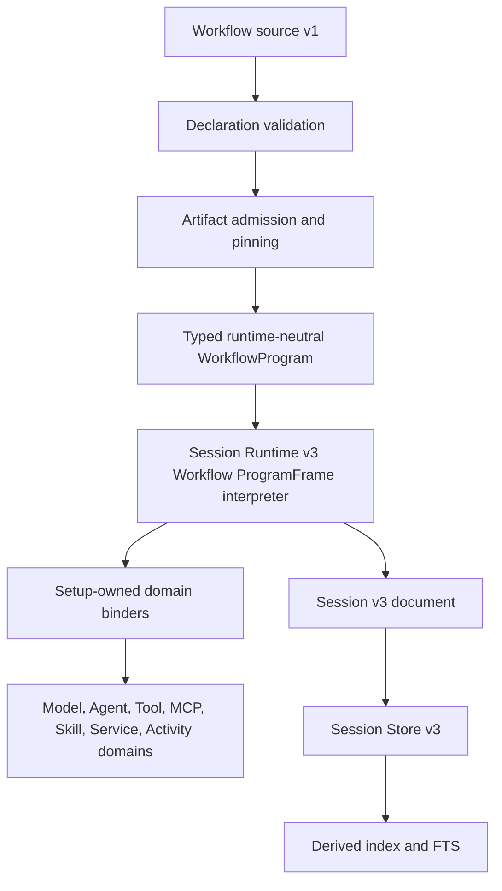

# Workflow v1 Declaration Model

## 1. Purpose

Workflow v1 is a typed declaration language for durable process execution.

```text
Agent       = reusable reasoning and interaction configuration

Workflow    = typed durable process declaration

Invocation  = one durable execution of a Workflow
```

An Agent owns reusable reasoning and interaction behavior. A Workflow owns process behavior, coordination, lifecycle, reliability, business control flow, and durable execution semantics.

Session Runtime v3 is the durable execution host for both normal conversation work and Workflow work.

```text
Session Runtime v3
    +
Workflow Runtime v3
    =
typed durable backend that includes normal Session v2 behavior
    +
full Workflow v1 behavior
```

Completion of the backend phases in this document and the runtime document produces a Session Runtime v3 backend that is ready for frontend replacement of Session v2.

## 2. Version contract

Workflow declarations use:

```yaml
apiVersion: v1
type: workflow
```

`apiVersion: v1` identifies the declaration language.

The declaration language version is separate from the durable ProgramFrame payload version.

The current Workflow ProgramFrame payload is:

```text
artifact.workflow.v1@1
```

The payload remains `artifact.workflow.v1@1` during development. Workflow v1 remains `apiVersion: v1`.

A Workflow source document is stored as an Artifact definition. The standalone source field `apiVersion` is admission metadata and is not stored in the canonical definition body.

## 3. Responsibility boundaries

### 3.1 Workflow responsibilities

A Workflow owns:

- Ordered work.
- Typed callable invocation.
- Runtime target selection.
- Structured control flow.
- Typed state updates.
- Parallel and collection execution.
- Repeat behavior.
- State machines.
- Events, channels, ports, waits, and human work.
- Timers and schedules.
- Trigger behavior.
- Retry, reconciliation, compensation, and saga behavior.
- Resource claims and execution budgets.
- Cancellation and cleanup behavior.

A Workflow does not own:

- Artifact source parsing.
- Artifact storage.
- Credentials.
- Provider configuration.
- Provider clients.
- Native file access.
- MCP client sessions.
- Frontend state.
- Wails transport behavior.
- Browser state.

### 3.4 Workflow target-adapter boundary

Workflow owns orchestration adapters for callable targets.

Workflow adapters:

- Depend on existing typed Model, Agent, Tool, Skill, MCP, Workspace, Service, and Activity APIs.
- Convert Workflow-owned typed declarations and evaluated Workflow values into existing domain request types.
- Persist Workflow semantic facts before external dispatch.
- Keep native domain calls, provider clients, credentials, native paths, and domain-private handles outside Session documents.

Domains do not:

- Import Workflow Runtime or Session Runtime types.
- Add Workflow-only request contracts.
- Accept Workflow context through native Tool arguments, provider metadata, MCP metadata, Skill sidecars, or native context sidecars.

`CanonicalValue` can represent Workflow data boundaries. It must not become a
second Model or Agent request grammar. A Workflow Model or Agent target needs
a Workflow-owned typed adapter that uses the existing Model or Agent domain
contract. Until that adapter exists, admission rejects the target before
Workflow execution starts.

### 3.2 Agent responsibilities

An Agent owns reusable reasoning and interaction configuration.

An Agent can contribute:

- A Model selection.
- Instructions and Text contributions.
- Tool capabilities.
- Skill capabilities.
- MCP capabilities.
- Model system prompt behavior.
- Agent-specific capability requirements.

A Workflow invokes an Agent as a typed callable target. The invocation creates an Agent-loop ProgramFrame. Workflow input is converted only through a declared, typed Agent invocation plan. It is never converted into fallback chat text.

### 3.3 Invocation responsibilities

An Invocation is one durable Workflow execution.

An Invocation owns:

- Invocation input.
- The selected Workflow definition pin.
- ProgramFrames.
- WorkItems.
- Attempts.
- Waits.
- Timers.
- Trigger occurrences.
- Event and channel records.
- Effect facts.
- Reconciliation facts.
- Compensation facts.
- Resource claims.
- Budgets.
- Execution outcome.

The existing Session v3 document is the only durable root for an Invocation.

## 4. Architecture



| Layer                     | Primary package area                                                    | Responsibilities                                                                                                                                |
| ------------------------- | ----------------------------------------------------------------------- | ----------------------------------------------------------------------------------------------------------------------------------------------- |
| Declaration language      | `internal/llmartifactory-go/workflow/contract/v1/`                      | Source grammar, source schema, static validation, JSON Schema validity, CEL scope validity, target relationships, portable declaration validity |
| Workflow planning         | `internal/llmartifactory-go/workflow/`                                  | Artifact-backed relationship resolution and typed target, call-site, context-use, port-use, retry, effect, and nested-block inventory           |
| Admission and compilation | `internal/agentruntimesetup/workflowruntime/`                           | Current Artifact pins, nested Workflow admission, target adapter selection, typed WorkflowProgram lowering, and runtime transport admission     |
| Durable orchestration     | `internal/agentruntime-go/sessionv3/`                                   | ProgramFrames, WorkItems, Attempts, Waits, timers, effects, recovery, cancellation, durable control flow                                        |
| Domain binding            | `internal/agentruntimesetup/sessionv3runtime/`, domain runtime packages | Model, Agent, Tool, MCP, Skill, Workspace, attachment, Service, Activity, and provider adaptation                                               |
| Persistence               | `internal/sessionstorev3/`                                              | Authoritative Session v3 documents, tombstones, derived index, derived FTS                                                                      |
| Desktop composition       | `cmd/agentgo/`                                                          | Wails transport attachment, runtime composition, application binding registration                                                               |

Session Runtime v3 has no Artifact Store or setup import. It does not parse source, resolve Artifacts, configure providers, read Workspace files, discover MCP capabilities, render Skills, invoke native Tools directly, or materialize native attachments.

### 4.1 Validation ownership

One layer owns each validation class.

| Validation class                                                                                 | Owner                                     | Other layers                               |
| ------------------------------------------------------------------------------------------------ | ----------------------------------------- | ------------------------------------------ |
| Artifact envelope, Definition integrity, persistence identity                                    | Artifact Store                            | Consume admitted Artifact facts            |
| Workflow grammar, source schema, static CEL scope, static source relationships                   | Workflow contract v1                      | Consume typed validated declaration values |
| Artifact-backed Workflow plan and source relationship resolution                                 | Workflow planning                         | Expose typed plan facts                    |
| Current Artifact pin, binding, credential, policy, and transport availability                    | Setup adapter that owns the target domain | Return typed admission failure             |
| Durable Session, ProgramFrame, WorkItem, Attempt, Wait, timer, channel, and transition integrity | Session Runtime v3                        | Persist and recover durable facts          |
| Session document, tombstone, index, and FTS integrity                                            | Session Store v3                          | Rebuild derived records                    |

Workflow setup is a lowerer and binder assembler. It must not become a second
Workflow grammar validator, a second CEL scope validator, a second target
relationship resolver, or a second trigger scheduler.

Runtime-neutral Workflow types are deliberate boundary copies. Runtime cannot
import Artifact or declaration packages. These copies must contain runtime
semantics only and must not recreate source-language parsing behavior.

LLM declaration-family registration is also split by ownership:

- `internal/llmartifactory-go/registration` assembles family interpretations,
  schema codecs, canonical declaration decoders, source-format decoders, and
  locator factories.
- `internal/artifactsetup/registration` supplies application topology choices
  such as candidate filenames and package document layouts.

Generic schema type-overlap checks are domain-neutral JSON utility behavior.
They have one implementation in `internal/jsonutil`, used by both declaration
and runtime boundaries.

## 5. Root declaration

A root Workflow declaration has this shape:

```yaml
apiVersion: v1
type: workflow
name: example

inputSchema:
  type: object

outputSchema:
  type: object

schemas: {}

targets: {}

targetSets: {}

events: {}

channels: {}

ports: {}

triggers: {}

requirements: {}

resources: {}

limits: {}

state:
  schema:
    type: object
  initial: {}

listen: {}

steps: []

output: {}

catch: []

finally:
  steps: []
```

| Field          |                 Required | Meaning                                            |
| -------------- | -----------------------: | -------------------------------------------------- |
| `apiVersion`   | Yes in standalone source | Must be `v1`.                                      |
| `type`         |                      Yes | Must be `workflow`.                                |
| `name`         |                      Yes | Portable Workflow name.                            |
| `inputSchema`  |                      Yes | JSON Schema for invocation input.                  |
| `outputSchema` |                      Yes | JSON Schema for successful root output.            |
| `schemas`      |                       No | Reusable JSON Schema definitions.                  |
| `targets`      |                       No | Named callable targets.                            |
| `targetSets`   |                       No | Static or resolver-backed target collections.      |
| `events`       |                       No | Typed external event contracts.                    |
| `channels`     |                       No | Invocation-local durable message logs.             |
| `ports`        |                       No | Published typed port bindings.                     |
| `triggers`     |                       No | Event and schedule entry points.                   |
| `requirements` |                       No | Named capability requirements.                     |
| `resources`    |                       No | Named claimable resource definitions.              |
| `limits`       |                       No | Invocation limits and cleanup allowance.           |
| `state`        |                       No | Root typed state declaration.                      |
| `listen`       |                       No | Root subscriptions active before root work begins. |
| `steps`        |                      Yes | Ordered root steps.                                |
| `output`       |                      Yes | Explicit successful root output mapping.           |
| `catch`        |                       No | Ordered root failure handlers.                     |
| `finally`      |                       No | Root finalization block.                           |

The root Workflow has no implicit output. The final successful value is the root `output` value or an explicit Workflow-level `return`.

## 6. Blocks, identities, and outcomes

### 6.1 Blocks

A block contains:

- Optional local state.
- Optional subscriptions.
- Ordered steps.
- Explicit output.
- Optional ordered catch handlers.
- Optional finalization.

```yaml
steps:
  - id: prepare
    transform:
      value:
        request:
          $expr: input.request

output:
  prepared:
    $expr: steps.prepare.output
```

A nested block can omit `output` only when its grammar permits omission. Its default output is `null`.

The root output is always explicit.

### 6.2 Step identity

A step identity is unique within its block.

A nested step identity cannot shadow an enclosing visible step identity.

A logical operation identity includes:

- Workflow definition identity.
- ProgramFrame path.
- Step identity.
- Repeat iteration identity.
- Foreach item index.
- Target-set selection identity.
- Retry attempt sequence.

A retry retains one logical operation identity.

A Repeat iteration and a Foreach item create new logical operation identities.

### 6.3 Terminal step outcomes

A Workflow step has one durable terminal outcome:

```text
succeeded
failed
skipped
cancelled
uncertain
```

A successful outcome can contain:

- Typed output.
- Selected target identity.
- Receipt facts.
- Effect facts.

A false `when` condition produces `skipped`.

A skipped outcome has no output.

An uncertain outcome means an external effect can have happened but the runtime has no durable confirmation.

## 7. Values, schemas, and expressions

### 7.1 Canonical JSON values

Workflow values can be:

- JSON literals.
- Objects.
- Arrays.
- CEL expressions.
- Explicit literal directives.

```yaml
input:
  request:
    $expr: input.request
  language: en
  flags:
    - concise
    - reviewed
```

A CEL expression uses one field:

```yaml
$expr: input.price * input.quantity
```

A literal directive preserves expression-looking data:

```yaml
$literal:
  $expr: this-is-data
```

Ordinary strings are literal strings.

### 7.2 Schema boundaries

Workflow uses JSON Schema Draft 2020-12 at these boundaries:

- Invocation input.
- Invocation output.
- State initialization.
- State updates.
- Target input.
- Target output.
- Target error.
- Target receipt.
- Event data.
- Event correlation.
- Channel message data.
- Human response.
- Foreach item.
- Step output when `outputSchema` exists.
- Port payloads.
- Trigger input.

Schema validity and business success are separate concepts.

A business decline can be valid output data.

### 7.3 Expression scope

Expressions can use these variables when the controlling construct provides them:

| Variable    | Meaning                                                       |
| ----------- | ------------------------------------------------------------- |
| `input`     | Immutable invocation input.                                   |
| `state`     | Current state of the nearest state-owning scope.              |
| `steps`     | Completed step outcomes visible in the current scope chain.   |
| `item`      | Current Foreach item.                                         |
| `index`     | Current Foreach or Repeat index.                              |
| `result`    | Controlled-block result where defined.                        |
| `event`     | Current matched event, trigger event, or machine event.       |
| `messages`  | Authorized channel snapshot at the evaluation boundary.       |
| `error`     | Error visible to a catch handler.                             |
| `outcome`   | Scope outcome visible to finalization.                        |
| `completed` | Confirmed operation facts visible to compensation.            |
| `operation` | Original operation facts visible to reconciliation.           |
| `context`   | Invocation metadata and logical evaluation time.              |
| `ports`     | Authorized port input values for the current target boundary. |

Expressions are pure.

Expressions do not:

- Call external services.
- Read files.
- Resolve Artifacts.
- Resolve credentials.
- Open MCP connections.
- Invoke Tools.
- Invoke Models.
- Invoke Agents.
- Start timers.
- Mutate state.

External behavior uses a typed callable target or a Workflow operation.

### 7.4 Durable evaluation facts

The runtime persists evaluation facts that can affect a resumed expression:

- Logical `context.time`.
- Authorized retained channel snapshots.
- Current invocation input.
- Current scope state.
- Visible completed step outcomes.
- Active subscription facts.
- Current event, result, error, operation, completed-operation, and outcome values where applicable.
- Port input snapshots and cursors.

The runtime does not persist compiled CEL programs or compiled JSON Schema programs.

## 8. State

### 8.1 State declaration

```yaml
state:
  schema:
    type: object
    required: [attempts]
    properties:
      attempts:
        type: integer
        minimum: 0
    additionalProperties: false
  initial:
    attempts: 0
```

A state declaration creates a state-owning scope.

A nested block with local `state` initializes and owns its own state.

A nested block without local `state` reads and updates the closest enclosing state-owning scope.

### 8.2 Atomic update

```yaml
- id: record
  set:
    values:
      attempts:
        $expr: state.attempts + 1
    remove:
      - obsoleteField
```

All assignment expressions observe the same state snapshot.

The complete result validates against the owning state schema.

`set` returns the resulting state.

### 8.3 Concurrent state isolation

Parallel branches and Foreach items receive isolated state snapshots.

Their state cannot race with parent state.

A parent state changes only through an explicit deterministic merge after child outcomes are available.

The merge operation is represented by a typed StateUpdate WorkItem. It uses the captured parent state, selected child outcomes, the declared state schema, and a durable merge result.

## 9. Callable targets

### 9.1 Target kinds

```yaml
targets:
  research-agent:
    kind: agent
    ref: researcher

  summarize:
    kind: model
    ref: summary-model

  list-issues:
    kind: tool
    ref: issues.list

  publish:
    kind: service
    ref: releases.publish

  calculate:
    kind: activity
    ref: pricing.calculate

  review-process:
    kind: workflow
    ref: review-process
```

Supported target kinds are:

| Kind       | Meaning                              |
| ---------- | ------------------------------------ |
| `agent`    | Reusable Agent capability.           |
| `model`    | Direct Model request.                |
| `tool`     | Tool Artifact or MCP Tool operation. |
| `service`  | Registered typed Service binding.    |
| `activity` | Registered typed Activity binding.   |
| `workflow` | Nested Workflow declaration.         |

An MCP Tool target declares a server:

```yaml
targets:
  publish-issue:
    kind: tool
    server:
      name: issue-tracker
    ref: publish_issue
```

### 9.2 Callable interface

A target, target set, or call can declare a callable interface.

```yaml
interface:
  inputSchema:
    type: object
  outputSchema:
    type: object
  errorSchema:
    type: object
  receiptSchema:
    type: object
  modes: [invoke, start]
  context: {}
  ports: {}
  effect:
    kind: keyed
    keyed: true
  limits: {}
  capabilities: []
```

A callable interface defines:

- Input schema.
- Output schema.
- Error schema.
- Receipt schema.
- Supported modes.
- Accepted context forms.
- Typed ports.
- Effect capability.
- Limits.
- Capability requirements.

A call-level interface can narrow a target interface. It cannot widen the target interface.

### 9.3 Invocation

```yaml
- id: research
  call:
    target: research-agent
    input:
      request:
        $expr: input.request
    context:
      messages:
        $expr: messages.research
```

A call evaluates input and context once.

The runtime persists:

- Prepared input.
- Prepared context.
- Selected concrete target.
- Target-set membership.
- Effect key.
- Retry identity.
- Deadline.
- Port plans.
- Artifact and binding facts.

These facts remain stable through retries, waits, recovery, and resumption.

### 9.4 Call modes

| Mode      | Meaning                                            |
| --------- | -------------------------------------------------- |
| `invoke`  | Typed call-return behavior.                        |
| `start`   | Starts child work and returns a completion handle. |
| `handoff` | Transfers conversation ownership to an Agent.      |

`invoke` is the default.

`start` supports:

| Lifetime      | Meaning                                                 |
| ------------- | ------------------------------------------------------- |
| `attached`    | The child belongs to the parent scope.                  |
| `independent` | The child is an Execution in the same Session document. |

An independent child stores:

- Parent Execution identity.
- Root Execution identity.
- Parent ProgramFrame identity.
- Ownership facts.
- Cancellation relationship.
- Authorized child budget.
- Completion handle.

`handoff` is valid only for an Agent target.

A handoff stores:

- Conversation identity.
- Target Agent pin.
- Ownership facts.
- Saved conversation owner.
- Completion behavior.

Completion behavior is:

| Value     | Meaning                                                                 |
| --------- | ----------------------------------------------------------------------- |
| `restore` | Restore the saved owner after child completion.                         |
| `retain`  | Keep the target Agent as the conversation owner after child completion. |

### 9.5 Target sets

A target set restricts dynamic dispatch.

```yaml
targetSets:
  specialists:
    members:
      - analyst
      - reviewer
```

```yaml
- id: delegate
  call:
    target:
      $expr: steps.plan.output.assignee
    allowed: specialists
    input:
      $expr: steps.plan.output.task
```

A static target set has explicit members.

A resolver-backed target set has:

- A resolver value.
- A callable interface.
- Optional constraints.

The runtime creates a typed resolver WorkItem at the first call boundary.

The resolver WorkItem persists normalized membership before target selection.

The selected target identity becomes part of the durable step outcome.

Retries, waits, recovery, and resumed operation use the persisted membership and selected target identity.

### 9.6 Provider-managed Tool Artifacts

A provider SDK Tool Artifact is a provider-managed Model capability.

It appears only in a typed Model execution plan.

It does not become:

- A local Tool WorkItem.
- A synthetic local result.
- A fabricated local success.
- A local retry target.

A Workflow call to a provider-managed Tool Artifact requires a typed Model plan that owns provider Tool choice. Admission resolves this before unrelated external work starts.

## 10. Target transport ownership

Workflow owns:

- Ports.
- Channels.
- Cursor state.
- Parent-child delivery.
- Ordering.
- Retention.
- Durable replay semantics.

Generic domain APIs preserve their own native contracts.

| Target family       |                           Workflow context |                                Input ports |               Non-stream output port |                       Streamed output port |
| ------------------- | -----------------------------------------: | -----------------------------------------: | -----------------------------------: | -----------------------------------------: |
| Model               |         Supported through typed Model plan |                                  Supported |                            Supported |                                  Supported |
| Agent               |         Supported through typed Agent plan |                                  Supported |                            Supported |                                  Supported |
| Nested Workflow     | Supported through child ProgramFrame scope |                                  Supported |                            Supported |                                  Supported |
| Port-aware Service  | Supported when binding declares capability | Supported when binding declares capability |                            Supported | Supported when binding declares capability |
| Port-aware Activity | Supported when binding declares capability | Supported when binding declares capability |                            Supported | Supported when binding declares capability |
| Go Tool             |                                Unavailable |                                Unavailable | Supported after confirmed settlement |                                Unavailable |
| MCP Tool            |                                Unavailable |                                Unavailable | Supported after confirmed settlement |                                Unavailable |
| Skill Tool          |                                Unavailable |                                Unavailable | Supported after confirmed settlement |                                Unavailable |
| Provider SDK Tool   |                            Model-plan only |                            Model-plan only |                     Provider-managed |                           Provider-managed |

The native target contract remains authoritative:

- Go Tool function arguments remain Go Tool function arguments.
- MCP `tools/call` arguments remain MCP `tools/call` arguments.
- Skill Tool arguments remain Skill Tool arguments.
- Provider request plans remain provider request plans.

Workflow metadata is not injected through:

- Tool argument envelopes.
- Go `context.Context` sidecars.
- MCP metadata.
- MCP extensions.
- Skill Runtime sidecars.
- Provider metadata.
- Artifact-domain imports.

Setup can adapt a confirmed final native Tool result into a normal Workflow output port after settlement.

A declaration that requests unsupported Tool-family context, input-port, or stream-port transport fails during admission before target dispatch.

## 11. Context, ports, and channels

### 11.1 Explicit context transfer

Only mapped input, context, ports, and copied message values cross a target boundary.

A target does not implicitly receive:

- Whole Session history.
- Workspace files.
- Tool outputs.
- Attachments.
- Agent outputs.
- Channel logs.
- Credentials.
- Native paths.
- Application state.

### 11.2 Ports

A port is a typed named boundary between caller and target.

```yaml
ports:
  progress:
    direction: output
    stream: true
    schema:
      type: object
```

A call binds a target port to a Workflow channel:

```yaml
call:
  target: analyzer
  ports:
    progress:
      channel: analysis-progress
      access: write
```

Port validation checks:

- Port name.
- Port direction.
- Stream capability.
- Channel existence.
- Channel read or write authorization.
- Source schema.
- Destination schema.
- Parent-child ownership.
- Target interface compatibility.
- Published root Workflow port compatibility for nested Workflow targets.

Input ports transfer authorized retained channel values or explicit mapped values.

Output ports transfer final target values.

Streamed ports transfer ordered incremental values.

A final call output remains separate from a streamed port.

### 11.3 Channels

A channel is an invocation-local append-only durable message log.

```yaml
channels:
  review:
    schema:
      type: object
      required: [notes]
      properties:
        notes:
          type: string
    additionalProperties: false
    maxMessages: 50
    maxBytes: 262144
    readers:
      - review
    writers:
      - draft
```

A channel message contains:

- Message identity.
- Sequence.
- Channel identity.
- Kind.
- Data.
- Correlation.
- Deduplication key.
- Creation time.
- Consumption facts.

Channel reads are non-destructive unless a wait consumes a message.

Consumption is scoped to a wait or subscription identity. It does not globally remove a message.

### 11.4 Emit

```yaml
- id: publish-draft
  emit:
    to:
      channel: review
    kind: draft
    data:
      notes:
        $expr: steps.write.output.notes
    deduplicationKey:
      $expr: input.requestId
```

An emit can target:

- A local channel.
- A Workflow event.

An emit returns a durable receipt.

A duplicate deduplication key for the same destination returns the stored receipt and does not append another message.

## 12. Structured operations

### 12.1 Operation set

| Operation   | Purpose                                                 |
| ----------- | ------------------------------------------------------- |
| `call`      | Invoke, start, dispatch, or hand off to a typed target. |
| `transform` | Construct a deterministic value.                        |
| `set`       | Atomically update typed state.                          |
| `scope`     | Create a nested block and lifecycle boundary.           |
| `choose`    | Select one conditional block.                           |
| `parallel`  | Run named branches.                                     |
| `foreach`   | Process a captured collection.                          |
| `repeat`    | Repeat a block with carried state.                      |
| `machine`   | Run an explicit state lifecycle.                        |
| `wait`      | Suspend for a typed condition.                          |
| `emit`      | Publish a local channel message or event.               |
| `saga`      | Define a compensation boundary.                         |
| `cancel`    | Request cancellation of child work.                     |
| `return`    | Complete a block or Workflow with an explicit value.    |
| `fail`      | Produce a typed failure.                                |
| `break`     | Exit the nearest Repeat.                                |
| `continue`  | Complete the current Repeat iteration.                  |

### 12.2 Transform

```yaml
- id: prepare
  transform:
    value:
      title:
        $expr: input.title
      enabled:
        $expr: input.documents.filter(d, d.enabled)
    outputSchema:
      type: object
```

A transform is deterministic.

A transform does not create an external effect.

### 12.3 Scope

```yaml
- id: protected
  scope:
    state:
      schema:
        type: object
      initial: {}
    steps: []
    output: null
```

A scope creates a lifecycle boundary.

A scope can own:

- Local state.
- Subscriptions.
- Catch handlers.
- Finalization.
- Attached children.
- Resource claims.
- Cleanup work.

### 12.4 Choose

```yaml
- id: route
  choose:
    cases:
      - when:
          $expr: input.priority == 'high'
        do:
          steps: []
          output:
            queue: urgent
    default:
      steps: []
      output:
        queue: normal
```

Cases evaluate in declaration order.

The first matching case executes.

No matching case without `default` produces `routing.no_match`.

### 12.5 Parallel

```yaml
parallel:
  completion:
    mode: all
  errors: collect
  remaining: wait
  branches:
    legal:
      do:
        steps: []
        output:
          approved: true
    security:
      when:
        $expr: input.requiresSecurityReview
      do:
        steps: []
        output:
          approved: true
```

All branch conditions evaluate from the same entry snapshot.

Only selected branches participate in completion.

Completion modes:

| Mode              | Completion condition                             |
| ----------------- | ------------------------------------------------ |
| `all`             | Every selected branch succeeds.                  |
| `first-completed` | The first terminal branch determines the result. |
| `first-success`   | The first successful branch wins.                |
| `quorum`          | A declared positive number of branches succeed.  |

`remaining` behavior:

| Value    | Meaning                                              |
| -------- | ---------------------------------------------------- |
| `cancel` | Request cancellation of remaining selected branches. |
| `wait`   | Wait for remaining selected branches to settle.      |

For `all`, `errors` behavior:

| Value       | Meaning                                                       |
| ----------- | ------------------------------------------------------------- |
| `fail-fast` | Request cancellation after a branch failure.                  |
| `collect`   | Wait for all selected branches and return aggregate outcomes. |

Branch outcomes remain durable after another branch satisfies completion policy.

An uncertain branch remains visible. It is not converted to success, skipped, or cancelled because another branch completes.

### 12.6 Foreach

```yaml
foreach:
  items:
    $expr: input.files
  itemSchema:
    type: object
  concurrency: 4
  maxItems: 1000
  completion:
    mode: all
  errors: collect
  remaining: wait
  do:
    steps: []
    output:
      name:
        $expr: item.name
      index:
        $expr: index
```

Foreach:

- Captures the source collection once.
- Validates each item.
- Creates isolated item state.
- Preserves source-order outcomes.
- Applies effective concurrency and resource limits.
- Supports Parallel completion modes.
- Supports cancellation.
- Supports explicit parent-state merge.
- Returns an empty ordered item list for an empty `all` collection.

A Foreach item identity includes its captured source index.

### 12.7 Repeat

```yaml
repeat:
  state:
    schema:
      type: object
    initial:
      attempts: 0
  until:
    $expr: state.approved
  maxIterations: 3
  onExhausted: fail
  timeout: PT10M
  do:
    steps: []
    output: null
```

Exactly one repeat control is selected:

| Control                     | Meaning                          |
| --------------------------- | -------------------------------- |
| `count`                     | Fixed number of iterations.      |
| `while`                     | Condition before each iteration. |
| `until`                     | Condition after each iteration.  |
| `lifetime: until-cancelled` | Ongoing lifecycle.               |

Repeat returns:

```text
state
result
iterations
exhausted
```

A body-local state initializes once per iteration.

A carried Repeat state initializes once for the Repeat.

`break` exits the nearest Repeat.

`continue` completes the current Repeat iteration.

### 12.8 Durable Fork and Join

A child scheduling boundary uses a typed Fork WorkItem.

A child settlement aggregation boundary uses a typed Join WorkItem.

A Fork WorkItem persists:

- Parent ProgramFrame identity.
- Child ProgramFrame intents.
- Child identities.
- Child lifetimes.
- Child ownership facts.
- Child deadlines.
- Child program snapshots.

A Join WorkItem persists:

- Parent ProgramFrame identity.
- Child ProgramFrame identities.
- Join policy.
- Child terminal facts.

A parent interpreter receives child settlement only after the Join WorkItem confirms the child terminal state.

## 13. State machines

A state machine models cyclic and event-driven lifecycle behavior.

```yaml
machine:
  initial: open
  state:
    schema:
      type: object
    initial:
      version: 1
  listen:
    updates:
      event: case-updated
      correlation:
        caseId:
          $expr: input.caseId
  states:
    open:
      entry:
        steps: []
        output: null
      transitions:
        - event: updates
          when:
            $expr: event.data.action == 'close'
          to: closed
        - after: P30D
          to: expired
    closed:
      final: true
      output:
        status: closed
    expired:
      final: true
      output:
        status: expired
```

A machine persists:

- Current state.
- Carried state.
- Local state ownership.
- Entry time.
- Transition generation.
- Active subscriptions.
- Active event waits.
- Active timer waits.
- Selected transition.
- Current event.
- Child block state.

Machine behavior is serialized within the owning ProgramFrame.

State entry completes before transition selection.

Transition selection order is:

1. Immediate transitions.
2. Event transitions.
3. Timer transitions.

For one accepted event, the first matching transition wins.

A transition performs:

1. Current state exit block.
2. Transition block.
3. Target state entry block.
4. Target state transition selection.

A state timer begins on entry and ends on exit.

A final state returns its explicit output.

## 14. Events, waits, and human work

### 14.1 Event contracts

```yaml
events:
  payment-confirmed:
    source: payments
    schema:
      type: object
    correlationSchema:
      type: object
```

An event envelope contains:

```text
id
type
source
data
correlation
time
```

Duplicate event identity is `(source, id)`.

An event contract controls:

- Source.
- Data schema.
- Correlation schema.

### 14.2 Subscriptions

```yaml
listen:
  confirmation:
    event: payment-confirmed
    correlation:
      orderId:
        $expr: input.orderId
    filter:
      $expr: event.data.status == 'confirmed'
    retention: P1D
    capacity: 100
    maxBytes: 262144
```

A subscription becomes active when its scope begins, before its steps run.

A subscription stores:

- Event contract identity.
- Correlation facts.
- Filter facts.
- Retention settings.
- Capacity settings.
- Byte settings.
- Accepted event identities.
- Consumption facts.

### 14.3 Wait

```yaml
wait:
  for: event
  subscription: confirmation
  consume: true
```

Supported wait forms:

| `for`        | Required fields                     | Successful output           |
| ------------ | ----------------------------------- | --------------------------- |
| `timer`      | `after` or `at`                     | Timer firing facts.         |
| `event`      | `subscription`                      | Event envelope.             |
| `channel`    | `channel`                           | Channel message and cursor. |
| `completion` | `handle`                            | Child completion output.    |
| `human`      | assignees, request, response schema | Validated human response.   |

A completion handle can identify one:

- WorkItem.
- ProgramFrame.
- Execution.

A completion wait preserves success, failure, cancellation, and uncertainty semantics.

### 14.4 Human wait

```yaml
wait:
  for: human
  assignees:
    users:
      - release-manager-1
    roles:
      - release-manager
  request:
    release:
      $expr: input.release
  responseSchema:
    type: object
    required: [approved]
```

A human wait persists:

- User assignments.
- Role assignments.
- Request value.
- Response schema.
- Response authorization requirements.
- Deadline.
- Resolution identity.
- Typed response.

A response is accepted only when the response actor satisfies persisted assignment facts.

A business rejection remains response data unless the Workflow explicitly fails.

### 14.5 Timer behavior

Durations use ISO 8601.

Absolute times use RFC 3339.

A timer preserves:

- Scheduling time.
- Intended fire time.
- Actual fire time.
- Enclosing step deadline.

A timer cannot be manually resolved.

A timeout remains separate from a successful timer firing.

## 15. Triggers

Triggers create or address Workflow Executions.

A trigger is not a subscription.

A subscription receives an event inside an existing Invocation.

A trigger creates or addresses an Invocation from outside the Workflow body.

### 15.1 Event trigger

```yaml
triggers:
  intake:
    event:
      event: request-received
      filter:
        $expr: event.data.enabled
      input:
        request:
          $expr: event.data
      instanceKey:
        $expr: event.correlation.requestId
      behavior: start-or-signal
```

Event trigger behavior:

| Behavior          | Meaning                                                            |
| ----------------- | ------------------------------------------------------------------ |
| `start`           | Start a new Execution.                                             |
| `signal`          | Signal an active matching Execution.                               |
| `start-or-signal` | Signal an active matching Execution or start one when none exists. |

A trigger occurrence persists:

- Trigger identity.
- Event source.
- Event identity.
- Occurrence time.
- Accepted time.
- Mapped invocation input.
- Instance key.
- Selected Execution.
- Queue position.
- State.
- Failure facts.

### 15.2 Schedule trigger

```yaml
triggers:
  hourly:
    schedule:
      calendar: "0 * * * *"
      timeZone: America/New_York
      input:
        reportDate:
          $expr: context.time
      overlap: queue
      missed:
        mode: catch-up
        maxOccurrences: 3
```

A schedule has exactly one of:

| Field      | Meaning                             |
| ---------- | ----------------------------------- |
| `calendar` | Five-field numeric cron expression. |
| `interval` | ISO 8601 interval.                  |

A calendar schedule requires an IANA time zone.

Schedule overlap policy:

| Policy    | Meaning                                                   |
| --------- | --------------------------------------------------------- |
| `allow`   | Start another Execution.                                  |
| `skip`    | Record and skip while an instance is active.              |
| `queue`   | Persist the occurrence until an active instance settles.  |
| `replace` | Cancel matching active work and start the new occurrence. |

Missed-occurrence policy:

| Policy     | Meaning                                             |
| ---------- | --------------------------------------------------- |
| `skip`     | Skip missed occurrences.                            |
| `latest`   | Accept only the latest missed occurrence.           |
| `catch-up` | Accept at most `maxOccurrences` missed occurrences. |

Calendar gaps are skipped.

Repeated local times produce one occurrence for one scheduled local time.

UTC schedules avoid local-time ambiguity.

## 16. Effects, retries, reconciliation, compensation, and sagas

### 16.1 Effect contract

```yaml
effect:
  kind: keyed
  key:
    $expr: input.requestId + ':publish'
  reconcile:
    steps: []
    output:
      decision: unknown
  compensate:
    steps: []
    output: null
```

Effect kinds:

| Kind             | Meaning                                                    |
| ---------------- | ---------------------------------------------------------- |
| `read`           | No externally visible business mutation.                   |
| `idempotent`     | Repeating has the same business effect.                    |
| `keyed`          | Target deduplicates repeated requests with one stable key. |
| `non-idempotent` | Repeating can create another business effect.              |

A keyed operation has one stable idempotency key per logical WorkItem.

The key remains unchanged through:

- Attempts.
- Retry backoff.
- Durable waits.
- Recovery.
- Reconciliation.
- Resumption.

A new Repeat iteration or Foreach item receives a new logical WorkItem identity and can have a new key.

### 16.2 Effect state

Effect state is distinct from WorkItem state.

| Effect state          | Meaning                                 |
| --------------------- | --------------------------------------- |
| `notApplicable`       | Read-only work.                         |
| `notStarted`          | No external invocation started.         |
| `dispatched`          | External invocation can be in progress. |
| `confirmedApplied`    | Effect is confirmed.                    |
| `confirmedNotApplied` | Non-application is confirmed.           |
| `uncertain`           | Effect can have happened.               |
| `compensating`        | Compensation is in progress.            |
| `compensated`         | Compensation is confirmed.              |
| `compensationFailed`  | Compensation failed or is uncertain.    |

Effect state persists in:

- WorkItems.
- Attempts.
- Receipts.
- Errors.
- Effect records.
- Reconciliation facts.
- Compensation facts.

### 16.3 Retry

```yaml
retry:
  maxAttempts: 3
  match:
    categories: [transient, timeout]
  backoff:
    initial: PT1S
    maximum: PT30S
    multiplier: 2
    jitter: 0.2
  perAttemptTimeout: PT10S
```

Automatic retry requires:

1. A matching retry policy.
2. A retry-safe effect contract.

Read, idempotent, and keyed work can retry under the declared policy.

A non-idempotent WorkItem does not retry after uncertainty.

Confirmed non-application from reconciliation can enable retry for a non-idempotent WorkItem.

### 16.4 Reconciliation

A reconciliation block receives typed `operation` facts.

`operation` contains:

- Original WorkItem identity.
- Original Attempt identity.
- Original input.
- Selected target facts.
- Idempotency key.
- Receipt.
- Uncertainty error.

A reconciliation result distinguishes:

```json
{
  "decision": "applied",
  "output": {},
  "receipt": {}
}
```

```json
{
  "decision": "notApplied"
}
```

```json
{
  "decision": "unknown",
  "error": {
    "code": "status_unavailable",
    "message": "status service did not confirm the effect"
  }
}
```

Reconciliation behavior:

| Decision     | Runtime behavior                                                  |
| ------------ | ----------------------------------------------------------------- |
| `applied`    | Confirm the original WorkItem and continue with confirmed output. |
| `notApplied` | Mark confirmed non-application and evaluate retry eligibility.    |
| `unknown`    | Keep the original WorkItem uncertain and open recovery review.    |

A reconciliation starts through a typed Reconciliation WorkItem.

The Reconciliation WorkItem persists original operation facts before the reconciliation block starts.

### 16.5 Saga

```yaml
saga:
  compensateOn: [failed, cancelled]
  compensationErrors: continue
  concurrency: 1
  do:
    steps: []
    output: {}
```

A Saga defines a business compensation boundary.

A Saga records confirmed compensatable effects in dependency and confirmation order.

A Saga does not compensate:

- Read effects.
- Confirmed non-application.
- Unknown effects.
- Effects without a compensation block.
- Effects outside the Saga boundary.

An uncertain effect enters automatic compensation only after reconciliation confirms application.

### 16.6 Compensation

Compensation runs in reverse effect order while preserving dependency constraints.

A compensation operation receives typed `completed` facts.

`completed` contains:

- Original operation facts.
- Confirmed output.
- Receipt.
- Effect identity.
- Compensation identity.

A Compensation WorkItem persists compensation intent before a compensation child ProgramFrame starts.

Compensation policy:

| Policy     | Meaning                                            |
| ---------- | -------------------------------------------------- |
| `continue` | Record failure and continue eligible compensation. |
| `stop`     | Record failure and stop later compensation.        |

A compensation failure does not replace primary failure or cancellation.

Primary failure remains primary.

Compensation failures attach as typed causes.

### 16.7 Cleanup allowance

Cleanup allowance is separate from normal work duration.

A normal deadline can stop ordinary work while allowing bounded:

- Finalization.
- Reconciliation.
- Compensation.
- Target cancellation acknowledgement.
- Resource release.

Cleanup work uses declared cleanup duration.

## 17. Cancellation

Cancellation:

- Stops queued normal work.
- Requests cancellation from active targets.
- Resolves ordinary waits as cancelled.
- Propagates to attached children.
- Propagates to independent children when `cancelWithParent` is true.
- Runs finalization.
- Starts eligible reconciliation and compensation.
- Retains uncertainty when cancellation races with external mutation.

Cancellation does not prove that a dispatched mutating target did not apply its effect.

Cancellation remains cancellation through catch and finally behavior.

A catch handler can return an explicit allowed result only after cancellation cleanup.

## 18. Resources and limits

### 18.1 Resources

```yaml
resources:
  customer-write:
    concurrency: 1
    keyed: true
  vendor-api:
    rate:
      units: 100
      per: PT1M
      burst: 10
```

A resource can define:

- Concurrency.
- Rate.
- Burst.
- Per-key serialization.

### 18.2 Claims

```yaml
claims:
  - resource: customer-write
    units: 1
    key:
      $expr: input.customerId
```

A claim is acquired before owning WorkItem dispatch.

A claim is released when its owner settles.

A claim can be retained by a scope.

### 18.3 Limits

```yaml
limits:
  duration: P1D
  cleanupDuration: PT10M
  stepExecutions: 1000
  callAttempts: 100
  workflowDepth: 16
  concurrency: 10
  modelTokens: 200000
  messageCount: 10000
  messageBytes: 10485760
  eventCount: 10000
  eventBytes: 10485760
  cost:
    amount: 100
    currency: USD
```

A child limit can only narrow an inherited limit.

Attached children share parent aggregate budget.

Independent children persist an authorized child budget.

Cost budgets require a setup-owned cost meter. The runtime reports a typed limit failure before dispatch when that meter is unavailable.

## 19. Declaration validity

A valid Workflow declaration has:

- Known fields.
- Valid operation forms.
- Unique visible step identities.
- Valid CEL scope references.
- Valid JSON Schemas.
- Valid target relationships.
- Valid target-set membership.
- Valid callable interfaces.
- Valid port bindings.
- Valid channel permissions.
- Valid machine state names and transitions.
- Valid Repeat and Foreach controls.
- Valid trigger schedules.
- Valid event and correlation contracts.
- Valid resource claims.
- Valid limit inheritance.
- Explicit root output mapping.

Admission resolves:

- Artifact pins.
- Nested Workflow pins.
- Current Service bindings.
- Current Activity bindings.
- Provider-managed Tool ownership.
- Tool-family transport capability.
- Model and Agent invocation capability.
- Current policy and binding availability.

Admission never accepts a valid operation and later ignores it.

## 20. Compiler and runtime boundary

```text
Workflow source v1
        |
        v
Declaration validation
        |
        v
Artifact admission and pinning
        |
        v
Typed runtime-neutral WorkflowProgram
        |
        v
Session Runtime v3 ProgramFrame interpreter
        |
        v
Setup-owned domain binders
```

The declaration layer owns:

- Source syntax.
- Schema validity.
- Static CEL scope.
- Static target relationships.
- Portable declaration validity.

Runtime setup owns:

- Artifact pinning.
- Current dependency verification.
- Provider planning.
- Tool binding.
- MCP discovery.
- Skill resolution.
- Workspace planning.
- Attachment materialization.
- Service binding.
- Activity binding.
- External domain adaptation.

Session Runtime v3 owns:

- ProgramFrames.
- WorkItems.
- Attempts.
- Waits.
- Timers.
- Recovery.
- Idempotency.
- Cancellation.
- Durable effect state.
- Trigger state.
- Control-flow state.
- Persistence-safe semantics.

Canonical JSON values are used only at arbitrary JSON boundaries.

Typed structures own:

- IDs.
- Pins.
- Kinds.
- Limits.
- Effects.
- Attempts.
- Waits.
- Receipts.
- Errors.
- Budgets.
- Trigger state.
- Port state.
- Resource claims.
- Control-flow state.

## 21. Functional completion

Workflow Runtime v3 functional completion requires every valid Workflow v1 field to satisfy one result:

1. The field compiles into typed runtime behavior with durable recovery semantics.
2. The field is invalid by Workflow v1 language semantics.
3. The field requires an unavailable Artifact pin, binding, credential, policy, or external domain capability and fails before unrelated external work begins.

Functional completion includes:

- Typed compilation.
- Durable persistence.
- Durable recovery.
- Cancellation behavior.
- Reliable external work behavior.
- Typed projection and command wiring.
- Normal Session v2 backend parity in Session Runtime v3.

The backend is then ready for frontend replacement of Session v2.

## 22. Source-backed implementation status

### 22.1 Evidence coverage

| Area                                                       | Source evidence                                                                                                                                                                 |
| ---------------------------------------------------------- | ------------------------------------------------------------------------------------------------------------------------------------------------------------------------------- |
| Workflow source grammar and semantic validation            | `internal/llmartifactory-go/workflow/contract/v1/`                                                                                                                              |
| Artifact-backed Workflow planning                          | `internal/llmartifactory-go/workflow/plan.go`                                                                                                                                   |
| Admission and typed compilation                            | `internal/agentruntimesetup/workflowruntime/`                                                                                                                                   |
| Workflow interpreter and durable orchestration             | `internal/agentruntime-go/sessionv3/`                                                                                                                                           |
| Model, Tool, MCP, Skill, attachment, and execution binding | `internal/agentruntimesetup/sessionv3runtime/`, `internal/agentruntimesetup/toolruntime/`, `internal/agentruntimesetup/mcpruntime/`, `internal/agentruntimesetup/skillruntime/` |
| Session v3 persistence                                     | `internal/sessionstorev3/`                                                                                                                                                      |
| Desktop composition                                        | `cmd/agentgo/app.go`, `cmd/agentgo/wrapper_sessionv3_bootstrap.go`, `cmd/agentgo/wrapper_sessionv3_runtime.go`                                                                  |

### 22.2 Durable foundation

- [x] Session v3 is the durable root for Executions, ProgramFrames, WorkItems, Attempts, Waits, effects, trigger registrations, trigger occurrences, channels, and control-flow state.
- [x] Session Store v3 is the authoritative V3 persistence store.
- [x] Derived index and FTS data rebuild from the Session document.
- [x] Tombstones are durable deletion barriers.
- [x] Command idempotency records persist in the Session document.
- [x] Tombstones retain accepted deletion command records.
- [x] Restore restores tombstones before live Session recreation.
- [x] Runtime close cancels tracked timers, dispatch contexts, and owned asynchronous work.
- [x] Restore finishes before retry, wait, execution-deadline, cleanup-deadline, resource, and trigger timers are armed.

### 22.3 Callable targets and plans

- [x] Tool Artifact targets use typed Tool WorkItems.
- [x] MCP Tool targets use current MCP discovery and persisted binding facts.
- [x] Service targets use registered typed Service bindings.
- [x] Activity targets use registered typed Activity bindings.
- [x] Nested Workflow targets use child Workflow ProgramFrames.
- [ ] Agent targets are rejected at admission until a Workflow-owned typed Agent invocation adapter is composed from existing Agent APIs.
- [ ] Model targets are rejected at admission until a Workflow-owned typed Model invocation adapter is composed from existing Model APIs.
- [x] Static target sets enforce member identity.
- [x] Resolver-backed target sets use typed resolver WorkItems and persist membership.
- [x] Selected target identity persists with the logical Workflow step.
- [x] Completion waits preserve confirmed Tool error and skipped outcomes as typed terminal failure.
- [x] Provider SDK Tool Artifacts remain provider-managed Model choices.
- [x] Callable interface limits propagate to direct WorkItems and child ProgramFrame boundaries.
- [x] Receipt schemas are enforced for direct WorkItems and child ProgramFrame boundaries.
- [x] Typed Model and Agent dispatch plans persist artifact pins, Workspace, Model, Agent, instruction, Text, Tool, Skill, MCP, attachment, message, channel, context, and port facts.
- [x] Tool and MCP Tool target effect safety is conservative unless a current setup-domain binding supplies the authoritative effect fact.
- [x] Workflow does not convert input ports or arbitrary Workflow context into synthetic Model or Agent chat messages.
- [x] Typed Service and Activity dispatch plans persist binding identity, binding version, input, context, port facts, and effect facts.

### 22.4 Ports, channels, and messaging

- [x] Local channel emit, retained records, cursors, consume facts, observation behavior, and emit deduplication are durable runtime concepts.
- [x] Completion handles support WorkItems, ProgramFrames, and Executions.
- [x] Parent-child completion waits preserve terminal outcome semantics.
- [x] Input port plans are staged for Model, Agent, nested Workflow, and explicitly port-aware Service or Activity bindings.
- [x] Non-stream output ports are delivered from confirmed final output for all callable target families.
- [x] Streamed port plans are delivered through Model, Agent, nested Workflow, and explicitly streaming Service or Activity bindings.
- [x] Go Tool, MCP Tool, and Skill Tool input-port declarations fail during admission.
- [x] Go Tool, MCP Tool, and Skill Tool streamed-port declarations fail during admission.
- [x] Tool final output routes through normal non-stream output ports after confirmed settlement.
- [x] Port ownership, channel authorization, ordering, schema enforcement, and durable replay facts exist at target boundaries.
- [x] Attached and independent child Executions support durable live port messaging.
- [x] Nested Workflow root ports participate in parent-child access checks.
- [ ] Published nested Workflow port checks need complete source-to-target channel-schema compatibility validation. `workflow_published_ports.go` verifies published access and target channel existence. The completion work adds exact caller port schema to target published channel schema validation.

### 22.5 Structured behavior

- [x] Transform, Scope, Choose, Return, Fail, Break, Continue, Set, Parallel, Foreach, Repeat, Machine, Wait, Emit, Saga, and Cancel have typed compiler and interpreter routes.
- [x] Parallel supports `all`, `first-completed`, `first-success`, `quorum`, `cancel`, `wait`, `fail-fast`, and `collect`.
- [x] Parallel excludes condition-skipped branches from `all` completion and settles an empty selected `all` set deterministically.
- [x] Foreach captures source order, validates items, preserves ordered outcomes, isolates item execution, and supports completion policy.
- [x] Repeat supports count, while, until, timeout, carried state, local state, exhaustion, break, continue, and until-cancelled lifecycle behavior.
- [x] Machine initial state, entry, exit, immediate transitions, event transitions, timer transitions, transition blocks, final output, serialized handling, cancellation, and recovery are durable runtime behavior.
- [x] Fork WorkItems persist child scheduling boundaries.
- [x] Join WorkItems persist child aggregation boundaries.
- [x] Structured control flow reserves step budget for ordinary, Fork, Join, and controlling WorkItems.
- [x] Structured control flow uses durable ProgramFrame-held resource leases.
- [ ] Closest-owner state mutation needs completion across child blocks. `WorkflowScopeContext` currently carries `OuterState`, while `WorkflowInterpreter.set` uses `program.Root.State`. The completion work carries nearest state-owner schema and identity through child scope, Repeat, Machine, catch, finally, and compensation blocks.
- [ ] Parallel and Foreach need the declared explicit parent-state merge model. The current declaration types and schema preserve isolated child state but have no typed merge declaration and no parent StateUpdate merge boundary.
- [ ] Durable terminal step outcomes need complete `failed` and `uncertain` records. Current `WorkflowStepOutcomeStatus` persists `succeeded`, `skipped`, and `cancelled`; the completion work adds failure and uncertainty facts for visible step outcome semantics.

### 22.6 Effects, reconciliation, compensation, and cleanup

- [x] Read, idempotent, keyed, and non-idempotent effect contracts are typed.
- [x] Stable keyed idempotency keys persist in WorkItems and Attempts.
- [x] Effect state persists in WorkItems, Attempts, receipts, and errors.
- [x] Uncertain non-idempotent work does not automatically replay.
- [x] Read, idempotent, and keyed work can resume only through their replay-safe effect contract.
- [x] Reconciliation WorkItem intent and typed reconciliation result states exist.
- [x] Saga scope identity and confirmed compensatable effect ledger facts exist.
- [x] Compensation WorkItem intent and cleanup state exist.
- [x] Reconciliation child-block execution covers effect-bearing Tool, Service, and Activity WorkItems.
- [x] Applied reconciliation output validates against original target and call contracts.
- [x] Confirmed non-application retry behavior exists for declared retry policies.
- [x] Unknown reconciliation outcomes route to typed recovery review.
- [x] Reverse dependency-aware compensation scheduling exists.
- [x] Compensation concurrency limits exist.
- [x] Compensation `continue` and `stop` policies exist.
- [x] Primary outcome projection includes typed compensation causes.
- [x] Cleanup timer expiry and bounded cleanup cancellation exist.
- [x] Structured cancellation preserves dispatched mutation uncertainty and routes catch, finally, reconciliation, and compensation through cleanup work.
- [x] Recovery starts declared reconciliation before generic recovery review for uncertain Workflow WorkItems.

### 22.7 Coordination, triggers, resources, and limits

- [x] Event waits, channel waits, timer waits, completion waits, and human waits are typed WorkItem behavior.
- [x] Signals use source and identity deduplication.
- [x] Trigger registrations persist in Session documents.
- [x] Event trigger occurrences persist accepted occurrence identity, mapped input, instance key, selected Execution, queue position, and failure facts.
- [x] Schedule triggers support intervals and five-field cron schedules with IANA time zones.
- [x] Trigger overlap and missed-occurrence policies are typed.
- [x] Subscription retention, capacity, and byte limits are enforced.
- [x] Channel retention and byte limits are enforced.
- [x] Human response actor authorization is enforced.
- [x] Trigger registration without initial explicit Workflow start exists.
- [x] Trigger occurrence failure projection and operational management commands exist.
- [x] Resource definitions compile to typed resource definitions.
- [x] Resource claims compile to typed WorkItem claim plans.
- [x] Concurrency, rate, and keyed serialization claims are enforced.
- [x] Root Workflow limits compile to typed Execution budgets.
- [x] Step limits compile to typed nested budgets.
- [x] Child Execution budgets and cleanup duration are typed and durable.
- [x] Model token, message, event, cost, and step accounting are enforced or fail before dispatch when a required setup-owned meter is unavailable.
- [x] Budget exhaustion propagates typed limit and timeout errors through WorkItems, Attempts, ProgramFrames, and Execution outcomes.

### 22.8 Current model-binding closure

- [ ] Workflow Model targets are rejected at admission because no typed Workflow-to-V3-LLM invocation adapter exists.
- [ ] Workflow Agent targets are rejected at admission because no typed Workflow-to-Agent-loop invocation adapter exists.
- [ ] No Workflow Model or Agent child ProgramFrame, dispatch plan, or provider call is created from valid Workflow source.
- [x] Workflow input never becomes fallback chat text.
- [x] Generic `messages` and `instructions` JSON envelopes remain disabled. They were a Workflow-local duplicate of Model and Agent invocation behavior.
- [ ] The remaining work is a Workflow-owned typed adapter layer over existing Model and Agent APIs. It must not require a Workflow-specific Model or Agent domain contract.
- [ ] Admission must prove Model and Agent input, context, port, and mode compatibility through that Workflow adapter before Workflow execution starts.

## 23. Remaining implementation phases

### Phase 1: Complete the V3 normal-session model superset

This phase completes the typed normal conversation configuration model that Workflow Model and Agent calls share.

Deliverables:

- Add a V3 typed configuration model that covers:
  - Model request defaults and clears.
  - Agent selection.
  - Workspace selection and capability overrides.
  - Inline and Artifact-backed instruction selection.
  - Artifact and direct Tool selections.
  - Skill selection and active Skill selection.
  - MCP server, Tool, resource, resource-template, prompt, and policy selection.
  - History and metadata controls.
  - Per-conversation-execution limits.
- Add typed per-message and per-continuation invocation overrides.
- Persist immutable operation-level resolved configuration facts.
- Keep normal conversation ProgramFrames long-lived while preserving V2 run-level behavior at each message boundary.
- Expose typed V3 user-message Skill template preparation and instruction Skill preview operations.
- Preserve typed Model dispatch planning and provider-private binding boundaries.

Required source coverage:

- `internal/agentruntime-go/sessionv3/`
- `internal/agentruntimesetup/sessionv3runtime/`
- `internal/agentruntimesetup/modelruntime/`
- `internal/agentruntimesetup/skillruntime/`
- `internal/agentruntime-go/session/`
- `internal/agentruntimesetup/sessionruntime/`
- `internal/sessionstorev3/`
- `cmd/agentgo/`

#### Phase 1 implementation status

- [x] V3 user-message Skill template preparation and instruction Skill preview use typed Runtime, setup-domain, and Wails routes.
- [x] V3 persists resolved existing-surface defaults on normal message activities and supports typed per-message and per-continuation overrides with clear semantics.
- [x] V3 persists conversation-level and invocation-level normal execution budgets through normal ProgramFrame creation and child budget narrowing.
- [x] V3 exposes a consolidated frontend-ready Session snapshot derived only from the authoritative Session document.
- [ ] The full V2-equivalent normal Session configuration model, per-message overrides, per-continuation overrides, execution budgets, and immutable operation configuration facts remain incomplete.
- [ ] The full V2 command, projection, and frontend snapshot parity ledger remains incomplete.

### Phase 2: Complete Workflow state, outcome, structured merge, and invocation semantics

This phase completes the Workflow v1 language behavior that currently has durable model gaps.

Deliverables:

- Carry nearest state-owner identity and state schema through child scope context.
- Make `set` update the nearest state-owning scope in Scope, Choose, Parallel branch, Foreach item, Repeat body, Machine entry and transition blocks, catch blocks, finally blocks, reconciliation blocks, and compensation blocks.
- Add typed parent-state merge declarations for Parallel and Foreach.
- Compile merge declarations into durable StateUpdate WorkItems after required child outcomes settle.
- Preserve child state isolation until the explicit merge boundary.
- Extend step outcome records with failed and uncertain outcome state, typed error facts, target facts, receipt facts, and effect facts.
- Expose those durable outcome facts consistently through `steps`.
- Add Model and Agent invocation adapters that accept all declared callable-interface input and context forms through typed target-specific plans.
- Preserve the rule that arbitrary Workflow JSON never becomes fallback chat text.

Required source coverage:

- `internal/llmartifactory-go/workflow/contract/v1/`
- `internal/llmartifactory-go/workflow/`
- `internal/agentruntimesetup/workflowruntime/`
- `internal/agentruntime-go/sessionv3/`
- `internal/agentruntimesetup/sessionv3runtime/`

#### Phase 2 implementation status

- [x] Child Workflow scope context now carries nearest state-owner identity and schema, and inherited `set` uses that owner through structured, terminal, machine, reconciliation, and compensation child blocks.
- [x] Parallel and Foreach support typed `merge` declarations that create persisted deterministic StateUpdate WorkItems after child settlement.
- [x] Failed and uncertain step outcomes persist typed error, receipt, effect, and target facts and are exposed through Workflow projections and CEL `steps`.
- [x] Nested Workflow published-port admission compares caller and callable schemas with the target published channel schema.
- [ ] Typed Model and Agent invocation adapters still support only the existing explicit `messages` and `instructions` request forms.
- [ ] Structured retry remains incomplete for accepted Scope, Choose, Parallel, Foreach, Repeat, Machine, Saga, Start, Handoff, and child-frame boundaries.

### Phase 3: Complete structured retry and published-port boundary behavior

This phase makes accepted Workflow declarations complete through retry and parent-child boundaries.

Deliverables:

- Add durable retry boundaries for every Workflow step form that accepts `retry`.
- Preserve logical operation identity, idempotency key, deadline, resource claims, step budget reservation, child settlement facts, and effect state through structured retry.
- Implement retry behavior for Scope, Choose, Parallel, Foreach, Repeat, Machine, Saga, Start, Handoff, and child ProgramFrame boundaries where v1 permits retry.
- Align declaration validation, compiler admission, interpreter behavior, recovery behavior, and cancellation behavior.
- Compare caller port schema with published nested Workflow channel schema.
- Validate published input and output channel direction, stream capability, retention facts, ownership, and schema compatibility before child dispatch.
- Preserve exact typed port behavior through attached and independent child Executions.

Required source coverage:

- `internal/llmartifactory-go/workflow/contract/v1/`
- `internal/agentruntimesetup/workflowruntime/`
- `internal/agentruntime-go/sessionv3/`
- `internal/agentruntimesetup/sessionv3runtime/`
- `internal/sessionstorev3/`

#### Phase 3 implementation status

- [x] Every accepted Workflow `retry` declaration now uses a durable retry-boundary ProgramFrame with persisted child attempts and Runtime-owned timer waits.
- [x] Retry boundaries retain resolved target-set membership, use effect-contract replay safety, preserve keyed operation keys, and stop replay after uncertainty or unsafe confirmed effects.
- [ ] The source-to-runtime audit must still verify all retry interactions with every externally supplied Service and Activity binding.

#### Architecture cleanup status

- [x] Workflow binder delegates deterministic WorkItems to the base V3 binder instead of executing a second deterministic route.
- [x] Workflow setup no longer owns a duplicate trigger scheduler.
- [x] Declaration and runtime port boundaries share one JSON Schema primitive-type compatibility helper.
- [x] Workflow planning emits typed target, call-site, context-use, port-use, retry, effect, and nested-block inventory facts.
- [x] Workflow target admission consumes planning-owned target resolution facts instead of rebuilding target lookup from composition occurrences.
- [x] Workflow Tool, MCP Tool, Service, and Activity transport admission uses planning-owned call-site, context-use, port-use, target, and target-set facts.
- [x] Native URL normalization and unified-diff implementation behavior is outside `workflowruntime/appbinding`; that package is limited to Workflow binding registration and result adaptation.
- [ ] Model and Agent targets remain admission failures pending a Workflow-owned typed adapter over the existing V3 LLM invocation contract.
- [ ] Workflow compiler still contains source-shaped lowering traversal. It must remain limited to typed lowering and must not add declaration grammar validation.
- [ ] Runtime validation needs separation between durable integrity checks and declaration grammar checks.

### Phase 4: Complete the Workflow v1 source-to-runtime audit

This phase closes every valid source-field path.

Deliverables:

- Build a source-field ledger from:
  - `types.go`
  - `validation.go`
  - `workflow-v1.schema.json`
- Map every valid field to:
  - Typed compiler output.
  - Durable runtime state.
  - Binder behavior.
  - Persistence behavior.
  - Recovery behavior.
  - Cancellation behavior.
  - Projection behavior.
- Resolve every reachable compiler and interpreter fallback branch.
- Remove all permanent unsupported paths reachable from valid Workflow v1 source.
- Keep language-invalidity rules in declaration validation.
- Keep unavailable binding, Artifact, credential, policy, and domain capability failures at admission or binding before unrelated external work begins.
- Confirm all Workflow source paths preserve typed error, receipt, effect, budget, resource, port, trigger, and cleanup semantics.

Required source coverage:

- `internal/llmartifactory-go/workflow/`
- `internal/agentruntimesetup/workflowruntime/`
- `internal/agentruntime-go/sessionv3/`
- `internal/agentruntimesetup/sessionv3runtime/`
- `internal/sessionstorev3/`

### Phase 5: Adoption, verification, frontend migration, migration tooling, and cleanup

This is the aggregate completion phase.

Deliverables:

- Add verification coverage for normal Session parity, Workflow source fields, nested published ports, dynamic target-set transport, machine ordering, schedule recovery, saga cleanup, compensation concurrency, and cancellation races.
- Update runtime and model documentation.
- Move frontend transport from Session v2 to Session v3 commands and projections.
- Add offline Session v2 to Session v3 migration tooling.
- Make Session v2 and Session Store v2 deprecation decisions.
- Remove retired runtime paths after migration completion.
- Complete aggregate cleanup.

Required source coverage:

- `frontend/`
- `cmd/agentgo/`
- `internal/agentruntime-go/session/`
- `internal/agentruntime-go/sessionv3/`
- `internal/agentruntimesetup/sessionruntime/`
- `internal/agentruntimesetup/sessionv3runtime/`
- `internal/sessionstore/`
- `internal/sessionstorev3/`
- `devdocs/requirements/`
