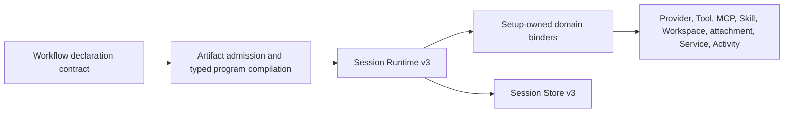
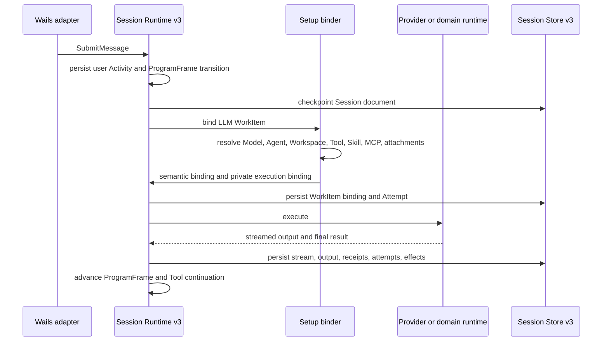

# Session Runtime v3 and Workflow Runtime v3 High-Level Design

## 1. Purpose

Session Runtime v3 is the durable backend for:

- Conversation activity.
- Agent loops.
- Direct Model calls.
- Workflow execution.
- Coordination.
- Effects.
- Long-lived process behavior.
- Trigger registrations.
- Human work.
- Recovery.
- Command idempotency.

Workflow source validation and source planning are outside Session Runtime v3.
Workflow Runtime v3 is the setup-owned lowering and binding path plus the
Session Runtime v3 ProgramFrame interpreter path. It is not a second source
parser, target resolver, or scheduler.

The target state is:

```text
Session Runtime v3
    +
Workflow Runtime v3
    =
functional typed durable backend superset of Session v2
    +
full Workflow v1 execution behavior
```

The Session v3 backend becomes ready for frontend replacement of Session v2 when the functional backend phases are complete.

## 2. Durable root

A Session is the only authoritative durable root for one coherent activity.

```text
Session
├── Timeline[] Activity
├── Executions[] Execution
│   ├── ProgramFrames[]
│   ├── WorkItems[]
│   ├── Attempts[]
│   ├── Waits[]
│   ├── Effects[]
│   ├── Cleanup
│   ├── Signals[]
│   ├── Channels[]
│   ├── Resource leases and rate windows
│   ├── Child Execution links
│   └── Outcome
├── TriggerRegistrations[]
├── ConversationOwnership[]
├── CommandRecords[]
└── Defaults and metadata
```

A Session document can contain:

- Conversation ProgramFrames.
- Agent-loop ProgramFrames.
- Single-model ProgramFrames.
- Workflow ProgramFrames.
- Independent child Executions.
- Trigger registrations.
- Durable event and channel records.
- Effect and compensation records.
- App identity and approved App context.
- Durable command receipts.

A Session document does not contain:

- Provider clients.
- HTTP clients.
- MCP clients.
- Artifact service handles.
- Native file paths used as live handles.
- Browser state.
- Wails state.
- Credentials.
- OAuth tokens.
- Approval tokens.
- Callbacks.
- Cancellation functions.
- Timers.
- Compiled CEL programs.
- Compiled JSON Schemas.
- Domain-private execution bindings.

## 3. Ownership boundaries



| Layer                     | Owner                                             | Responsibilities                                                                                                            | Excluded responsibilities                                        |
| ------------------------- | ------------------------------------------------- | --------------------------------------------------------------------------------------------------------------------------- | ---------------------------------------------------------------- |
| Declaration syntax        | `internal/llmartifactory-go/workflow/contract/v1` | Source grammar, static validation, CEL scope, target relationships, portable validity                                       | Session mutation, Artifact mutation, external work               |
| Workflow planning         | `internal/llmartifactory-go/workflow`             | Artifact-backed relationship resolution and typed target, call-site, context, port, retry, effect, and block-path inventory | Session mutation, dispatch, provider invocation                  |
| Admission and compilation | `internal/agentruntimesetup/workflowruntime`      | Current Artifact pin verification, lowering from planning facts, target adapter selection, and Service or Activity binding  | Source parsing, source relationship resolution, Session mutation |
| Durable orchestration     | `internal/agentruntime-go/sessionv3`              | ProgramFrames, WorkItems, Attempts, Waits, timers, effects, recovery, cancellation, durable state                           | Artifact services, source parsing, provider configuration        |
| Domain binding            | `internal/agentruntimesetup`, domain runtimes     | Model, Tool, MCP, Skill, Workspace, attachment, Service, Activity, provider adaptation                                      | Session persistence roots, Workflow source parsing               |
| Persistence               | `internal/sessionstorev3`                         | Authoritative documents, tombstones, derived index, derived FTS                                                             | Provider and Artifact behavior                                   |
| Desktop composition       | `cmd/agentgo`                                     | Wails service attachment and concrete dependency composition                                                                | Runtime semantics                                                |

Session Runtime v3 does not import Artifact packages or setup packages.

Session Runtime v3 does not:

- Resolve Artifacts.
- Read Workspace files.
- Discover MCP Tools.
- Render Skills.
- Configure providers.
- Invoke Tool implementations directly.
- Materialize local attachments.
- Resolve credentials.
- Persist domain-private values.

### 3.1 Workflow adapter ownership

Workflow setup adapters are the only layer that translates Workflow callable
targets into existing domain operations.

```text
Workflow declaration and ProgramFrame
        |
        v
Workflow setup adapter
        |
        v
existing Model, Agent, Tool, Skill, MCP, Service, or Activity API
```

The target domain remains independent of Workflow. It does not import Workflow
or Session Runtime packages and it does not define Workflow-only request
types. Workflow generic JSON is allowed only for Workflow values and schema
boundaries. It is not a substitute for a typed Model or Agent invocation.

Workspace is not a direct Workflow callable target. It remains a setup-owned
contribution to a typed Model or Agent invocation plan.

Go Tool, MCP Tool, and Skill Tool domains receive only their native typed
arguments. Workflow context, input-port transport, and streamed output-port
transport are rejected by Workflow admission and are not represented in
durable Tool work input.

### 3.2 Single-owner validation rule

The Runtime checks durable execution integrity. It does not revalidate source
grammar that Workflow contract v1 already admitted.

Setup checks current binding and capability availability. It does not repeat
Workflow grammar, static CEL scope, declaration relationship, or source schema
validation.

The intended flow is:

```text
Artifact Store
    validates persisted Artifact and Definition facts
        |
        v
Workflow contract and planning
    validate source grammar and static semantics
        |
        v
Workflow setup lowerer
    pin and bind current target adapters
        |
        v
Session Runtime v3
    validate and execute durable orchestration state
```

The lowerer creates runtime-neutral copies because Session Runtime has no
Artifact or setup imports. It must not parse Workflow source, interpret
Workflow directives, or duplicate domain-native request grammars.

### 3.3 LLM declaration registration boundary

`internal/llmartifactory-go/registration` owns reusable assembly of LLM
family interpretation registrations, schema codecs, declaration decoders, and
locator factories.

`internal/artifactsetup/registration` maps application topology choices into
that factory. It does not own declaration grammar, schema assembly, or source
format semantics.

## 4. Typed runtime discipline

Runtime-owned semantics use concrete types.

This includes:

- Session identity.
- Execution identity.
- ProgramFrame identity.
- WorkItem identity.
- Attempt identity.
- Wait identity.
- Trigger identity.
- Artifact pin.
- Target selection.
- Binding version.
- Retry policy.
- Deadline.
- Effect contract.
- Effect state.
- Effect ledger record.
- Compensation state.
- Receipt.
- Error.
- Budget.
- Claim.
- Channel cursor.
- Port plan.
- Trigger occurrence.
- Machine state.
- Structured-control state.
- Conversation ownership.
- App identity.

`CanonicalValue` is used only at arbitrary JSON boundaries:

- Invocation input.
- Invocation output.
- JSON Schema.
- Literal expression values.
- Expression results.
- Schema-defined Workflow state.
- Generic Tool input and output.
- Generic metadata.
- Event data.
- Event correlation.
- Channel message data.
- Human response.
- Generic protocol projections.
- Generic debugger projections.

No durable semantic model uses `map[string]any` or `json.RawMessage` as its primary representation.

## 5. Persistence and Session Store v3

`internal/sessionstorev3` is the authoritative V3 persistence store.

The authoritative document is one Session document per Session ID.

Derived data includes:

- Session list index.
- Execution list index.
- Full-text search records.
- Conversation projection.
- Activity projection.
- Workflow projection.
- Normal Session Runtime projection.

Derived data rebuilds from authoritative Session documents.

Tombstones are durable deletion barriers.

A tombstone prevents stale checkpoint data from recreating a deleted Session.

A restore preserves:

- Durable command records.
- Trigger registrations.
- Trigger occurrences.
- Execution hierarchy.
- ProgramFrame state.
- WorkItems.
- Attempts.
- Waits.
- Signals.
- Channels.
- Emit receipts.
- Effect records.
- Compensation records.
- Outcomes.

## 6. Durable external-work sequence

Every external WorkItem follows this sequence:

1. Persist typed WorkItem intent.
2. Resolve current dependencies through the owning setup domain.
3. Verify Artifact pins and current target binding facts.
4. Persist semantic binding facts.
5. Persist an Attempt before external invocation.
6. Invoke external work.
7. Persist confirmed output, receipt, failure, cancellation fact, or uncertainty.
8. Apply effect-contract recovery behavior.
9. Use Runtime timers for durable timing.
10. Cancel all timers and owned goroutines during `Runtime.Close`.

The sequence applies to:

- Tool WorkItems.
- MCP Tool WorkItems.
- Service WorkItems.
- Activity WorkItems.
- LLM WorkItems.
- Resolver WorkItems that require durable membership resolution.
- Reconciliation WorkItems.
- Compensation WorkItems.

A process stop after external dispatch and before confirmed settlement produces uncertainty unless the durable effect contract proves safe replay behavior.

Read, idempotent, and keyed contracts can recover through their declared replay-safe semantics.

A non-idempotent uncertain WorkItem waits for reconciliation or explicit recovery review.

## 7. ProgramFrame interpreters

Built-in interpreters are versioned.

| Interpreter              | Purpose                                                                 |
| ------------------------ | ----------------------------------------------------------------------- |
| `builtin.conversation@1` | Conversation activity routing and visible message history.              |
| `builtin.agent-loop@1`   | Agent reasoning, Model calls, Tool calls, waits, and Tool continuation. |
| `builtin.single-model@1` | One direct Model call.                                                  |
| `artifact.workflow.v1@1` | Typed Workflow Program execution.                                       |

A ProgramFrame contains:

- Interpreter identity.
- Interpreter version.
- Typed program snapshot.
- Typed program state.
- Parent relationship.
- Child frame identities.
- Child Execution identities.
- WorkItem identities.
- Output.
- Error.
- Deadline.
- Fork boundary.
- Join boundaries.
- Effect-frame linkage where applicable.
- Port plans and input snapshots.
- Conversation handoff identity where applicable.

A ProgramFrame interpreter does not persist:

- Compiled CEL programs.
- Compiled schemas.
- Clients.
- Callbacks.
- Credentials.
- Timers.
- Context cancellation functions.

## 8. Workflow compiler contract

Workflow source is not a ProgramFrame payload.

```text
Workflow declaration v1
        |
        v
Artifact pinning and target binding preparation
        |
        v
Typed runtime-neutral WorkflowProgram
        |
        v
Workflow ProgramFrame
```

The typed program contains:

- Typed blocks.
- Typed steps.
- Typed target descriptions.
- Typed target sets.
- Typed state specifications.
- Typed values.
- Typed retry policies.
- Typed effect plans.
- Typed saga plans.
- Typed waits.
- Typed channels.
- Typed subscriptions.
- Typed triggers.
- Typed ports.
- Typed machine state.
- Typed structured-control state.
- Stable Artifact pins where required.
- Stable Service and Activity binding IDs and versions.

The compiler preserves every valid Workflow v1 field.

The compiler does not:

- Invent chat text from generic Workflow input.
- Omit valid fields.
- Convert a provider-managed Tool into local work.
- Fabricate target success.
- Defer known unavailable transport or binding capability until unrelated external work begins.

## 9. Callable target runtime mapping

| Workflow target | Runtime mapping                                           |
| --------------- | --------------------------------------------------------- |
| Agent           | Child Agent-loop ProgramFrame with typed Agent plan.      |
| Model           | Child single-model ProgramFrame with typed Model plan.    |
| Nested Workflow | Child Workflow ProgramFrame.                              |
| Tool Artifact   | Tool WorkItem.                                            |
| MCP Tool        | Tool WorkItem with persisted MCP binding facts.           |
| Service         | Service WorkItem with registered binding ID and version.  |
| Activity        | Activity WorkItem with registered binding ID and version. |

A target-set resolver maps to a typed resolver WorkItem when membership requires durable resolution.

A target-set selection persists:

- Target-set identity.
- Normalized member identities.
- Resolver time.
- Selected target identity.
- Input.
- Context.
- Effect key.
- Retry identity.

## 10. Model and Agent execution plans

A typed Model or Agent plan is complete before provider dispatch.

The plan can contain:

- Selected Agent.
- Selected Workspace.
- Selected Model.
- Model request patch.
- Instruction contributions.
- Text contributions.
- Tool choices.
- Provider-managed Tool choices.
- Skill contributions.
- MCP server contributions.
- MCP Tool choices.
- MCP resource contributions.
- MCP resource-template contributions.
- MCP prompt contributions.
- Attachment contributions.
- Message contributions.
- Channel contributions.
- Port contributions.
- Conversation ownership facts.
- Artifact pins.
- Semantic binding facts.

Session Runtime persists durable semantic facts.

Runtime setup holds private provider-ready values in memory until dispatch completes.

## 11. Normal conversation flow



The normal conversation path supports:

- Direct Model chat.
- Agent-backed chat.
- Provider streaming.
- Typed Model planning.
- Tool continuation.
- Go Tools.
- Provider SDK Tools.
- MCP Tools.
- Skill Tools.
- MCP resources and prompts.
- MCP Apps.
- App Tool calls.
- Approved App context staging.
- App resource reads.
- Attachments.
- Command idempotency.
- Durable projections.

V3 keeps normal conversation behavior inside the same durable model as Workflow execution.

## 12. Tool behavior

### 12.1 Go Tools

Go Tools use:

- Typed Tool binding.
- Artifact pin verification.
- Function identity.
- Canonical arguments.
- Typed Tool output.
- Receipt and error facts.

### 12.2 Provider SDK Tools

Provider SDK Tools are provider-managed.

They remain Tool choices in typed Model plans.

They do not produce local Tool WorkItems.

They do not produce fabricated local success.

### 12.3 MCP Tools

MCP Tool binding performs:

1. Current MCP server verification.
2. Current discovery lookup.
3. Provider Tool identity verification.
4. Digest verification.
5. Current policy evaluation.
6. Approval behavior.
7. Invocation.
8. Typed result adaptation.

MCP binding facts persist before invocation.

MCP approval tokens remain process-private.

### 12.4 Skill Tools

Skill Tools use an Execution-owned Skill session.

The durable model persists selected Skill Artifact identities and active state facts.

The durable model does not persist the Skill Runtime session handle.

### 12.5 Service and Activity bindings

Service and Activity bindings are registered typed domain bindings.

A binding provides:

- Stable binding identity.
- Stable binding version.
- Effect contract.
- Typed bind behavior.
- Typed execution behavior.
- Typed wait behavior where applicable.
- Optional Workflow context, input-port, and stream-port capability declaration.

Session Runtime does not implement Service or Activity domain behavior.

## 13. Ports, channels, and messaging

A typed port plan contains:

- Port name.
- Port direction.
- Stream capability.
- Schema.
- Channel identity.
- Reader or writer access.
- Parent-child ownership.
- Input cursor.
- Output delivery semantics.

The runtime validates ports before external dispatch.

A port failure is a typed binding or validation failure.

A channel stores:

- Ordered messages.
- Message identities.
- Cursors.
- Retention facts.
- Capacity facts.
- Byte accounting.
- Consumption facts.
- Observation facts.
- Deduplication receipts.

Port delivery preserves:

- Schema validity.
- Channel authorization.
- Parent-child ownership.
- Message ordering.
- Stream ordering.
- Durable replay semantics.

## 14. Structured execution

### 14.1 Sequential execution

The Workflow interpreter advances ordered steps after the controlling predecessor settles.

### 14.2 Fork

A Fork WorkItem persists child ProgramFrame intent before child scheduling.

A Fork WorkItem is required whenever child scheduling crosses a durable boundary.

### 14.3 Join

A Join WorkItem persists child terminal aggregation before a parent interpreter receives child settlement.

A Join WorkItem is required whenever completion aggregation crosses a durable boundary.

### 14.4 Parallel and Foreach

Parallel and Foreach retain:

- Selected branch or item identities.
- Branch or item state.
- Child frame identities.
- Winner identities.
- Cancellation requests.
- Ordered outcomes.
- Uncertain outcomes.
- Explicit parent-state merge behavior.

### 14.5 Repeat

Repeat retains:

- Current iteration.
- Carried state.
- Local iteration state.
- Last result.
- Exhaustion state.
- Deadline.
- Nested break and continue behavior.

### 14.6 Machine

A machine retains:

- Current state.
- Entry time.
- Transition generation.
- Carried state.
- Active subscriptions.
- Timer WorkItems.
- Event WorkItems.
- Selected transition.
- Current event.
- Child block identities.

## 15. Waits, timers, events, and triggers

A Wait WorkItem persists:

- Wait identity.
- Owner WorkItem identity.
- Wait kind.
- Typed request.
- Deadline.
- Timer state.
- Subscription identity.
- Channel cursor.
- Completion handle.
- Assignee facts.
- Response schema.
- Resolution.
- Response.
- Error.
- Authorized human actor.

Runtime timers exist only in process memory.

A durable timer is reconstructed from persisted timer state after restore.

Retry timers, trigger timers, resource-rate timers, execution deadlines, and cleanup deadlines follow the same rule.

An event signal persists:

- Source.
- Identity.
- Event name.
- Data.
- Correlation.
- Time.
- Consumption facts.

Duplicate event identity is `(source, id)`.

An event can be consumed once per subscription identity.

A channel message persists:

- Channel.
- Sequence.
- Identity.
- Kind.
- Data.
- Correlation.
- Deduplication key.
- Consumption facts.

A channel observe operation does not consume a message.

A channel consume operation records the consuming wait identity.

A trigger registration persists:

- Trigger identity.
- Workflow Artifact pin.
- Typed Workflow Program snapshot.
- Trigger declaration identity.
- Trigger kind.
- Registration state.
- Next schedule occurrence.
- Last occurrence.
- Last calendar local occurrence.
- Accepted occurrences.
- Queue state.

A trigger does not create another persistence root.

## 16. Effects, reconciliation, compensation, and cleanup

A WorkItem retains:

- Effect contract.
- Effect state.
- Stable idempotency key.
- Effect plan.
- Reconciliation state.
- Cleanup marker.
- Receipt.
- Error.

An Attempt retains:

- Attempt identity.
- Stable idempotency key.
- Effect state.
- Receipt.
- Error.
- Deadline.

An EffectRecord retains:

- Original WorkItem identity.
- Original ProgramFrame identity.
- Saga identity.
- Confirmation order.
- Dependencies.
- Typed original operation facts.
- Compensation block.
- Compensation policy.
- Compensation WorkItem identity.
- Compensation ProgramFrame identity.
- Compensation receipt.
- Compensation error.

Reconciliation flow:

```text
uncertain mutating WorkItem
        |
        v
persist Reconciliation WorkItem
        |
        v
start reconciliation child ProgramFrame
        |
        +-- applied ------> confirm original WorkItem
        |
        +-- not-applied --> retry only when policy permits
        |
        +-- unknown ------> typed recovery review wait
```

Compensation flow:

```text
failed or cancelled Saga boundary
        |
        v
select confirmed compensatable effects
        |
        v
reverse dependency-aware order
        |
        v
persist Compensation WorkItem
        |
        v
start compensation child ProgramFrame
        |
        +-- success -----> record compensated
        |
        +-- failure -----> record typed cause
```

Unknown effects do not enter automatic compensation before reconciliation confirms application.

Cleanup is active after normal failure, timeout, or cancellation when finalization, reconciliation, compensation, or release work remains.

Cleanup work can dispatch after normal cancellation only when it is marked as cleanup work and remains inside cleanup allowance.

## 17. Cancellation and close

Cancellation requests:

- Stop queued normal WorkItems.
- Cancel active normal dispatch contexts.
- Cancel ordinary waits.
- Cancel attached children.
- Cancel eligible independent children.
- Preserve uncertain dispatched mutations.
- Permit bounded cleanup work.
- Preserve cancellation as primary terminal meaning.

`Runtime.Close`:

1. Marks the Runtime closed.
2. Cancels lifecycle context.
3. Cancels WorkItem dispatch contexts.
4. Cancels wait timers.
5. Cancels retry timers.
6. Cancels trigger timers.
7. Cancels resource timers.
8. Cancels execution and cleanup deadline timers.
9. Waits for owned asynchronous work.
10. Closes process-private domain bindings.
11. Closes process-private Skill sessions.
12. Releases subscribers.

## 18. Recovery

Restore behavior:

1. Restore Session documents.
2. Restore tombstones.
3. Restore durable command records.
4. Normalize process-private runtime handles out of durable state.
5. Mark dispatched work uncertain when no confirmed terminal result exists.
6. Rebind replay-safe WorkItems through current dependency verification.
7. Preserve stable keyed idempotency keys.
8. Create recovery review waits for unresolved uncertainty.
9. Rearm waits, retries, resource waits, deadlines, and triggers after complete restore.
10. Resume dispatchable WorkItems.

Recovery does not automatically replay uncertain non-idempotent work.

Recovery does not automatically compensate unknown effects.

## 19. Commands and projections

Commands are transport-neutral.

Wails exposes commands and projections but does not own runtime semantics.

Core V3 command categories include:

- Session creation, rename, defaults update, and deletion.
- Message submission.
- Workflow start.
- Workflow trigger registration.
- Trigger event acceptance.
- Execution signal.
- WorkItem execution request.
- Execution continuation.
- Wait resolution.
- Execution pause.
- Execution resume.
- Execution cancellation.
- Tool retry, skip, and manual error completion.
- Automation holds.
- MCP App view, App Tool, App context, and App resource operations.
- Edit-and-resend.

Core V3 projections include:

- Conversation projection.
- Activity projection.
- Workflow projection.
- Execution read.
- Session list.
- Execution list.
- Search projection.
- Model operation projection.
- Tool call projection.
- Attempt projection.
- Wait projection.
- App projection.
- Usage projection.
- Protocol output projection.
- Debugger projection.

## 20. Application composition

The Wails application composes V2 and V3 independently.

`cmd/agentgo/app.go`:

- Creates the legacy Session Store and Session Runtime.
- Creates Session Store v3 under `sessions_v3`.
- Creates Workflow admission and application Service and Activity bindings.
- Registers `flexigpt.url.normalize` as a typed read Service binding.
- Registers `flexigpt.text.apply-unified-diff` as a typed non-idempotent Activity binding.
- Creates the V3 base binder.
- Wraps the base binder in Workflow Runtime binder behavior.
- Configures Workflow interpreter and admission into Session Runtime v3.
- Restores Session Runtime v3 before Wails starts.
- Closes Session Runtime v3 before Session Store v3 and domain runtimes close.

`cmd/agentgo/wrapper_sessionv3_runtime.go` exposes transport-neutral V3 commands and durable projections to Wails.

## 21. Implementation status

### 21.1 Evidence coverage

| Area                            | Source evidence                                                               |
| ------------------------------- | ----------------------------------------------------------------------------- |
| Session V3 durable runtime      | `internal/agentruntime-go/sessionv3/`                                         |
| Workflow interpreter            | `internal/agentruntime-go/sessionv3/workflow_*.go`                            |
| V3 setup binder                 | `internal/agentruntimesetup/sessionv3runtime/`                                |
| Workflow compiler and admission | `internal/agentruntimesetup/workflowruntime/`                                 |
| Model runtime                   | `internal/agentruntimesetup/modelruntime/`                                    |
| Tool runtime                    | `internal/agentruntimesetup/toolruntime/`                                     |
| MCP runtime                     | `internal/agentruntime-go/mcp/`, `internal/agentruntimesetup/mcpruntime/`     |
| Skill runtime                   | `internal/agentruntime-go/skill/`, `internal/agentruntimesetup/skillruntime/` |
| Session Store v3                | `internal/sessionstorev3/`                                                    |
| Desktop composition             | `cmd/agentgo/`                                                                |

### 21.2 Architecture and durable core

- [x] Session v3 is the only V3 durable root.
- [x] Session Store v3 stores authoritative Session documents.
- [x] Index and FTS records are derived.
- [x] Tombstones are durable deletion barriers.
- [x] Durable command idempotency exists.
- [x] Accepted Session deletion commands remain idempotent after restore.
- [x] Runtime-owned timers have explicit close ownership.
- [x] Restore completes before timer rearming.
- [x] Clients, credentials, callbacks, timers, native handles, approval tokens, and private bindings remain non-durable.

### 21.3 Workflow target transport ownership

- [x] Session Runtime v3 owns Workflow ports, channels, cursors, ordering, retention, parent-child delivery, and durable replay semantics.
- [x] Generic Go Tool, MCP, Skill, Text, inference, provider, and Artifact domains remain independent of Workflow and Session Runtime types.
- [x] Setup adapts native target output to Session Runtime output only after target settlement.
- [x] Go Tool, MCP Tool, and Skill Tool targets reject Workflow context, input ports, and streamed output ports during admission.
- [x] Go Tool, MCP Tool, and Skill Tool final output can use a normal non-stream output port after confirmed settlement.
- [x] Provider SDK Tools remain typed Model-plan capabilities and never become local Tool WorkItems.
- [x] Service and Activity transport capability failure is determined during Workflow admission.

### 21.4 ProgramFrames and WorkItem lifecycle

- [x] Conversation ProgramFrames exist.
- [x] Agent-loop ProgramFrames exist.
- [x] Single-model ProgramFrames exist.
- [x] Workflow ProgramFrames exist.
- [x] Typed WorkItems, Attempts, Waits, receipts, errors, and outcomes exist.
- [x] Typed external-work bind, dispatch, and settlement sequence exists.
- [x] Typed retry scheduler state exists.
- [x] Typed timer wait state exists.
- [x] Typed recovery review waits exist.
- [x] WorkItem-level resource acquisition and release exists.
- [x] WorkItem-level aggregate budget accounting exists.
- [x] Step execution reservation exists for ordinary, Fork, Join, and controlling WorkItems.
- [x] Required cost-meter absence produces typed pre-dispatch failure.

### 21.5 Callable targets and planning

- [x] Tool Artifact targets map to Tool WorkItems.
- [x] MCP Tool targets map to Tool WorkItems with discovery binding.
- [x] Service targets map to Service WorkItems.
- [x] Activity targets map to Activity WorkItems.
- [x] Nested Workflow targets map to child ProgramFrames.
- [ ] Workflow Agent targets are held at admission pending a Workflow-owned adapter over current Agent APIs.
- [ ] Workflow Model targets are held at admission pending a Workflow-owned adapter over current Model APIs.
- [x] Static target sets persist member selection.
- [x] Resolver-backed target sets persist resolver WorkItems and membership.
- [x] Provider SDK Tools remain Model-plan-only capabilities.
- [x] Callable interface limits propagate to direct WorkItems and child ProgramFrame boundaries.
- [x] Callable interface context declarations are checked for target boundaries.
- [x] Callable interface input-port declarations are checked for target boundaries.
- [x] Callable interface non-stream output-port declarations route through Session Runtime after confirmed settlement.
- [x] Callable interface stream-port declarations route through Model, Agent, nested Workflow, and port-aware Service or Activity bindings.
- [x] Full receipt schema enforcement exists for direct WorkItems, child Agent, child Model, child Workflow, and started child work.
- [x] Workflow Tool and MCP Tool effect guarantees are conservative unless the setup-domain binding provides the authoritative fact.
- [x] Workflow does not inject ports or arbitrary context into synthetic Model or Agent provider messages.
- [ ] Model and Agent callable-interface input and context adapters need completion. Current generic Workflow invocation parsing is disabled at admission and dispatch.
- [ ] A Workflow-owned adapter layer must use existing Model and Agent domain APIs without requiring Model or Agent domains to understand Workflow.

### 21.6 Structured execution

- [x] Sequence, transform, scope, choose, return, fail, break, continue, wait, emit, and cancel exist.
- [x] Parallel completion modes and error policies exist.
- [x] Foreach source ordering, item validation, concurrency state, and ordered outcomes exist.
- [x] Repeat controls and carried state exist.
- [x] Machine lifecycle state exists.
- [x] Catch and finally behavior exists.
- [x] Fork WorkItems persist child scheduling boundaries.
- [x] Join WorkItems persist child aggregation boundaries.
- [x] Resource and budget behavior is enforced inside Parallel, Foreach, Repeat, Scope, Machine, and Saga.
- [x] Cleanup behavior is enforced inside finalization, reconciliation, and compensation paths.
- [ ] Inherited state mutation needs completion across child Workflow blocks.
- [ ] Explicit parent-state merge needs completion for Parallel and Foreach.
- [ ] Failed and uncertain Workflow step outcomes need durable step-level projection.
- [ ] Structured retry needs durable implementation for every v1 step form that accepts `retry`.

### 21.7 Coordination and triggers

- [x] Timer waits exist.
- [x] Event waits exist.
- [x] Channel waits exist.
- [x] Completion waits exist.
- [x] Human waits exist.
- [x] Signals use durable source and identity facts.
- [x] Channel cursors and emit receipts exist.
- [x] Trigger registrations persist in Session documents.
- [x] Event trigger occurrences persist.
- [x] Interval schedules exist.
- [x] Five-field cron schedules exist.
- [x] Trigger overlap policies exist.
- [x] Missed-occurrence policies exist.
- [x] Subscription retention enforcement exists.
- [x] Subscription capacity enforcement exists.
- [x] Subscription byte-limit enforcement exists.
- [x] Human response authorization exists.
- [x] Trigger administration commands exist.
- [x] Trigger timers arm only after complete restore.
- [x] Calendar gaps are skipped and repeated local times are deduplicated by scheduled local time.

### 21.8 Effects and cleanup

- [x] Effect kinds exist.
- [x] Stable keyed idempotency keys exist.
- [x] Effect state exists in WorkItems, Attempts, receipts, and errors.
- [x] Effect operation facts are typed.
- [x] Reconciliation WorkItem intent exists.
- [x] Reconciliation decision union exists.
- [x] Saga scope identity exists.
- [x] Confirmed effect ledger records exist.
- [x] Compensation WorkItem intent exists.
- [x] Cleanup state exists.
- [x] Reconciliation execution exists for effect-bearing target kinds.
- [x] Reconciliation result validation exists.
- [x] Confirmed non-application retry exists.
- [x] Unknown reconciliation recovery review exists.
- [x] Reverse dependency-aware compensation exists.
- [x] Compensation concurrency exists.
- [x] Compensation `continue` behavior exists.
- [x] Compensation `stop` behavior exists.
- [x] Cleanup deadline expiry exists.
- [x] Public projection preserves primary failure with compensation causes.
- [x] A confirmed receipt received after cancellation remains confirmed application when the receipt proves settlement.

### 21.9 Normal Session Runtime V3 capability

- [x] Direct Model chat exists.
- [x] Agent-backed chat exists.
- [x] Provider streaming exists.
- [x] Usage projection exists.
- [x] Protocol output projection exists.
- [x] Debugger projection exists.
- [x] Tool result continuation exists.
- [x] Go Tool execution exists.
- [x] Provider SDK Tool planning exists.
- [x] MCP Tool execution exists.
- [x] Skill Tool execution exists.
- [x] MCP resources, prompts, Apps, approvals, App Tool calls, App resource reads, and approved App context staging have typed domain routes.
- [x] Skill session lifecycle has typed domain routes.
- [x] V3 attachment admission snapshots local files, images, directories, and URLs into replay-safe semantic attachments.
- [x] V3 historical attachment behavior is replay-safe because attachment snapshots persist content, not live native handles.
- [x] V3 provider attachment adaptation exists.
- [x] V3 Service binding composition exists.
- [x] V3 Activity binding composition exists.
- [x] V3 Tool final output ports emit durable typed output records.
- [x] V3 command coverage includes defaults updates, continuation input, explicit Tool execution, retry, skip, manual error completion, automation holds, App operations, and edit-and-resend.
- [x] V3 projection coverage exposes model WorkItems, streamed output, Tool WorkItems, Attempts, Waits, Apps, usage, protocol output, debugger facts, and activities from durable Session documents.
- [ ] Full normal Session v2 backend parity remains the leading implementation phase.

### 21.10 Exact V2 parity work

The source shows these V3 gaps:

- [ ] V3 needs a typed configuration model equal to the normal Session v2 configuration surface. V2 includes Model defaults and clears, Workspace context and capability overrides, inline and Artifact instruction overrides, direct Tool selection, Skill selection, active Skill selection, MCP selection, and per-run configuration. V3 `SessionDefaults` currently has a smaller surface.
- [ ] V3 needs typed per-message and per-continuation configuration and budget overrides equivalent to normal V2 run behavior.
- [ ] V3 needs typed user-message Skill template preparation and instruction Skill preview endpoints.
- [ ] V3 needs a complete normal-session command inventory and an explicit V2-to-V3 command mapping.
- [ ] V3 needs a complete projection inventory and a direct projection mapping for every normal V2 frontend read.
- [ ] V3 needs frontend-ready snapshot composition where a V2 frontend read currently expects one Session or Run snapshot.
- [ ] V3 needs the source-to-runtime audit that proves every normal V2 capability has one V3 typed equivalent.

## 22. Remaining implementation phases

### Phase 1: Complete normal Session Runtime v3 parity

This phase makes V3 a complete backend superset for normal Session behavior.

Implementation sequence:

1. Define typed V3 session configuration, execution configuration, and operation configuration structures.
2. Cover all normal Model request settings and clears.
3. Cover Agent, Workspace, Text, Tool, Skill, MCP, history, metadata, and attachment configuration behavior.
4. Support direct capability selections where normal Session v2 supports them.
5. Add per-message, per-continuation, and per-execution override structures.
6. Add per-execution limits and durable budget behavior for normal conversations.
7. Persist operation-level resolved configuration and dispatch-plan facts.
8. Add typed user-message Skill template preparation and instruction Skill preview operations.
9. Add V3 command and projection equivalents for all normal V2 reads and mutations.
10. Add frontend-ready V3 snapshots built only from the durable Session document.

Required source coverage:

- `internal/agentruntime-go/session/`
- `internal/agentruntime-go/sessionv3/`
- `internal/agentruntimesetup/sessionruntime/`
- `internal/agentruntimesetup/sessionv3runtime/`
- `internal/agentruntimesetup/modelruntime/`
- `internal/agentruntimesetup/toolruntime/`
- `internal/agentruntimesetup/mcpruntime/`
- `internal/agentruntimesetup/skillruntime/`
- `internal/sessionstore/`
- `internal/sessionstorev3/`
- `cmd/agentgo/`

#### Phase 1 implementation status

- [x] V3 exposes typed user-message Skill template preparation and instruction Skill preview through SessionV3Wrapper and setup-owned Skill resolution.
- [x] V3 persists resolved per-message and per-continuation existing-surface defaults before normal Agent-loop dispatch.
- [x] V3 persists conversation and invocation execution-budget facts for normal conversation ProgramFrames.
- [x] V3 exposes a durable-document-only consolidated frontend snapshot projection.
- [ ] V3 still lacks the complete V2-equivalent typed configuration, override, execution-budget, command, projection, and frontend snapshot surface.

### Phase 2: Complete Workflow v1 semantic closure

This phase completes the remaining Workflow language semantics.

Implementation sequence:

1. Add nearest state-owner schema and identity to child Workflow scope context.
2. Complete inherited `set` behavior through all child block forms.
3. Add explicit deterministic state merge declarations for Parallel and Foreach.
4. Create StateUpdate WorkItems for parent-state merge boundaries.
5. Persist failed and uncertain step outcomes.
6. Complete structured retry behavior for every accepted retry declaration.
7. Complete Model and Agent callable-interface adapters.
8. Complete nested Workflow published-port schema compatibility checks.
9. Preserve all new semantics through persistence, recovery, cancellation, and projections.

Required source coverage:

- `internal/llmartifactory-go/workflow/`
- `internal/agentruntimesetup/workflowruntime/`
- `internal/agentruntime-go/sessionv3/`
- `internal/agentruntimesetup/sessionv3runtime/`
- `internal/sessionstorev3/`

#### Phase 2 implementation status

- [x] State-owner identity and schema propagate through nested Workflow scope construction, and inherited `set` uses the nearest owner schema.
- [x] Parallel and Foreach have typed `merge` declarations and durable StateUpdate merge boundaries.
- [x] Workflow failed and uncertain outcomes retain typed facts and are included in Workflow projections.
- [x] Nested Workflow published-port checks compare caller and target channel schemas before child dispatch.
- [ ] Model and Agent Workflow targets are currently admission failures, not partial generic JSON invocations.
- [ ] The remaining adapter work belongs in Workflow setup composition over existing domain APIs.
- [ ] No Model, Agent, Tool, Skill, MCP, or Workspace domain contract changes are required merely to support Workflow.
- [ ] Structured retry remains incomplete for every accepted structured retry declaration.

#### Architecture cleanup status

- [x] The composed Workflow binder delegates deterministic WorkItems to the existing base V3 binder.
- [x] Runtime remains the single trigger, timer, retry, wait, and recovery scheduler.
- [x] Generic JSON Schema primitive-type compatibility has one `jsonutil` implementation.
- [x] Workflow planning exposes typed target, call-site, context-use, port-use, retry, effect, and nested-block inventory facts.
- [x] Workflow target admission consumes the planning-owned target inventory rather than rebuilding target relationship lookup from `CapabilityPlan`.
- [x] Workflow Tool, MCP Tool, Service, and Activity transport admission consumes typed call-site inventory rather than recursively walking lowered Workflow blocks.
- [x] Built-in URL normalization and unified-diff native behavior live in setup-domain adapters; `workflowruntime/appbinding` contains only Workflow binding registration and result adaptation.
- [x] Tool-family transport availability is decided once by Workflow admission from planning facts.
- [x] V3 Tool binding no longer repeats Workflow source transport checks.
- [x] Durable Tool work has no generic Workflow context carrier.
- [x] The unsupported generic Workflow-to-Model or Agent `LLMInvocationPlan` bridge is removed.
- [ ] Model and Agent Workflow targets remain unavailable until a Workflow-owned typed adapter can lower them into the existing V3 LLM invocation path.
- [ ] Runtime durable validation must be reduced to persistence and execution invariants after declaration-lowering cleanup.

### Phase 3: Close domain binding and durable recovery edges

This phase completes execution behavior at all setup-owned domain boundaries.

Implementation sequence:

1. Review Model and Agent invocation-plan construction against callable interfaces.
2. Review Tool, MCP, Skill, Service, and Activity result adaptation against output, receipt, error, and effect contracts.
3. Review every wait, retry, cancellation, timeout, panic, reconciliation, compensation, and cleanup path.
4. Preserve all domain-private binding values in process memory only.
5. Ensure every durable semantic binding fact is restored and revalidated before replay.
6. Ensure every terminal WorkItem state advances parent frames, completion waits, execution state, effects, ports, channels, and projections consistently.
7. Complete source-backed recovery behavior for nested, attached, and independent child work.

Required source coverage:

- `internal/agentruntime-go/sessionv3/`
- `internal/agentruntimesetup/sessionv3runtime/`
- `internal/agentruntimesetup/workflowruntime/`
- `internal/agentruntimesetup/toolruntime/`
- `internal/agentruntimesetup/mcpruntime/`
- `internal/agentruntimesetup/skillruntime/`
- `internal/sessionstorev3/`

#### Phase 3 implementation status

- [x] Accepted Workflow retry declarations route through a durable retry-boundary ProgramFrame and Runtime-owned timer waits.
- [x] Retry-boundary state persists retry attempts, selected target-set facts, child settlement facts, and retry timing through recovery and cancellation.
- [ ] The full Service and Activity binding audit remains required to verify every domain-specific effect contract and retry result adaptation.
- [ ] A future Model or Agent Workflow adapter must reuse setup-owned typed
      invocation planning. It must not restore a generic JSON invocation bridge.

### Phase 4: Complete the functional backend audit

This phase closes all remaining source-to-runtime paths.

Implementation sequence:

1. Build a complete Workflow v1 source-field ledger.
2. Build a complete V2 normal-session command and projection ledger.
3. Map each entry to compiler, runtime, persistence, recovery, cancellation, and Wails composition behavior.
4. Resolve every reachable fallback branch from valid source.
5. Keep invalid language forms in the declaration validator.
6. Keep unavailable runtime-domain dependencies as typed admission or binding failures before unrelated external work starts.
7. Mark functional backend completion after every ledger entry has a typed V3 result.

Required source coverage:

- `internal/llmartifactory-go/workflow/`
- `internal/agentruntime-go/session/`
- `internal/agentruntime-go/sessionv3/`
- `internal/agentruntimesetup/sessionruntime/`
- `internal/agentruntimesetup/sessionv3runtime/`
- `internal/agentruntimesetup/workflowruntime/`
- `internal/sessionstore/`
- `internal/sessionstorev3/`
- `cmd/agentgo/`

### Phase 5: Adoption, verification, frontend migration, migration tooling, and cleanup

This phase completes product adoption after functional backend completion.

Implementation sequence:

1. Add verification coverage for V3 normal-session parity and Workflow v1 behavior.
2. Update technical documentation and user-facing migration documentation.
3. Move frontend command and projection traffic from V2 to V3.
4. Add offline Session v2 to Session v3 migration tooling.
5. Make Session v2 and Session Store v2 deprecation decisions.
6. Remove retired V2 paths after migration completion.
7. Complete aggregate cleanup.

Required source coverage:

- `frontend/`
- `cmd/agentgo/`
- `internal/agentruntime-go/session/`
- `internal/agentruntime-go/sessionv3/`
- `internal/agentruntimesetup/sessionruntime/`
- `internal/agentruntimesetup/sessionv3runtime/`
- `internal/sessionstore/`
- `internal/sessionstorev3/`
- `devdocs/requirements/`
